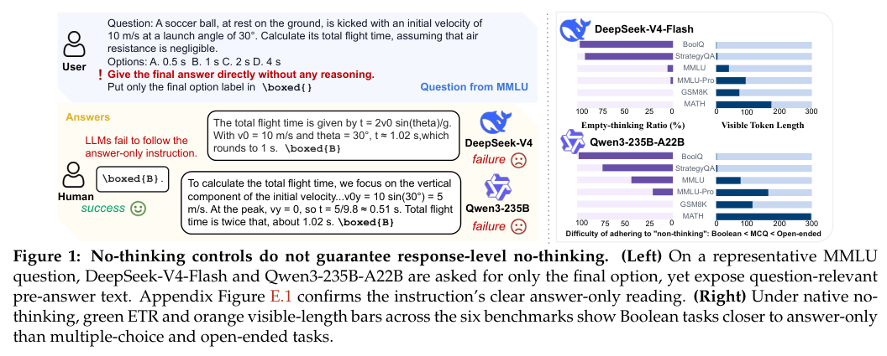
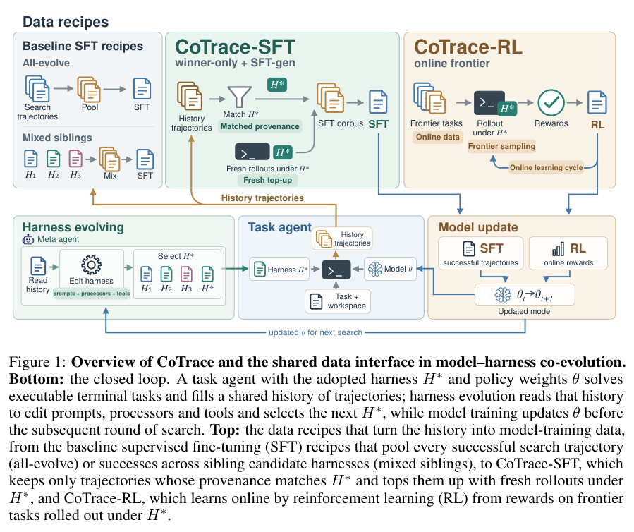
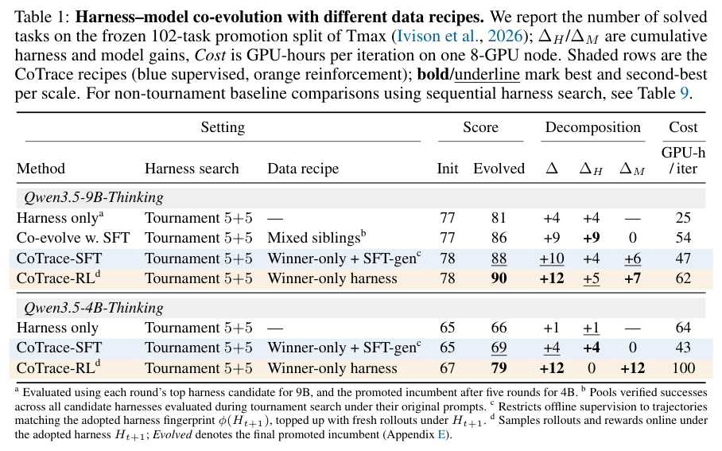
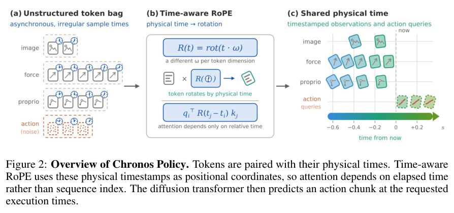
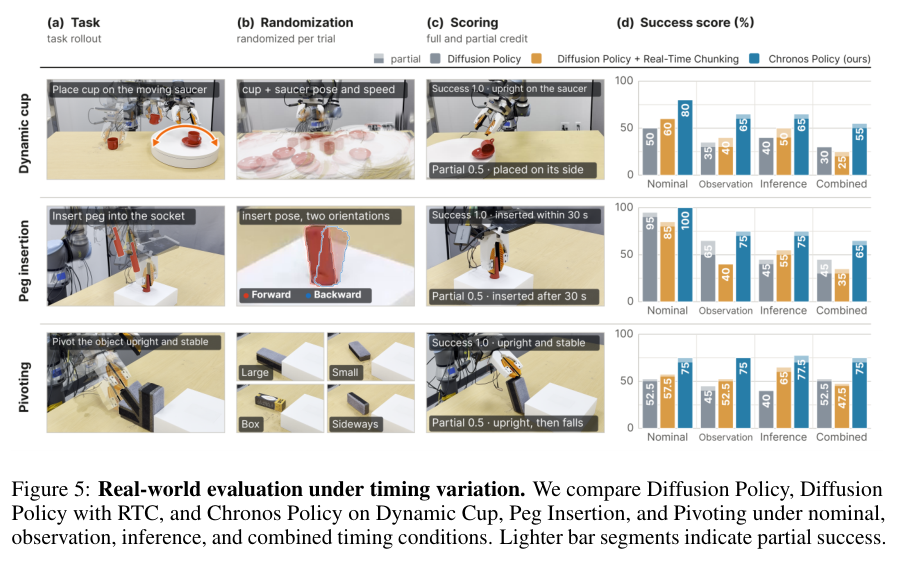
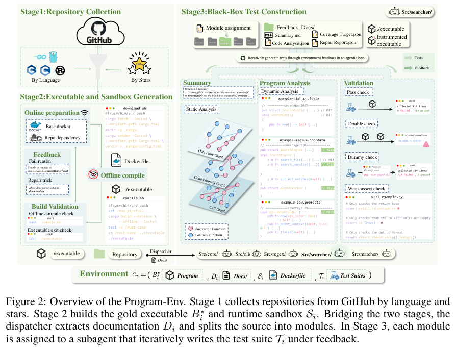
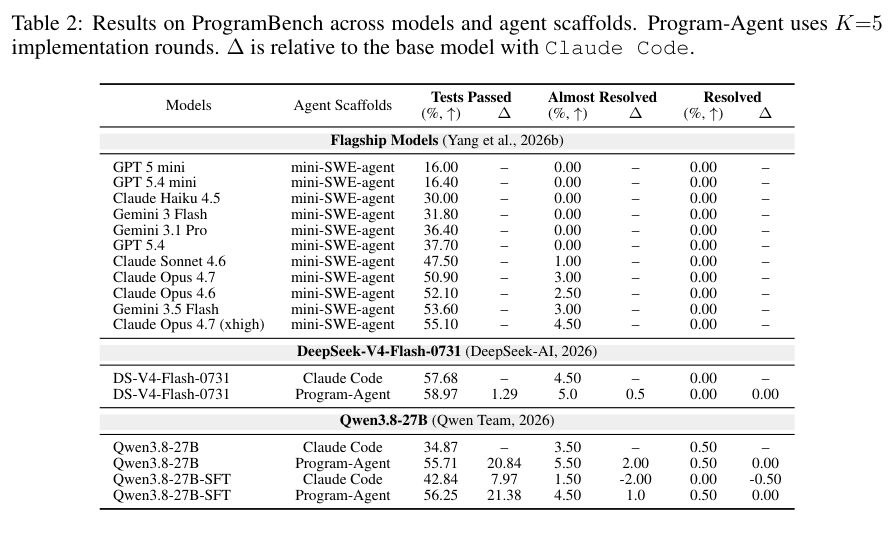

缓存、数据来源和时间表示看似属于不同系统，却都影响长链路的可靠性。本期介绍硬件建图、终端 Agent、机器人策略和程序复现，并检查推理模式的实际行为。

## 1. 硬件图谱：分块抽取、层级路由和可追踪更新

这项数据手册建图管线先分块抽取属性，再将属性路由到层级硬件图并迭代细化。LLM 负责抽取与语义判断，图更新则通过经过验证的指令和确定性本地执行完成，同时保留来源，减少一次性长上下文处理漏掉规格的风险。

在 20 份不同组件和长度的数据手册上，作者报告属性忠实度从单次处理基线的 76.1% 到 98.8%。所谓 inter-graph completeness 是图间相对语义覆盖，不是有穷金标准下的绝对完整率；高忠实度也不能保证所有重要工程约束都已收录。

[Faithful and Complete LLM-Assisted Automated Construction of Hierarchical Hardware Knowledge Graphs](https://arxiv.org/abs/2610.12762v1) · 2610.12762v1。

[Figure 1（原文）](https://arxiv.org/pdf/2610.12762v1#page=5)。

## 2. Thinking Inertia：关掉思考模式，输出也未必只剩答案

Thinking Inertia 将回答前文本与最终答案规范化，分别测严格答案输出、问题相关度和显式推理，避免把“没有长轨迹”直接当作没有推理。实验覆盖六个模型、六类提示干预及布尔、多选和开放问答。

*图｜Lei, Dianqiao 等，Thinking Inertia，[Figure 1（PDF 第 1 页）](https://arxiv.org/pdf/2610.11765v1#page=1)，[CC0 1.0](http://creativecommons.org/publicdomain/zero/1.0/)。裁剪自原文。*

显式 no-think 控制仍不能稳定消除可见推理，答案空间越开放越明显；布尔和多选题准确率较稳定，开放题则出现答案输出服从度与准确率的取舍。这些指标只观察可见文本，不证明模型内部停止或继续了哪种计算；模型开关和文字要求也不能替代实际行为测量。

[Thinking Inertia: LLMs Keep Thinking When Told Not To](https://arxiv.org/abs/2610.11765v1) · 2610.11765v1。

## 3. ReplaySSM：缓存输入而非每步完整状态

固定大小的循环状态仍可能造成解码带宽瓶颈，推测回滚又增加管理成本。ReplaySSM 保存检查点与最近输入，改变状态的读写周期。

### 方法与问题

循环展开将输出计算与检查点更新分离，多数步只读需要的信息，定期刷新检查点；回滚调整输入缓冲指针。高、低精度检查点分别服务更新与输出，减少低精度误差进入循环状态。

### 实验证据

作者在 vLLM 实现 Mamba-2 与 Gated DeltaNet。batch size 256、缓冲长度 L=16、FP32 状态时，四个混合模型普通解码端到端加速为 1.20–1.47 倍，参照调优后的 vLLM。两个 120B 级模型的推测解码吞吐约为基线 1.8 倍，是另一项实验指标。4B 模型用单张 H100，120B 级用单张 B300，不能作等硬件横向排名。

### 讨论

架构优势需要状态生命周期设计兑现。迁移时先测 batch、状态尺寸、推测长度和显存流量，再决定缓冲长度。内核倍数与端到端倍数不同，低 batch 和其他混合比例仍需实测。

图源：Ze-Wei Liou , Harris Nover , Amey Naik , Andrii Skliar , Igor Shovkun , Ido Shahaf , Tri Dao，《ReplaySSM: Cache SSM Inputs, Not State》，2610.13778v1，Table 1 and Figure 2，PDF 第 6 页。[原图出处](https://arxiv.org/pdf/2610.13778v1#page=6) · [CC BY 4.0](https://creativecommons.org/licenses/by/4.0/)。裁剪自原文。

- [ReplaySSM: Cache SSM Inputs, Not State](https://arxiv.org/abs/2610.13778v1) · 2610.13778v1，该版本公开于 2026-10-09。

## 4. CoTrace：训练轨迹必须与采用的 harness 相容

CoTrace 将 harness 搜索和策略训练交替进行，分别决定哪一组件值得晋级。它按运行框架管理轨迹来源、路由和课程刷新：SFT 使用与已采用运行时匹配的验证轨迹，RL 则使用新的在线交互，避免把不同框架生成的数据混成无差别回放池。

*图｜Chen, Jixuan 等，CoTrace，[Figure 1（PDF 第 2 页）](https://arxiv.org/pdf/2610.10426v1#page=2)，[CC BY 4.0](http://creativecommons.org/licenses/by/4.0/)。裁剪自原文。*

在 Tmax 的晋级划分中，Qwen3.5-9B 的已解任务由 78 到 SFT 的 88，在线 RL 变体到 90。分布外评测进一步显示，工具接口与执行脚手架的相容性会影响迁移；这些任务数属于特定划分，不能等同于通用 coding 准确率提升。

*图｜Chen, Jixuan 等，CoTrace，[Table 1（PDF 第 6 页）](https://arxiv.org/pdf/2610.10426v1#page=6)，[CC BY 4.0](http://creativecommons.org/licenses/by/4.0/)。裁剪自原文。*

[CoTrace: Data Recipes for Training Terminal Agents with Harness-Model Co-Evolution](https://arxiv.org/abs/2610.10426v1) · 2610.10426v1。

## 5. Chronos Policy：把物理时间写进机器人策略

Chronos Policy 显式输入观测采集时刻和期望动作执行时刻，处理相机频率、传感器异步和推理延迟变化。它比较时间戳嵌入与 time-aware RoPE，并在训练中随机化观测抽样和动作块起点，让策略看到不同感知—执行日程。

*图｜Wang, Changhao 等，Chronos Policy，[Figure 2（PDF 第 4 页）](https://arxiv.org/pdf/2610.13929v1#page=4)，[CC BY 4.0](http://creativecommons.org/licenses/by/4.0/)。裁剪自原文。*

仿真和实机结果支持 time-aware RoPE 在动态和多传感任务中的稳健性，准静态任务也保持了常规性能。显式时间能帮助解释旧观测，却不能补回完全没有观测到的状态；部署仍受实际延迟分布、控制接口和训练日程覆盖限制。

*图｜Wang, Changhao 等，Chronos Policy，[Figure 5（PDF 第 9 页）](https://arxiv.org/pdf/2610.13929v1#page=9)，[CC BY 4.0](http://creativecommons.org/licenses/by/4.0/)。裁剪自原文。*

[Chronos Policy: Learning Robot Policies on Physical Time](https://arxiv.org/abs/2610.13929v1) · 2610.13929v1。

## 6. ProgramGym：从参考程序构造长期复现任务

ProgramGym 的 Program-Env 从仓库构建沙箱和黑盒测试，并通过反馈修复运行环境与测试质量；Program-Agent 则分开分析、实现和评审角色，管理版本以支持编译检查与失败恢复。它提供 1,648 个 C、C++、Go、Rust 环境，要求 Agent 探索参考行为后决定如何实现。

*图｜Yang, Chengyi 等，ProgramGym，[Figure 2（PDF 第 4 页）](https://arxiv.org/pdf/2610.13395v1#page=4)，[CC BY 4.0](http://creativecommons.org/licenses/by/4.0/)。裁剪自原文。*

在 ProgramBench 上，轨迹微调和 Agent 工作流各自改善结果，组合也有效。这两种改变应分别比较，不能把全部收益归给数据或角色分工。黑盒测试锚定的是参考行为覆盖，并不自动涵盖安全、可访问性或所有未被测试的需求。

Table 2 中，固定 Qwen3.8-27B 权重，把 Claude Code 换成 Program-Agent 后，ProgramBench 的 Tests Passed 从 34.87% 升至 55.71%；固定 Claude Code，训练后为 42.84%。这两组对照分别检验编排与训练的作用；Tests Passed 是测试通过比例，前两种设置的完整 Resolved 均只有 0.50%，微调后在 Claude Code 下为 0.00%，不能将前者当作项目完整解决率。

*图｜Yang, Chengyi 等，ProgramGym，[Table 2（PDF 第 8 页）](https://arxiv.org/pdf/2610.13395v1#page=8)，[CC BY 4.0](http://creativecommons.org/licenses/by/4.0/)。裁剪自原文。*

[ProgramGym: Scaling Training Environments for Long-Horizon Program Reproduction Agents](https://arxiv.org/abs/2610.13395v1) · 2610.13395v1。
