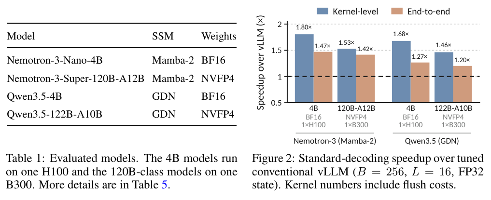

本文补录 **2026-10-13 的精选阅读**，于 2026-10-29 核对公开原文。归档日不等于论文发表日，采用下方历史版本；数字为作者报告，本站未独立复现。

固定大小的循环状态仍可能造成解码带宽瓶颈，推测回滚又增加管理成本。ReplaySSM 保存检查点与最近输入，改变状态的读写周期。

## 方法与问题

循环展开将输出计算与检查点更新分离，多数步只读需要的信息，定期刷新检查点；回滚调整输入缓冲指针。高、低精度检查点分别服务更新与输出，减少低精度误差进入循环状态。

## 实验证据

作者在 vLLM 实现 Mamba-2 与 Gated DeltaNet。batch size 256、缓冲长度 L=16、FP32 状态时，四个混合模型普通解码端到端加速为 1.20–1.47 倍，参照调优后的 vLLM。两个 120B 级模型的推测解码吞吐约为基线 1.8 倍，是另一项实验指标。4B 模型用单张 H100，120B 级用单张 B300，不能作等硬件横向排名。

## 我的判断

架构优势需要状态生命周期设计兑现。迁移时先测 batch、状态尺寸、推测长度和显存流量，再决定缓冲长度。内核倍数与端到端倍数不同，低 batch 和其他混合比例仍需实测。

## 原论文视觉证据

图源：Ze-Wei Liou , Harris Nover , Amey Naik , Andrii Skliar , Igor Shovkun , Ido Shahaf , Tri Dao，《ReplaySSM: Cache SSM Inputs, Not State》，2610.13778v1，Table 1 and Figure 2，PDF 第 6 页。[原图出处](https://arxiv.org/pdf/2610.13778v1#page=6) · [CC BY 4.0](https://creativecommons.org/licenses/by/4.0/)。仅裁剪原页面，保留完整图表、图注和必要标签，未重绘或修改数据，不表示作者认可本解读。该图沿用 CC BY 4.0，本站页脚许可不为其增加非商业或相同方式共享限制。

## 原文与核验范围

- [ReplaySSM: Cache SSM Inputs, Not State](https://arxiv.org/abs/2610.13778v1) · 2610.13778v1，该版本公开于 2026-10-09。

本篇深读 1 篇，仅核对上述方法、图表数字与条件；未将其他候选二手摘要算作已核验结论，也不宣称完整覆盖当天所有论文。
