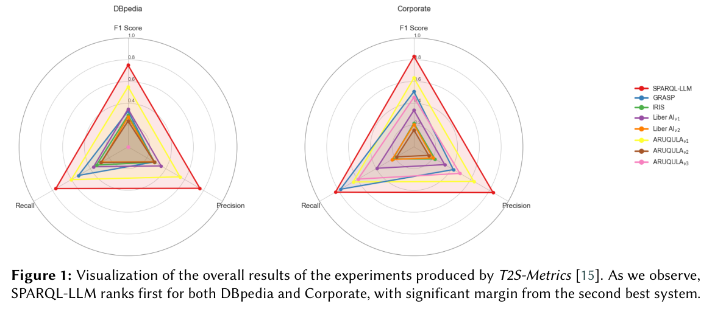

知识图谱问答必须同时找到实体、关系、端点与查询结构。SPARQL-LLM 的挑战赛结果值得读，但其中约 59% 的提升需要明确分母。

## 方法与问题

系统参加 TEXT2SPARQL 2026 的 DBpedia 与企业图谱任务。报告配置为 GPT-5.2、400K 上下文、温度 0、最大输出 16K tokens。这是完整系统的比较，不能隔离单个检索或提示模块的贡献。

## 实验证据

西班牙语 DBpedia F1 为 0.7810，第二名 ARUQULA v1 为 0.4904，差值 0.2906，即 29.06 个百分点；约 59% 是相对增幅。英语 DBpedia 为 0.7192 对 0.6142，增加 10.50 个百分点。系统在所报参赛方法中总体第一，但这些赛题分数不是任意企业图谱的准确率承诺。

## 我的判断

完整配置和逐数据集表格比排名更容易复用。应固定语言、模型版本、端点可用性、实体链接与执行判分口径。SPARQL 能运行仍可能语义错误，需要分别验证。

## 原论文视觉证据

图源：Panayiotis Smeros , Vincent Emonet , Ruijie Wang , Ana-Claudia Sima , Tarcisio Mendes de Farias，《SPARQL-LLM in the TEXT2SPARQL 2026 Challenge》，2610.13648v1，Figure 1，PDF 第 3 页。[原图出处](https://arxiv.org/pdf/2610.13648v1#page=3) · [CC BY 4.0](https://creativecommons.org/licenses/by/4.0/)。裁剪自原文。

## 论文来源

- [SPARQL-LLM in the TEXT2SPARQL 2026 Challenge](https://arxiv.org/abs/2610.13648v1) · 2610.13648v1，该版本公开于 2026-10-09。

## 本期其他论文

### Correction Training：让模型学习修正自己的去噪预测

Correction Training 为扩散模型增加一个 corrector：输入基础去噪器自己的预测，目标仍是同一干净样本。推理时在每个噪声水平反复修正预测，尝试阻止早期结构错误一路保留到最终图像；额外计算也可通过蒸馏转回基础模型。

作者在 DiT、SiT、JiT 等架构上比较生成质量与多样性，并区分单次修正和重复修正的收益。它针对的是训练输入与采样时自身预测之间的分布差距；比较时应同时计算 denoiser 和 corrector 调用，不能只因采样步数相同就认为计算预算相等。 [作者项目页](https://sunovivid.github.io/correction-training/)。

[Correction Training for Diffusion Models](https://arxiv.org/abs/2610.14136v1) · 2610.14136v1。

### MagicBeanStalk：训练题多，不代表有非零学习优势

MagicBeanStalk 从 RLVR 的零优势陷阱出发：对固定学生和 rollout 预算，太容易的题每次都对，太难的题每次都错，两者都难提供组内相对信号。它自顶向下拆解难题，再自底向上递归合成，保留原题需要的推理结构，同时把难度校准到学生可学习的范围。

作者在数学和金融任务上比较全量真实语料、过滤子集和合成题，观察到数据有效性取决于学生与预算，而非题库大小本身。训练中“部分成功、部分失败”的窗口可能随模型变化；一次筛选或一个教师提示不能保证后续课程始终合适。

[MagicBeanStalk: Escaping the RLVR Zero Advantage Trap with Recursive Data Synthesis](https://arxiv.org/abs/2610.12659v1) · 2610.12659v1。

### Empowerment：寻找能展开更多技能的状态

Scaling Empowered Agents 将 empowerment 与技能学习联系起来，但明确两者不是同一目标。它用一个状态下可执行技能的数量近似可控性，鼓励 Agent 到达能展开更多技能的状态，方法可以建立在不同底层技能学习器之上。

在较大环境的实验中，作者观察到收集资源、改造环境和生存等涌现行为，包括 Crafter 中建造房屋。这里的多技能可达性是内在目标，并不自动等于完成用户任务或行为符合偏好；技能集合如何定义，也会改变什么状态被认为更有价值。

[Scaling Empowered Agents](https://arxiv.org/abs/2610.13002v1) · 2610.13002v1。

### Sonic-AMG：边听空间声音，边生成动作

Sonic-AMG 将声音内容和相对身体的声源几何编码成不同 token，用因果 Transformer 与 flow head 生成连续动作潜变量，再由因果 decoder 输出动作片段。与读取完整未来声音的离线方法不同，它支持声音持续到来时的流式反应。

rehearsal training 让模型在短自回放中学习，spatial feedback 根据已生成根姿态重算声源相对位置，缓解训练真实历史与推理生成历史的差异。SAM 上的 FID 和 R-precision 支持其生成质量，但这些指标不是人类反应正确性或机器人控制安全性的直接度量。

[Sonic-AMG: Streaming Human Motion Generation from Spatial Audio](https://arxiv.org/abs/2610.13300v1) · 2610.13300v1。

### Artisan：可动三维资产还要通过碰撞和重力检查

Artisan 在关节三维资产生成中加入多 Agent 和物理仿真反馈，除几何与外观，还检查运动碰撞、重力稳定、质量和材料属性。配套 benchmark 分开评价空间忠实度、物理合理性、下游任务与总体质量，避免把“看起来像”当成“能按预期运动”。

实验包含参考资产、稳定性提示和带参考质量的物体，并比较十余种方法；Artisan 在所测方法中碰撞较少、稳定性较高。仿真反馈的价值仍受物理模型和资产分布限制，可用资产不等于已经辨识真实物体全部动力学。

[Towards Physically Grounded Articulated 3D Assets: A Multi-Agent Pipeline and Benchmark](https://arxiv.org/abs/2610.13947v1) · 2610.13947v1。
