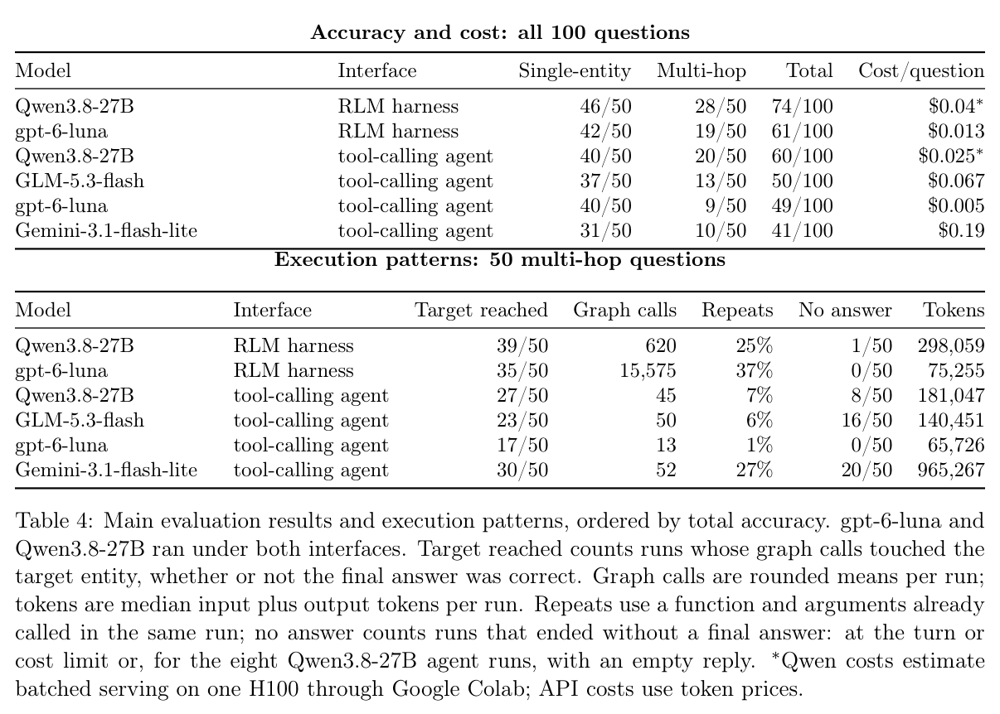

本文补录 **2026-10-15 的精选阅读**，于 2026-10-29 核对公开原文。归档日不等于论文发表日，采用下方历史版本；数字为作者报告，本站未独立复现。

如果每次图查询结果都直接进入上下文，长链路问答容易被无关信息淹没。Wikidata Search Traces 同时研究题目生成与证据管理。

## 方法与问题

作者在冻结 Wikidata 快照上逐步用嵌套条件替换命名实体，检查目标唯一性及条件必要性。RLM harness 批量执行图调用，将结果保留在持久 Python 状态，再用子调用解释选定证据。

## 实验证据

采用 10 月 9 日已公开的 v3。10,235 条保留轨迹由 9,563 条单实体和 672 条多跳轨迹组成，不能当作已接受问题数。在同一图函数、100 道题（单实体与多跳各 50 道）上，gpt-6-luna 从直接工具调用的 49 题正确升至 61 题，Qwen3.8-27B 从 60 题升至 74 题。这是接口与编排的整体比较，不是模型权重训练，也不能假定同时降低成本。

## 我的判断

我会先固定模型和图函数，检查证据存储与读取方式。100 题规模有限，冻结快照不能代表实时图谱；实验也未单独隔离批量调用与持久状态各自的贡献。

## 原论文视觉证据

图源：Mohamed Chenene , Carlos Rosas-Hinostroza , Anastasia Stasenko , Shani Evenstein Sigalov , Pierre-Carl Langlais，《Wikidata Search Traces: A Dataset for Training Knowledge Graph Search Agents》，2610.06650v3，Table 4，PDF 第 10 页。[原图出处](https://arxiv.org/pdf/2610.06650v3#page=10) · [CC BY 4.0](https://creativecommons.org/licenses/by/4.0/)。裁剪自原文。

## 原文与核验范围

- [Wikidata Search Traces: A Dataset for Training Knowledge Graph Search Agents](https://arxiv.org/abs/2610.06650v3) · 2610.06650v3，该版本公开于 2026-10-09。

本篇深读 1 篇，仅核对上述方法、图表数字与条件；未将其他候选二手摘要算作已核验结论，也不宣称完整覆盖当天所有论文。
