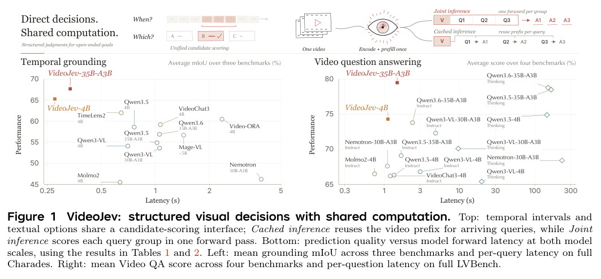
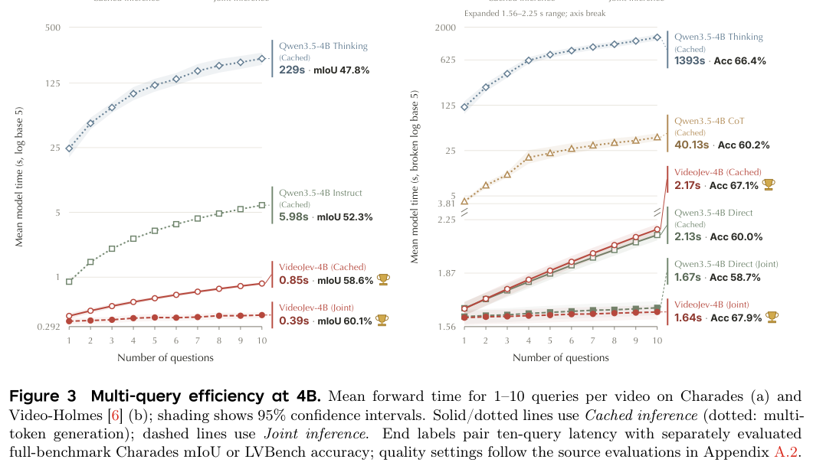
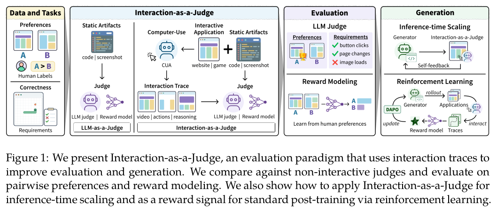
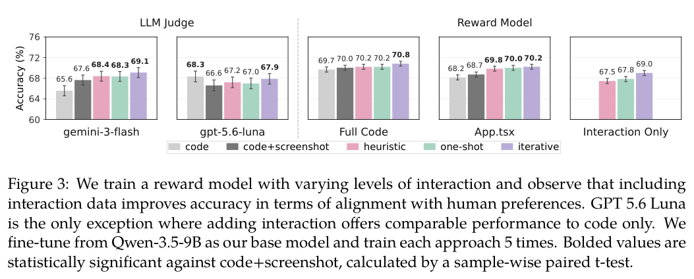
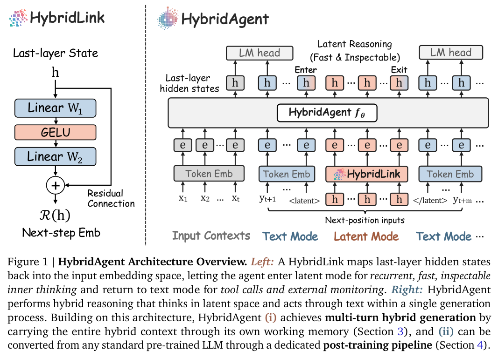
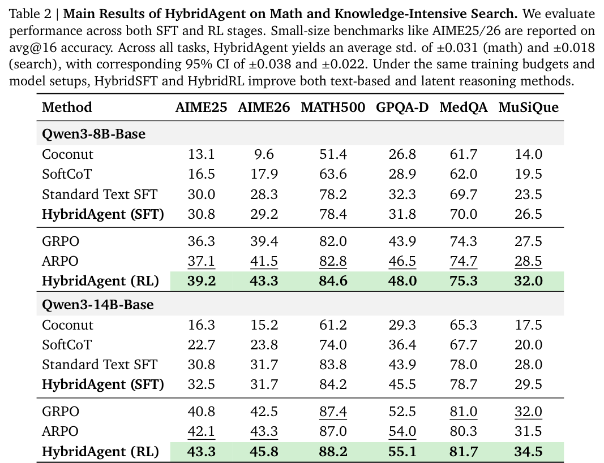
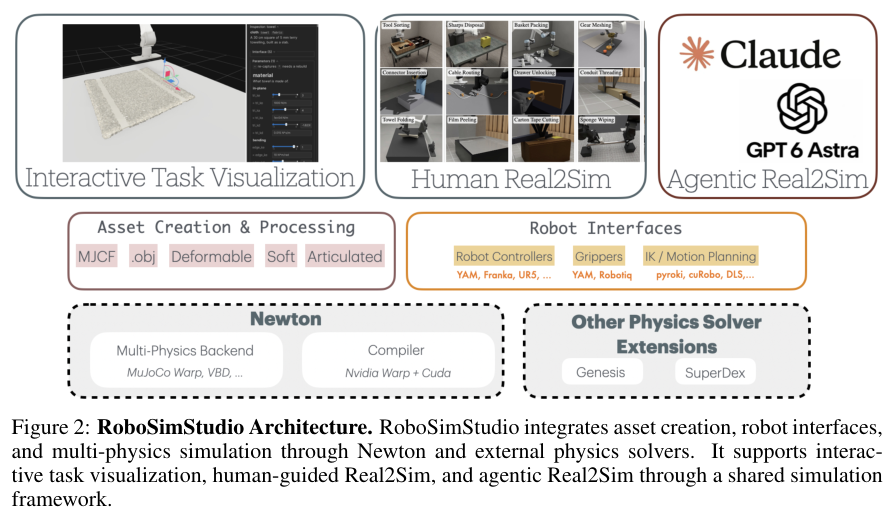

证据怎样存储、什么时候交给模型读取，以及怎样通过真实交互评判产物，是本期的主要线索。图谱搜索、视频决策、混合推理和仿真工具分别提供了具体方案。

## 1. Wikidata Search Traces：用持久状态组织图谱证据

如果每次图查询结果都直接进入上下文，长链路问答容易被无关信息淹没。Wikidata Search Traces 同时研究题目生成与证据管理。

### 方法与问题

作者在冻结 Wikidata 快照上逐步用嵌套条件替换命名实体，检查目标唯一性及条件必要性。RLM harness 批量执行图调用，将结果保留在持久 Python 状态，再用子调用解释选定证据。

### 实验证据

采用 10 月 9 日已公开的 v3。10,235 条保留轨迹由 9,563 条单实体和 672 条多跳轨迹组成，不能当作已接受问题数。在同一图函数、100 道题（单实体与多跳各 50 道）上，gpt-6-luna 从直接工具调用的 49 题正确升至 61 题，Qwen3.8-27B 从 60 题升至 74 题。这是接口与编排的整体比较，不是模型权重训练，也不能假定同时降低成本。

### 讨论

我会先固定模型和图函数，检查证据存储与读取方式。100 题规模有限，冻结快照不能代表实时图谱；实验也未单独隔离批量调用与持久状态各自的贡献。

图源：Mohamed Chenene , Carlos Rosas-Hinostroza , Anastasia Stasenko , Shani Evenstein Sigalov , Pierre-Carl Langlais，《Wikidata Search Traces: A Dataset for Training Knowledge Graph Search Agents》，2610.06650v3，Table 4，PDF 第 10 页。[原图出处](https://arxiv.org/pdf/2610.06650v3#page=10) · [CC BY 4.0](https://creativecommons.org/licenses/by/4.0/)。裁剪自原文。

- [Wikidata Search Traces: A Dataset for Training Knowledge Graph Search Agents](https://arxiv.org/abs/2610.06650v3) · 2610.06650v3，该版本公开于 2026-10-09。

## 2. VideoJev：把视频理解变成可复用的结构化决策

VideoJev 用共享评分头代替自回归答案解码，直接把视频证据与时间区间、文字选项匹配，统一时间定位和多选视频问答。同一段历史被连续询问时，Cached inference 复用视觉计算，Joint inference 则在一次前向处理多个查询。

*图｜Zhu, Yuhan 等，VideoJev，[Figure 1（PDF 第 1 页）](https://arxiv.org/pdf/2610.18615v1#page=1)，[CC BY 4.0](http://creativecommons.org/licenses/by/4.0/)。裁剪自原文。*

4B 和 35B-A3B 模型在时间定位与视频 QA 上报告了质量和时延收益。速度对照包括骨干的 Thinking 模式，而输出任务本身也限于区间或候选评分，不能把倍数理解为同等自由文本能力下的全面加速；复杂开放任务仍需要上层编排。

*图｜Zhu, Yuhan 等，VideoJev，[Figure 3（PDF 第 10 页）](https://arxiv.org/pdf/2610.18615v1#page=10)，[CC BY 4.0](http://creativecommons.org/licenses/by/4.0/)。裁剪自原文。*

[VideoJev: System One Model for Video Understanding and Interaction](https://arxiv.org/abs/2610.18615v1) · 2610.18615v1。

## 3. Verifier Hardening：先隔离判分器，再循环找漏洞和修复

这项 weak-to-strong verifier hardening 工作先将判分器放入 Agent 无法直接改写的独立沙箱，再运行 hacker–fixer 循环，寻找不用完成任务却能拿分的路径并修复。它把环境自身的验收正确性视为训练和评测可扩展的一部分。

作者在 Terminal Bench、KernelBench 和 SETA 上观察到攻击成功率降低，增加循环预算也能增强防御。较弱模型配合更多计算可以帮助加固，但测试过的攻击集合并不能穷尽未来策略；隔离之外，判分逻辑是否真正对应任务目标仍要持续审查。

[Scalable Weak-to-Strong Verifier Hardening for Agent Environments](https://arxiv.org/abs/2610.15924v1) · 2610.15924v1。

[Figure 1（原文）](https://arxiv.org/pdf/2610.15924v1#page=1)。

## 4. Interaction-as-a-Judge：实际操作应用后再评分

Interaction-as-a-Judge 让 computer-use Agent 直接操作网站、桌面应用和游戏，用交互轨迹辅助判断要求是否满足，而不只阅读代码。论文提供 6,858 对带人工偏好的应用及轨迹，以及 222 个带人工核验需求标签的应用，分别测偏好一致性与需求验证。

*图｜Chi, Wayne 等，Interaction-as-a-Judge，[Figure 1（PDF 第 2 页）](https://arxiv.org/pdf/2610.17895v1#page=2)，[CC BY 4.0](http://creativecommons.org/licenses/by/4.0/)。裁剪自原文。*

相对非交互方法，偏好预测从 65.6% 到 69.1%，需求验证从 77.0% 到 81.6%。交互反馈也被用于修复和训练生成器，但自动操作可能漏掉路径；两种评判指标及生成质量收益应分别看待，不能由一次测试通过推断应用所有功能都正确。

*图｜Chi, Wayne 等，Interaction-as-a-Judge，[Figure 3（PDF 第 7 页）](https://arxiv.org/pdf/2610.17895v1#page=7)，[CC BY 4.0](http://creativecommons.org/licenses/by/4.0/)。裁剪自原文。*

[Interaction-as-a-Judge](https://arxiv.org/abs/2610.17895v1) · 2610.17895v1。

## 5. HybridAgents：潜在思考和文字工具交互之间切换

HybridAgents 用轻量 HybridLink 连接文字与潜在模式，并以连续工作记忆保存跨轮混合上下文。HybridSFT 先训练骨干与接口协作，HybridRL 再学习何时在潜在空间计算、何时通过文字调用外部工具，使潜在推理不必脱离 Agent 交互。

*图｜Zou, Jiaru 等，HybridAgents，[Figure 1（PDF 第 1 页）](https://arxiv.org/pdf/2610.18861v1#page=1)，[CC BY 4.0](http://creativecommons.org/licenses/by/4.0/)。裁剪自原文。*

论文在三个模型规模和 11 项 benchmark 上比较质量、token、时延与费用，支持混合路线的效率潜力。这些口径不能互相替代：减少文字 token 不等于没有内部计算；可检查潜在状态也不自动意味着已经获得完整、忠实的推理解释。

*图｜Zou, Jiaru 等，HybridAgents，[Table 2（PDF 第 10 页）](https://arxiv.org/pdf/2610.18861v1#page=10)，[CC BY 4.0](http://creativecommons.org/licenses/by/4.0/)。裁剪自原文。*

[Hybrid Reasoning Agents](https://arxiv.org/abs/2610.18861v1) · 2610.18861v1。

## 6. RoboSimStudio：让接触模型和物理参数可修改

RoboSimStudio 基于 Newton 物理系统，把求解器、接触模型、刚度、摩擦等选择显式暴露给人和 coding Agent。观察到真实交互与仿真不一致时，可以逐项修改并重跑，而不是将整个 real2sim 过程藏在一个固定配置后面。

*图｜Chen, Kaiyuan 等，RoboSimStudio，[Figure 2（PDF 第 4 页）](https://arxiv.org/pdf/2610.18835v1#page=4)，[CC BY 4.0](http://creativecommons.org/licenses/by/4.0/)。裁剪自原文。*

论文展示视觉判断、力反馈和 Agent 辅助 Real2Sim2Real 三种实验路线。工具的贡献是缩短可检查的迭代链路，并未给出一个适用于所有接触任务的统一拟合精度；不同参数可能解释相似现象，迁移效果仍需用真实行为验证。

[RoboSimStudio: An Interactive Toolkit for Rapid Real2Sim of Robot Manipulation Tasks](https://arxiv.org/abs/2610.18835v1) · 2610.18835v1。
