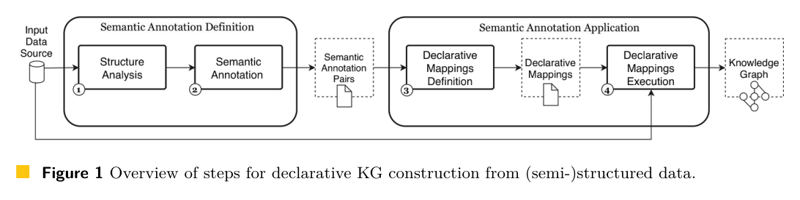

本文补录 **2026-10-16 的精选阅读**，于 2026-10-29 核对公开原文。归档日不等于论文发表日，采用下方历史版本；数字为作者报告，本站未独立复现。

表格语义标注能识别实体，却未必直接生成图谱；声明式建图又常假设映射已经准备好。AutoRML 将标注结果接到可检查、可修改的 RML 规则。

## 方法与问题

论文形式化主语、类、谓词与对象映射的生成，可接入不同标注框架。信息不足时保留专家可补充的声明式规则。下图是原文的声明式建图流程概览，不应误称为 AutoRML 独有的新架构。

## 实验证据

TGDK 4(3) Article 2 于 2026 年 9 月 30 日正式出版。评估结论有明确前提：自动与人工构建使用同一目标知识库作为参照时，AutoRML 可构造与人工结果一致的图谱。它验证既定注释与参照条件下的映射链路，不证明任意原始表格都可无误建图，论文也未提供可据此引用的人工小时节省数。

## 我的判断

留下版本化 RML 中间产物有助复查和复用。但标注错误仍会被映射过程传播，验收应分开测注释质量、映射正确性与最终图谱质量。

## 原论文视觉证据

图源：Ioannis Dasoulas, Ali Elhalawati, Anastasia Dimou，《AutoRML: Automated Declarative RDF Generation Leveraging Semantic Table Annotation》，TGDK 4(3), Article 2, publisher version，Figure 1，PDF 第 2 页。[原图出处](https://drops.dagstuhl.de/storage/08tgdk/tgdk-vol004/tgdk-vol004-issue003/TGDK.4.3.2/TGDK.4.3.2.pdf#page=2) · [CC BY 4.0](https://creativecommons.org/licenses/by/4.0/)。仅裁剪原页面，保留完整图表、图注和必要标签，未重绘或修改数据，不表示作者认可本解读。该图沿用 CC BY 4.0，本站页脚许可不为其增加非商业或相同方式共享限制。

## 原文与核验范围

- [AutoRML: Automated Declarative RDF Generation Leveraging Semantic Table Annotation](https://drops.dagstuhl.de/entities/document/10.4230/TGDK.4.3.2) · TGDK 4(3), Article 2, publisher version，该版本公开于 2026-09-30。

本篇深读 1 篇，仅核对上述方法、图表数字与条件；未将其他候选二手摘要算作已核验结论，也不宣称完整覆盖当天所有论文。
