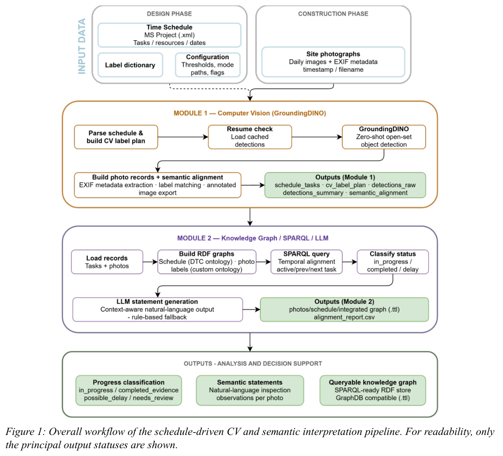
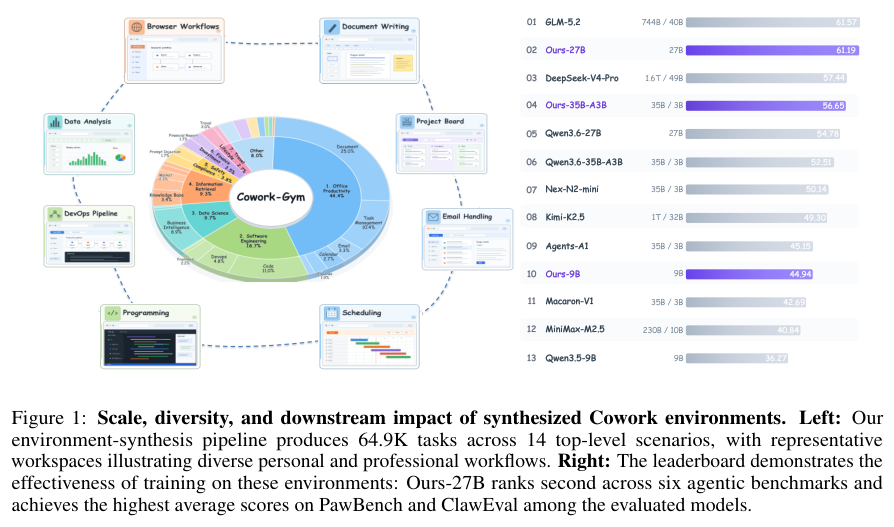
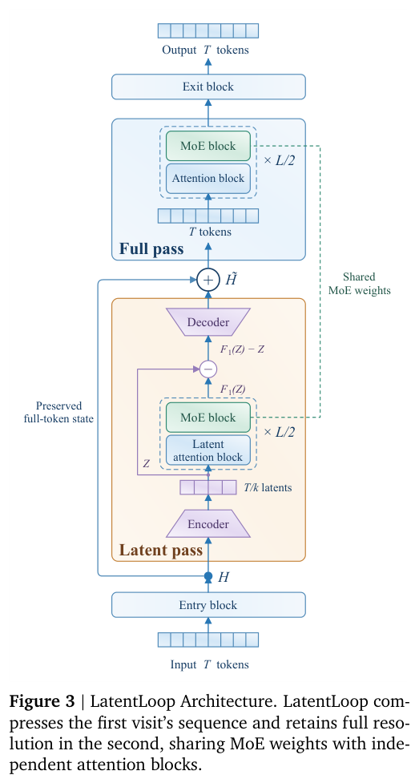
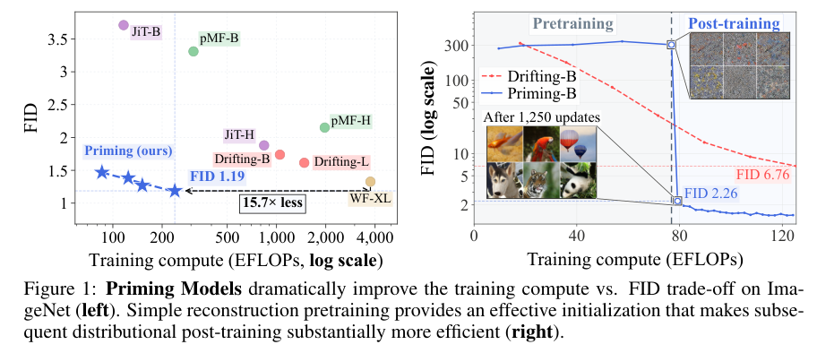

本期介绍从语义注释生成图谱、从现场照片形成施工证据，以及面向协作和动态攻防的 Agent 环境。循环 MoE 和一步生成则从模型训练侧寻找效率空间。

## 1. AutoRML：连接表格语义注释与声明式映射

表格语义标注能识别实体，却未必直接生成图谱；声明式建图又常假设映射已经准备好。AutoRML 将标注结果接到可检查、可修改的 RML 规则。

### 方法与问题

论文形式化主语、类、谓词与对象映射的生成，可接入不同标注框架。信息不足时保留专家可补充的声明式规则。下图是原文的声明式建图流程概览，不应误称为 AutoRML 独有的新架构。

### 实验证据

TGDK 4(3) Article 2 于 2026 年 9 月 30 日正式出版。评估结论有明确前提：自动与人工构建使用同一目标知识库作为参照时，AutoRML 可构造与人工结果一致的图谱。它验证既定注释与参照条件下的映射链路，不证明任意原始表格都可无误建图，论文也未提供可据此引用的人工小时节省数。

### 讨论

留下版本化 RML 中间产物有助复查和复用。但标注错误仍会被映射过程传播，验收应分开测注释质量、映射正确性与最终图谱质量。

图源：Ioannis Dasoulas, Ali Elhalawati, Anastasia Dimou，《AutoRML: Automated Declarative RDF Generation Leveraging Semantic Table Annotation》，TGDK 4(3), Article 2, publisher version，Figure 1，PDF 第 2 页。[原图出处](https://drops.dagstuhl.de/storage/08tgdk/tgdk-vol004/tgdk-vol004-issue003/TGDK.4.3.2/TGDK.4.3.2.pdf#page=2) · [CC BY 4.0](https://creativecommons.org/licenses/by/4.0/)。裁剪自原文。

- [AutoRML: Automated Declarative RDF Generation Leveraging Semantic Table Annotation](https://drops.dagstuhl.de/entities/document/10.4230/TGDK.4.3.2) · TGDK 4(3), Article 2, publisher version，该版本公开于 2026-09-30。

## 2. 施工监测：从视觉检测走到可追溯的进度证据

这项 schedule-driven 框架先由施工计划产生并优化 GroundingDINO 检测标签，再把照片元数据、检测对象和计划整合为 RDF 图，用 SPARQL 规则赋予进度状态。LLaMA 3.1 8B 只将结构化查询结果写成技术陈述，不负责改变规则分类。

*图｜Federica Madaschi 等，施工监测，[Figure 1（PDF 第 6 页）](https://www.itcon.org/papers/2026_50-ITcon-SI-Madaschi.pdf#page=6)，[CC BY 4.0](https://creativecommons.org/licenses/by/4.0/)。裁剪自原文。*

案例是米兰酒店工地一座 100 米独立塔吊的安装。它展示如何将“图中检测到了什么”连接到“哪项计划状态有证据”，而非只输出目标框；单案例仍不足以代表不同工种、遮挡和拍摄条件，语言表述流畅也不能修正上游误检。

[From visual detection to traceable progress evidence: A schedule-driven ontology framework for construction monitoring](https://www.itcon.org/paper/2026/50) · ITcon 31，1197–1218，出版版本。

## 3. CyberArena：攻击和防守在同一动态比赛中评估

CyberArena 在隔离沙箱中让两方按相同规则同时攻击和防守，服务状态随多轮对抗变化，避免静态目标很快被记住或饱和。自动生成、审查和验证环境的管线持续补充挑战，并用动态模型将比赛过程映射为攻防等多维分数。

论文评测 12 个前沿 Agent、40 个挑战和 466 场比赛，观察到单方静态测试之外的能力差异。分数取决于对手、轮次和服务变化，不能当作对真实部署的漏洞覆盖率；这里的可复现实验对象是受控比赛及其规则。

[CyberArena: Benchmarking AI Agents in Live Symmetric Attack-and-Defense Combat](https://arxiv.org/abs/2610.19005v1) · 2610.19005v1。

[Figure 1（原文）](https://arxiv.org/pdf/2610.19005v1#page=2)。

## 4. Cowork-Gym：把用户改需求和编辑共享文件也放进环境

Cowork-Gym 通过构建、执行、修订循环生成协作工作环境，用执行证据和评审反馈修复资源与验收条件。带状态用户模拟器既能对话，也能直接修改共享工作区，使 Agent 必须响应变化，而非只完成一次静态指令。

*图｜Zou, Anni 等，Cowork-Gym，[Figure 1（PDF 第 1 页）](https://arxiv.org/pdf/2610.17670v1#page=1)，[CC BY 4.0](http://creativecommons.org/licenses/by/4.0/)。裁剪自原文。*

作者合成 14 类场景的 64.9K 环境，并用 SFT、RL 和在策略蒸馏后训练多个 Qwen 模型，在六项 benchmark 上报告平均收益。模拟用户与生成验收器仍限定了训练交互的真实性；任务数量和跨基准均值不能替代对实际协作中权限、冲突和需求歧义的评估。

[Cowork-Gym: Synthesizing Interactive Work Environments at Scale](https://arxiv.org/abs/2610.17670v1) · 2610.17670v1。

## 5. LatentLoop：两次共享块调用不必分到同样计算量

LatentLoop 从两次访问共享模块的残差系数差异出发，压缩第一次访问的序列，第二次保留完整分辨率，再将省下的计算用于更大隐藏维度。MoE 权重共享，注意力参数则分别适应两种序列分辨率，使循环复用与不对称计算分配结合。

*图｜He, Zefeng 等，LatentLoop，[Figure 3（PDF 第 5 页）](https://arxiv.org/pdf/2610.19975v1#page=5)，[CC BY 4.0](http://creativecommons.org/licenses/by/4.0/)。裁剪自原文。*

论文在 1.3B–7B 的 15 个配置上测验证 NLL 和九项下游任务，并按拟合曲线估计匹配 NLL 的计算节省。拟合节省不是同一硬件上的端到端时延，且依赖目标损失、规模和配置范围；它支持不等量分配循环计算，而非任意循环次数都越多越好。

[LatentLoop: Scaling Looped MoE Models with Asymmetric Compute Allocation](https://arxiv.org/abs/2610.19975v1) · 2610.19975v1。

## 6. Priming Models：先重建，再训练一步生成分布

Priming Models 用两阶段简化一步生成训练：先在固定噪声水平等条件下做重建，再进行特征空间的分布后训练。研究重点是，简单重建起点能否缓解从随机初始化直接学习生成分布的困难，而不依赖更复杂的扩散蒸馏流程。

*图｜Park, Woobin 等，Priming Models，[Figure 1（PDF 第 1 页）](https://arxiv.org/pdf/2610.20331v1#page=1)，[CC BY 4.0](http://creativecommons.org/licenses/by/4.0/)。裁剪自原文。*

作者在类别条件图像、文生图和世界建模中比较训练计算与质量；ImageNet-256 的一步生成报告 FID 1.19。这个数值属于指定数据、分辨率和评估协议，训练计算比较也不等于完整系统费用；一步网络调用仍有模型大小与部署吞吐成本。

[Are We Overthinking One-Step Generation?](https://arxiv.org/abs/2610.20331v1) · 2610.20331v1。
