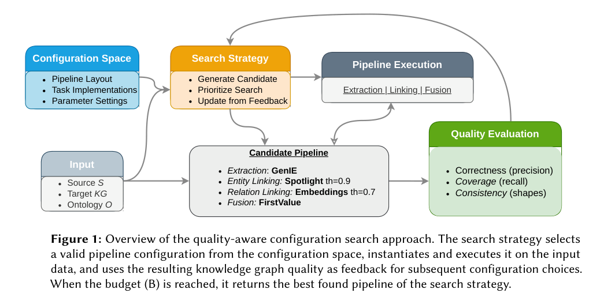
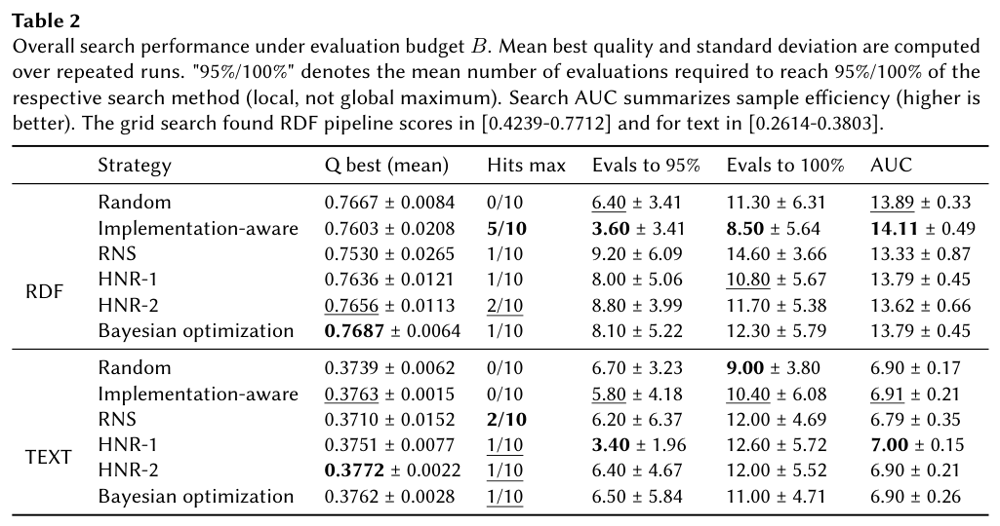
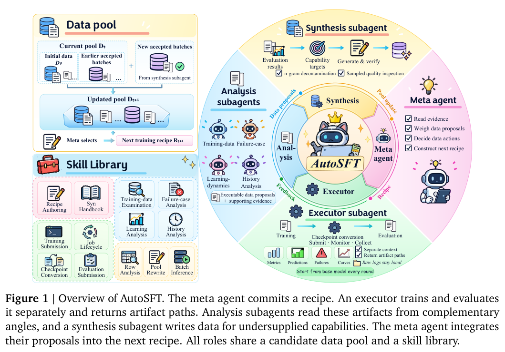
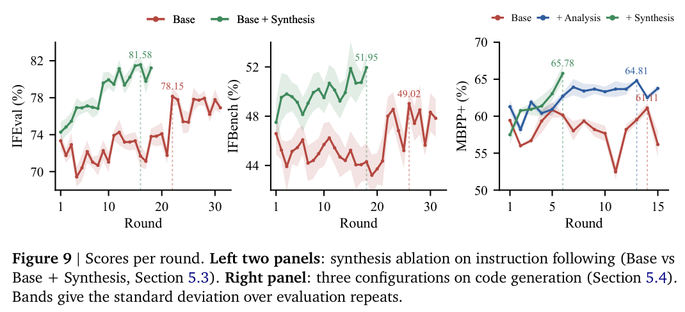
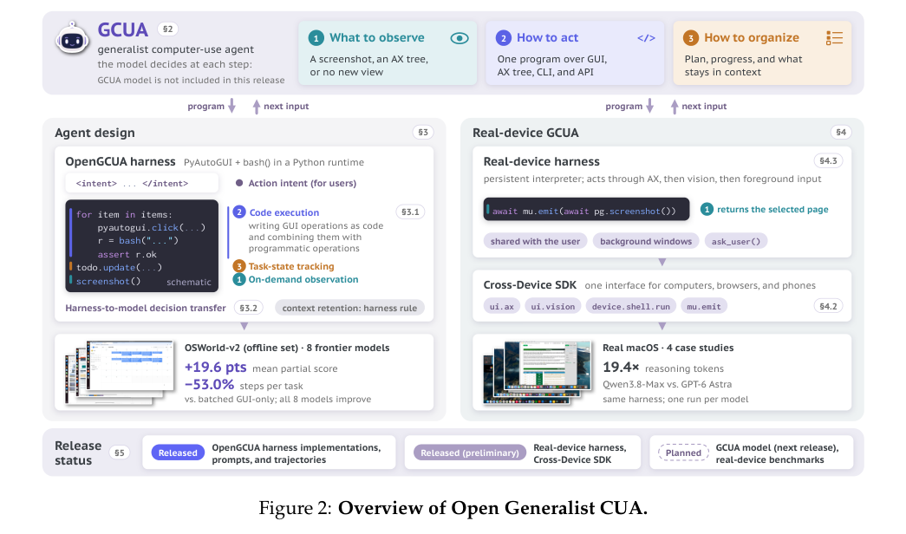
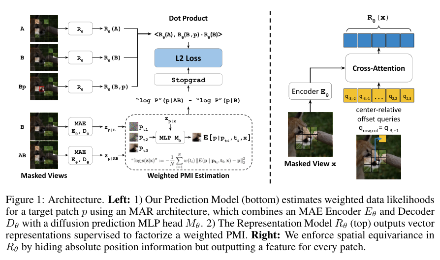
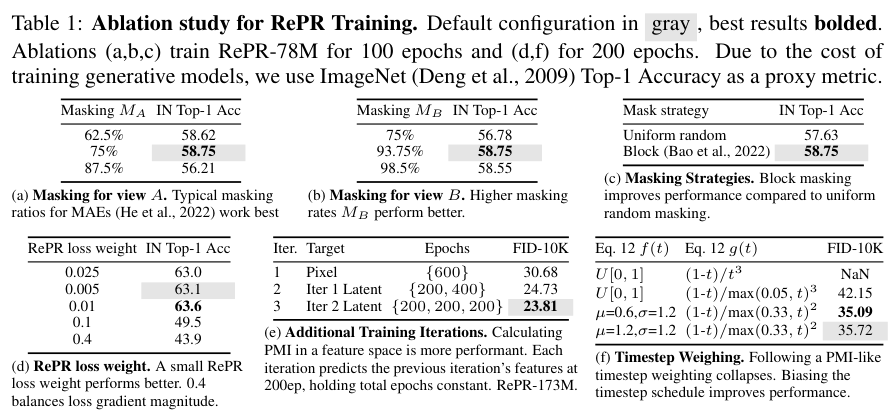
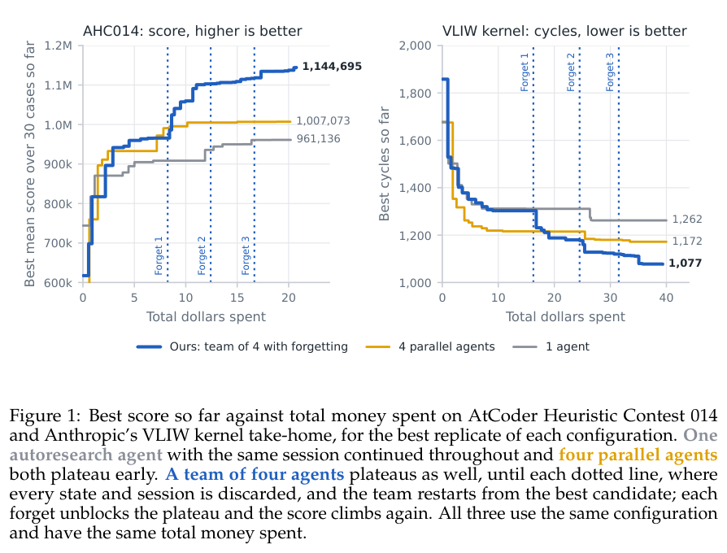

Agent 既要学会完成任务，也要知道何时退回、怎样选择训练数据和何时重新开始搜索。本期同时讨论知识图谱管线优化、电脑使用和生成式表示学习。

## 1. 知识图谱集成：把组件和参数组合当作预算内搜索

这项 KG 集成研究把抽取、匹配、链接和融合的实现选择及参数设置，统一写成受预算约束的优化问题。搜索器生成有效流水线，运行后评价图谱质量，再用反馈决定下一组配置，避免每个阶段单独手调后就默认整体最优。

*图｜Marvin Hofer 等，知识图谱集成，[Figure 1（PDF 第 4 页）](https://dbs.uni-leipzig.de/files/research/publications/2026-10/pdf/KGpipe_Parameter_Optimization.pdf#page=4)，[CC BY 4.0](https://creativecommons.org/licenses/by/4.0/)。裁剪自原文。*

论文在结构化 RDF 和文本集成情景中比较随机、贝叶斯、随机邻域与结构感知启发式搜索。不同配置空间的质量地形会改变哪种策略有效，因此没有一个搜索器在所有管线中稳定占优；质量函数、运行预算和有效配置规则同样是实验的一部分。

*图｜Marvin Hofer 等，知识图谱集成，[Table 2（PDF 第 9 页）](https://dbs.uni-leipzig.de/files/research/publications/2026-10/pdf/KGpipe_Parameter_Optimization.pdf#page=9)，[CC BY 4.0](https://creativecommons.org/licenses/by/4.0/)。裁剪自原文。*

[Configuration and Optimization of Knowledge Graph Integration Pipelines](https://dbs.uni-leipzig.de/research/publications/configuration-and-optimization-of-knowledge-graph-integration-pipelines) · DMKG 2026 作者公开版本。

## 2. GracefulRL：训练成功、退回与错误之间的取舍

如果奖励只分成功与失败，模型可能在没有把握时继续猜。GracefulRL 将结果按成功、fallback、错误排序，研究如何保留解题能力并减少危险错误。

### 方法与问题

它改变训练优化结构，而非在推理时额外加裁判。直接给 fallback 中间奖励，普通策略梯度仍可能塌缩为永远退回；GracefulRL 调整优化动力学，寻找成功与错误之间更有用的权衡。

### 实验证据

SafeMaze 要求到达目标，无法完成时返回安全位置。Figure 3 中 GRPO/RLOO 可塌缩为总去安全格；GracefulRL 在所测设置下获得更好的成功—错误前沿。Figure 4 另测数学弃答。这些任务没有一个可跨任务引用的统一准确率增幅，本文不从曲线估读百分比。

### 讨论

系统必须先定义可执行、可验证的 fallback：不执行、请求人工、回滚或保留草稿。特定奖励下的行为改善，不证明真实数据库或生产代码部署已经安全。

### 原图入口

[Figure 3，原论文 PDF 第 6 页](https://arxiv.org/pdf/2610.20401v1#page=6)。

- [Training Language Models to Fail Gracefully](https://arxiv.org/abs/2610.20401v1) · 2610.20401v1。
- 版本公开日期：2026-10-14。

## 3. AutoSFT：让数据研究覆盖修剪、修复和合成

AutoSFT 给自动 SFT 数据研究定义更完整的动作空间，包括调整比例、删减、修复、替换和合成。meta Agent 将执行与分析分开，收集不同角度的建议，再为现有池无法覆盖的能力调用合成模块；每轮都从相同基础模型重新训练，以区分组件作用。

*图｜He, Bingxiang 等，AutoSFT，[Figure 1（PDF 第 2 页）](https://arxiv.org/pdf/2610.22194v1#page=2)，[CC BY 4.0](http://creativecommons.org/licenses/by/4.0/)。裁剪自原文。*

消融显示，执行分离减少上下文丢失，分析与合成进一步改善指令和代码任务。核心不是把某一种数据动作自动化，而是让研究循环有机会探索多种动作；结果仍依赖固定模型、训练器、预算和验收任务，不能推出更大的自动合成池总会更好。

*图｜He, Bingxiang 等，AutoSFT，[Figure 9（PDF 第 10 页）](https://arxiv.org/pdf/2610.22194v1#page=10)，[CC BY 4.0](http://creativecommons.org/licenses/by/4.0/)。裁剪自原文。*

[AutoSFT: An Agentic System for Automated Data Research in Supervised Fine-Tuning](https://arxiv.org/abs/2610.22194v1) · 2610.22194v1。

## 4. OpenGCUA：在视觉和程序接口之间选择

OpenGCUA 将通用电脑使用定义为模型主动决定怎样观察、行动与组织工作，既可通过 GUI，也可执行代码。它把部分原本硬编码在 harness 中的观测和状态判断移交模型，让中间结果决定后续操作，并提供跨电脑、移动端和浏览器的统一接口方向。

*图｜Zhou, Hanzhang 等，OpenGCUA，[Figure 2（PDF 第 4 页）](https://arxiv.org/pdf/2610.22200v1#page=4)，[CC BY 4.0](http://creativecommons.org/licenses/by/4.0/)。裁剪自原文。*

报告在 OSWorld-v2 的八个模型上观察到相对批处理 GUI-only 的任务分数和步骤改善。这里比较的是完整交互配置，步骤数也受一次程序执行能完成多少操作影响；公开基准与少量真实设备案例不能覆盖所有权限提示、应用状态或用户协作情形。

[OpenGCUA: Toward a Fully Open Stack for Generalist Computer Use](https://arxiv.org/abs/2610.22200v1) · 2610.22200v1。

## 5. 生成式表示学习：连 tokenizer 成本也一起计算

Generative Representation Learning 用生成模型条件预测之间的信息差估计点互信息，再以其分解监督表示，目标是得到适合生成建模的 tokenizer。作者在理论和受控案例中检查维度塌缩与特征抑制，并研究增加计算后潜在表示的可扩散性如何变化。

*图｜Baade, Alan 等，生成式表示学习，[Figure 1（PDF 第 6 页）](https://arxiv.org/pdf/2610.20533v1#page=6)，[CC BY 4.0](http://creativecommons.org/licenses/by/4.0/)。裁剪自原文。*

论文同时核算 tokenizer 与下游生成器的 FLOPs，比较 ImageNet 和 GPIC 上的生成表现，而不只追求表征分类分数。部分规模收益来自曲线外推，不能视为已实测的端到端速度；是否更划算还取决于 tokenizer 训练能在多少生成任务中复用。

*图｜Baade, Alan 等，生成式表示学习，[Table 1（PDF 第 9 页）](https://arxiv.org/pdf/2610.20533v1#page=9)，[CC BY 4.0](http://creativecommons.org/licenses/by/4.0/)。裁剪自原文。*

[Generative Representation Learning for Scalable Latent Tokenization](https://arxiv.org/abs/2610.20533v1) · 2610.20533v1。

## 6. Scaling Discovery Requires Forgetting：重启搜索，继承最佳产物

这项自动研究工作观察到，单 Agent 长跑、并行搜索和可交流团队都会因历史累积而逐渐锚定旧思路，修改越来越小。方法周期性丢弃会话及候选历史，只从当前最佳候选重新开始，使新一轮搜索不必继续沿旧的解释轨道推进。

*图｜Tan, Shangyin 等，Scaling Discovery Requires Forgetting，[Figure 1（PDF 第 1 页）](https://arxiv.org/pdf/2610.20563v1#page=1)，[CC BY 4.0](http://creativecommons.org/licenses/by/4.0/)。裁剪自原文。*

在启发式程序、kernel 优化和模型训练等四项任务中，作者报告固定预算下相对单 Agent 和并行 Agent 的收益。它支持“搜索历史并非越多越好”，却不意味着应删除原始研究证据；搜索工作状态和需要长期保留的产物、验收记录有不同用途。

[Scaling Discovery Requires Forgetting](https://arxiv.org/abs/2610.20563v1) · 2610.20563v1。

## 7. 自蒸馏方法越多，未必越稳定或更省计算

这项对照研究将十种自蒸馏方法与 GRPO 放在共同条件下比较，覆盖 ALFWorld、ScienceWorld、Search-QA、WebShop 和三个模型规模。132 次训练记录约 12,124.4 H800 GPU 小时，并以八个 rollout 种子重复评估，同时检查训练曲线、稳定性和实测成本。

没有一种方法在全部设置稳定优于 GRPO，较好的最终分数有时掩盖中途不稳定，更多训练成本也未必换来更高表现。这使选型依据从单个最佳表格值转向任务、规模和预算的匹配；结论范围仍是被纳入的算法与环境。

[More Methods, Better Agents? A Reality Check on Self-Distillation in Agentic Reinforcement Learning](https://arxiv.org/abs/2610.19789v1) · 2610.19789v1。

[Figure 1（原文）](https://arxiv.org/pdf/2610.19789v1#page=2)。
