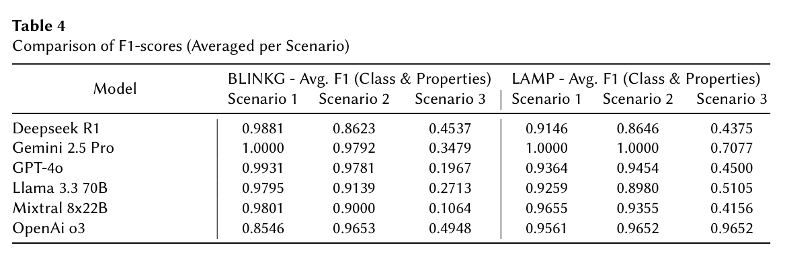

本文为 **2026-10-18 精选阅读回补**，于 2026-10-29 核对公开原文。归档日期不等于首次发表日期；数字为作者报告，本站未独立复现。

表结构到本体的映射，需要同时对齐字段含义、值转换与关系结构。LAMP 用任务拆解、检索、全局上下文与术语细化降低单次提示负担。

## 方法与问题

类与属性映射分阶段处理，并保留跨步骤一致性信息。系统有人工反馈入口，但不能因此认为所有报告成绩都用了人工反馈。本文是对 2026 年 8 月 24 日已发表论文的补读。

## 实验证据

BLINKG 三个复杂度场景中，Table 4 的高抽象场景 3：Gemini 2.5 Pro 平均 F1 从单提示 BLINKG 的 0.3479 到 LAMP 的 0.7077，DeepSeek R1 却从 0.4537 到 0.4375。不同模型搭配不同 embedding，跨模型排名不能归因于拆解本身。Table 3 使用 Gemini 2.5 Flash，未加入用户反馈，高复杂场景属性映射 F1 为 0.4828。

## 我的判断

结构化分解值得研究，但不是自动解决映射的保证。应固定模型与嵌入，分别消融上下文、术语细化和拆解，并对低置信度属性映射进行专家复核。

## 原论文视觉证据

图源：Sulthoni Ashiddiiqi, Fajar J. Ekaputra, Muhammad Zuhri Catur Candra, Gusti Ayu Putri Saptawati Soekidjo，《Reducing Human Effort in Ontology-Based Data Integration: An LLM-Assisted Mapping Pipeline》，CEUR-WS Vol-4245 paper9 publisher PDF，Table 4，PDF 第 12 页。[原图出处](https://ceur-ws.org/Vol-4245/paper9.pdf#page=12) · [CC BY 4.0](https://creativecommons.org/licenses/by/4.0/)。仅裁剪原页面，保留完整图表、图注与标签，未重绘或修改数据，不表示作者认可本解读。该图沿用 CC BY 4.0，本站页脚许可不为其增加非商业或相同方式共享限制。

## 原文与核验范围

- [Reducing Human Effort in Ontology-Based Data Integration: An LLM-Assisted Mapping Pipeline](https://ceur-ws.org/Vol-4245/paper9.pdf) · CEUR-WS Vol-4245 paper9 publisher PDF。
- 版本公开日期：2026-08-24。

本篇深读 1 篇，仅核对上述论文与正文引用条件；不宣称完整覆盖当天候选，也不把其余二手摘要视为已核验实验。
