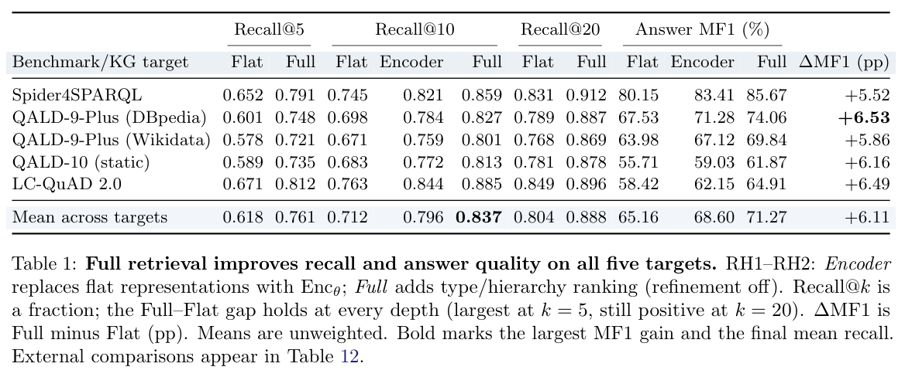

本文为 **2026-10-19 精选阅读回补**，于 2026-10-29 核对公开原文。归档日期不等于首次发表日期；数字为作者报告，本站未独立复现。

自然语言到 SPARQL 的错误可能来自概念绑定、连接或算子作用域，而不只是语法。Reflective Compositional Grounding 将概念组合与查询组合联系起来。

## 方法与问题

固定概念编码器表示复合表达，结合语义相似度、类型兼容与层级距离检索 schema。反思阶段定位参数、连接与作用域偏差，将反馈送回负责步骤，而非总是从头改写。

## 实验证据

五个基准/图谱目标的不加权平均 schema Recall@10 从 0.712 到 0.837，是关闭反思时的检索对照。固定检索结果后，反思提示改写另带来 2.27–3.33 个答案 F1 百分点。两组实验检验不同机制，不能把所有提升都归于反思；Recall@10 也不是最终答案准确率。

## 我的判断

先确保关系进入候选，再检查组合是否保持语义，有助归因。论文的保守改写形式条件比自由提示改写更强，实验收益不证明每次改写都满足条件。仍需查询执行与语义回归检查。

## 原论文视觉证据

图源：Isabelle Mohr , John Dujany , Andre Freitas，《Reflective Compositional Grounding for Natural-Language-to-SPARQL》，2610.21796v1，Table 1，PDF 第 6 页。[原图出处](https://arxiv.org/pdf/2610.21796v1#page=6) · [CC BY 4.0](https://creativecommons.org/licenses/by/4.0/)。仅裁剪原页面，保留完整图表、图注与标签，未重绘或修改数据，不表示作者认可本解读。该图沿用 CC BY 4.0，本站页脚许可不为其增加非商业或相同方式共享限制。

## 原文与核验范围

- [Reflective Compositional Grounding for Natural-Language-to-SPARQL](https://arxiv.org/abs/2610.21796v1) · 2610.21796v1。
- 版本公开日期：2026-10-15。

本篇深读 1 篇，仅核对上述论文与正文引用条件；不宣称完整覆盖当天候选，也不把其余二手摘要视为已核验实验。
