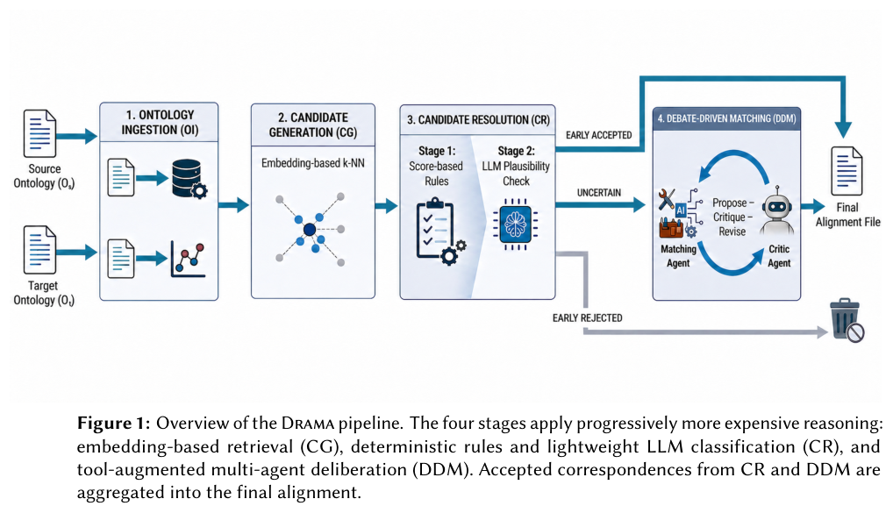
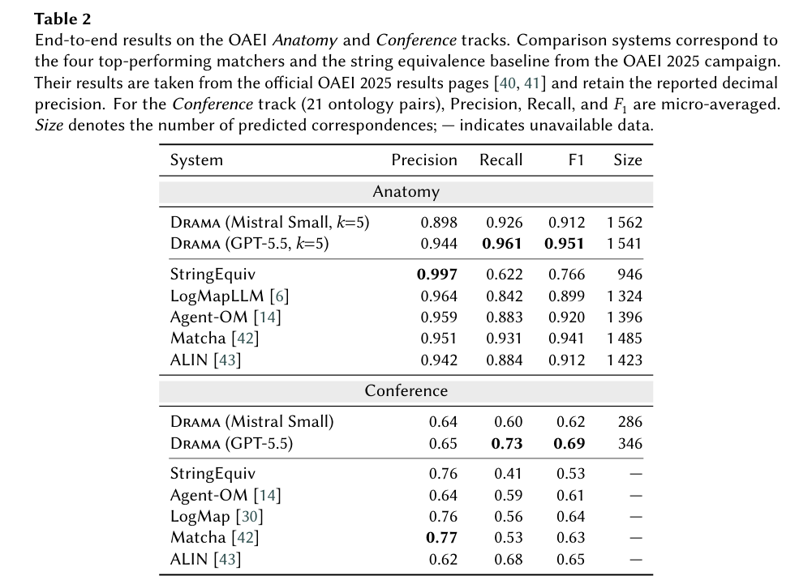
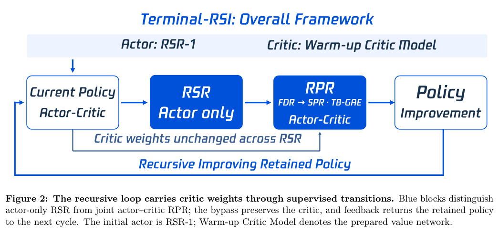
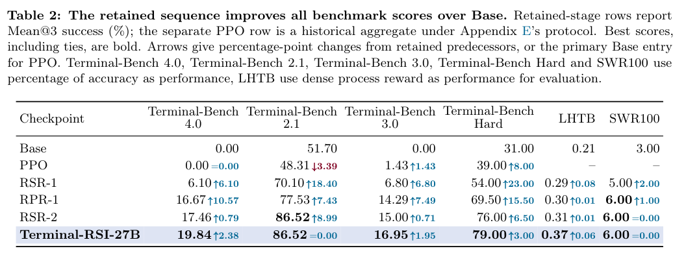

本期关注语义证据怎样约束决策，以及模型如何把知识转化成可执行行为。六项研究分别涉及本体匹配、SPARQL 修复、轻量决策、视觉知识迁移、终端训练和触觉预训练。

## 1. DRAMA：让本体匹配接受有证据的质疑

本体匹配中，名称相近的实体可以先用词法或嵌入筛选，真正含糊的对应则需要检查语义和结构。DRAMA 采用分级流水线：Matching Agent 借助工具提出对应关系，Critic Agent 给出基于证据的异议，再通过辩论迭代修改，把较昂贵的推理留给困难候选。

*图｜Yannick Oefler 等，DRAMA，[Figure 1（PDF 第 5 页）](https://om.ontologymatching.org/2026/papers/om2026-LTpaper2.pdf#page=5)，[CC BY 4.0](https://creativecommons.org/licenses/by/4.0/)。裁剪自原文。*

作者在 OAEI Anatomy 和 Conference 上使用 GPT-5.5，报告 F1 分别为 0.951 和 0.688，优势主要来自召回率，精确率仍落后于部分结构匹配器。消融也提示，底层模型能力对结果的贡献大于 critic 机制本身；因此不能只凭总分就认定多 Agent 辩论是提升的主要原因。

Table 2 同时列出精确率、召回率和 F1：GPT-5.5 配置在 Anatomy 的精确率为 0.944、召回率为 0.961。对照匹配器的数值取自 OAEI 2025 官方结果，并非全部在本次环境下重跑。

*图｜Yannick Oefler 等，DRAMA，[Table 2（PDF 第 8 页）](https://om.ontologymatching.org/2026/papers/om2026-LTpaper2.pdf#page=8)，[CC BY 4.0](https://creativecommons.org/licenses/by/4.0/)。裁剪自原文。*

[DRAMA: Debate-Driven Reasoning Agents for Matching Alignments](https://om.ontologymatching.org/2026/papers/om2026-LTpaper2.pdf) · OM 2026 workshop PDF。

## 2. Reflective Compositional Grounding：定位并修复 SPARQL 语义偏差

自然语言到 SPARQL 的错误可能来自概念绑定、连接或算子作用域，而不只是语法。Reflective Compositional Grounding 将概念组合与查询组合联系起来。

### 方法与问题

固定概念编码器表示复合表达，结合语义相似度、类型兼容与层级距离检索 schema。反思阶段定位参数、连接与作用域偏差，将反馈送回负责步骤，而非总是从头改写。

### 实验证据

五个基准/图谱目标的不加权平均 schema Recall@10 从 0.712 到 0.837，是关闭反思时的检索对照。固定检索结果后，反思提示改写另带来 2.27–3.33 个答案 F1 百分点。两组实验检验不同机制，不能把所有提升都归于反思；Recall@10 也不是最终答案准确率。

### 讨论

先确保关系进入候选，再检查组合是否保持语义，有助归因。论文的保守改写形式条件比自由提示改写更强，实验收益不证明每次改写都满足条件。仍需查询执行与语义回归检查。

图源：Isabelle Mohr , John Dujany , Andre Freitas，《Reflective Compositional Grounding for Natural-Language-to-SPARQL》，2610.21796v1，Table 1，PDF 第 6 页。[原图出处](https://arxiv.org/pdf/2610.21796v1#page=6) · [CC BY 4.0](https://creativecommons.org/licenses/by/4.0/)。裁剪自原文。

- [Reflective Compositional Grounding for Natural-Language-to-SPARQL](https://arxiv.org/abs/2610.21796v1) · 2610.21796v1。
- 版本公开日期：2026-10-15。

## 3. JevAgentHarness：小决策模型何时接管工具选择

许多 Agent 调用大模型，只是为了在几个工具、参数或停止选项中作选择。JevAgentHarness 先用 Agent 自己的轨迹，为每类决策校准置信阈值：足够确定时交给低成本决策模型，否则让大模型处理。配套 AgentDecisionBench 同时测试孤立选择题、记录轨迹和实际运行中的控制，避免把单步答对直接当作整项任务成功。

论文发现，未经阈值校准地委托工具选择，可使任务成功率下降 19.0 个百分点。在接近训练分布的任务上，按实际访问状态训练的 4B 决策模型将费用降低 81.1%–89.0%、最高加速 2.5 倍，成功率损失小于 3 个百分点。这是所测任务、决策位置与校准协议下的结果；更换工具或任务分布后，需要重新检查阈值和错误恢复能力。

[JevAgentHarness: Benchmarking, Deploying and Training Decision Models That Share Control with LLMs](https://arxiv.org/abs/2610.21412v1) · 2610.21412v1。

[Figure 1（原文）](https://arxiv.org/pdf/2610.21412v1#page=1)。

## 4. 图像生成学到的知识，能否用文字回答

统一多模态模型可能会画出某个空间关系，却不能用文字说出它。Knowledge Transfer Probing 为此构造受控知识：只在图像生成训练中提供新事实，再用不带图片的问答检查文字端能否读出。实验覆盖七类知识和三个统一模型，将生成能力与知识的语言可访问性分开测量。

作者观察到直接但不均衡的迁移，并用 Textual Alignment 与图文交错对齐改善跨接口读取；对部分实体提供指导，也能帮助其他实体的问答。这个结果支持视觉监督可以成为知识来源，同时保留了明显的图像—文字访问缺口。它不表示会生成正确图像的模型就已经能稳定回答该图像涉及的所有问题。

[Can Visual Generation Expand What Unified Multimodal Models Know?](https://arxiv.org/abs/2610.21459v1) · 2610.21459v1。

[Figure 1（原文）](https://arxiv.org/pdf/2610.21459v1#page=1)。

## 5. Terminal-RSI：把局部修复推进到严格完成

Terminal-RSI 交替进行 Recursive Self-Rewrite 和 Recursive Policy-Refine：先重写经过验证的成功轨迹，再在继承 critic 的条件下强化训练。TB-GAE 按交互轮次处理信用衰减，奖励设计则区分任务族内的语义进展和严格完成，减少日志长度与局部检查数量对学习信号的干扰。

*图｜Yang, Junyao 等，Terminal-RSI，[Figure 2（PDF 第 3 页）](https://arxiv.org/pdf/2610.22192v1#page=3)，[CC BY 4.0](http://creativecommons.org/licenses/by/4.0/)。裁剪自原文。*

在 Qwen3.8-27B 的两轮交替训练中，作者同时报告多项终端基准结果。LHTB 的过程奖励由 0.21 升至 0.37，但严格完成仍只是从 0/46 到 5/46；这组对照尤其说明，局部进展增加并不等于长任务已可靠解决。轨迹重写、critic 继承和奖励调整共同变化，整体收益不能单独归因于“递归”这一名称。

Table 2 中，Terminal-Bench 4.0 从 RSR-2 的 17.46% 到最终 19.84%，而 2.1 在这两阶段都为 86.52%，并非每个阶段、每个基准都继续上升。表中保留检查点取三次独立评估的算术平均 Mean@3，不是 pass@3；单列 PPO 是另一历史协议的汇总。

*图｜Yang, Junyao 等，Terminal-RSI，[Table 2（PDF 第 7 页）](https://arxiv.org/pdf/2610.22192v1#page=7)，[CC BY 4.0](http://creativecommons.org/licenses/by/4.0/)。裁剪自原文。*

[Terminal-RSI: Recursive Self-Improving Terminal Agents via Recursive Self-Rewrite and Policy-Refine](https://arxiv.org/abs/2610.22192v1) · 2610.22192v1。

## 6. Spark-0：触觉既是输入，也是视觉预训练监督

Spark-0 把触觉放在两个位置：训练时用手套接触图和冻结三维教师监督视觉 token，运行时则可用区域力历史与三维触点状态调节动作专家。同一检查点支持纯视觉或带触觉部署；HumanTouch 的 1,000 小时人类操作数据，与第一视角、机器人和仿真数据共同用于预训练。

在数据和计算量匹配、只丢弃触觉监督的对照中，保留触觉使 Ego Humanoid 的纯视觉成功率从 52.5% 到 71.7%；部署时也使用触觉的 SparkArena-Real 从 44.0% 到 52.0%。两项结果的输入条件不同，不能合成一个通用提升幅度。迁移还依赖传感器与手部布局的空间对齐，以及训练数据对接触类型的覆盖。

[Spark-0: Scaling Spatially Aligned Tactile Pretraining for Robot Dexterous Manipulation](https://arxiv.org/abs/2610.22342v1) · 2610.22342v1。

[Figure 1（原文）](https://arxiv.org/pdf/2610.22342v1#page=1)。
