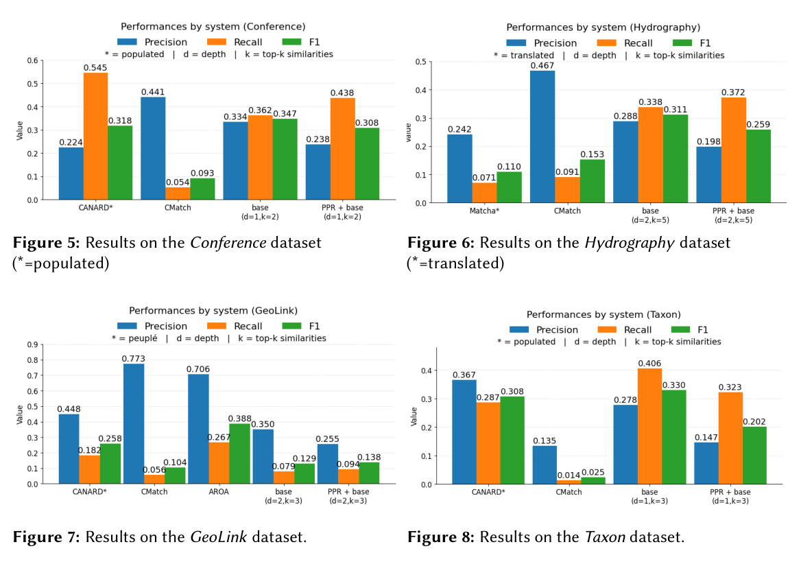

本文为 **2026-10-20 精选阅读回补**，于 2026-10-29 核对公开原文。归档日期不等于首次发表日期；数字为作者报告，本站未独立复现。

复杂本体匹配要识别逻辑表达式之间的对应，而非只计算标签相似度。VERSO 只用 schema，通过 PageRank 模块化与本体文本化缩小输入范围。

## 版本时间边界

本文归档于 10 月 20 日，但本次可核验的是 10 月 29 日获取的 OM 2026 workshop PDF。研讨会日期为 10 月 25 日，首次公开时间尚未独立确认。因此这是后续补读，不能作为论文在 10 月 20 日已公开的证据。

## 方法与实验

Qwen3-14B 推理、Qwen3-Embedding-8B 候选生成，在 OAEI Complex 的 Conference、GeoLink、Hydrography、Taxon 上比较 PageRank/PPR、邻域深度与三种文本化方式。Conference 加 PPR 后召回率 0.362→0.438，精确率 0.334→0.238。仅聚合 Conference、GeoLink、Taxon 时，依赖实例的 CANARD F1 为 0.329，VERSO 最佳配置为 0.293。更少输入前提不代表所有指标更强。

## 我的判断

过长上下文与 Lost in the Middle 是作者解释精度下降的假说，缺少直接因果验证。应按任务选择小而保留 IRI 的上下文，测量额外上下文究竟干扰了哪些对应。

## 原论文视觉证据

图源：Igor Nascimento, Rinaldo Lima, Cassia Trojahn，《Combining PageRank Modularization and Ontology Verbalization for LLM-Based Complex Ontology Matching》，OM 2026 workshop PDF，Figures 5–8，PDF 第 11 页。[原图出处](https://om.ontologymatching.org/2026/papers/om2026-LTpaper6.pdf#page=11) · [CC BY 4.0](https://creativecommons.org/licenses/by/4.0/)。仅裁剪原页面，保留完整图表、图注与标签，未重绘或修改数据，不表示作者认可本解读。该图沿用 CC BY 4.0，本站页脚许可不为其增加非商业或相同方式共享限制。

## 原文与核验范围

- [Combining PageRank Modularization and Ontology Verbalization for LLM-Based Complex Ontology Matching](https://om.ontologymatching.org/2026/papers/om2026-LTpaper6.pdf) · OM 2026 workshop PDF。
- 版本公开日期：未独立确认；仅确认 OM 2026 研讨会于 2026-10-25 举行。

本篇深读 1 篇，仅核对上述论文与正文引用条件；不宣称完整覆盖当天候选，也不把其余二手摘要视为已核验实验。
