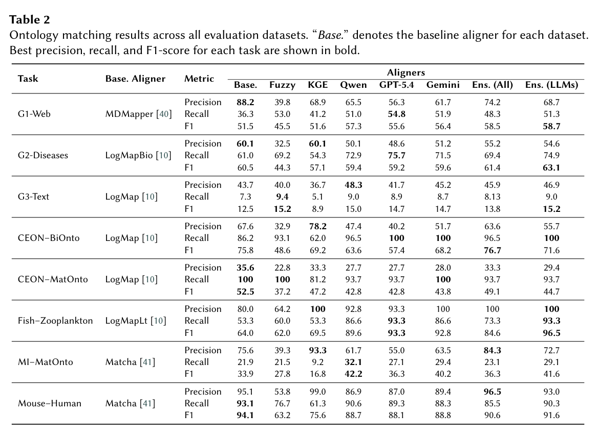
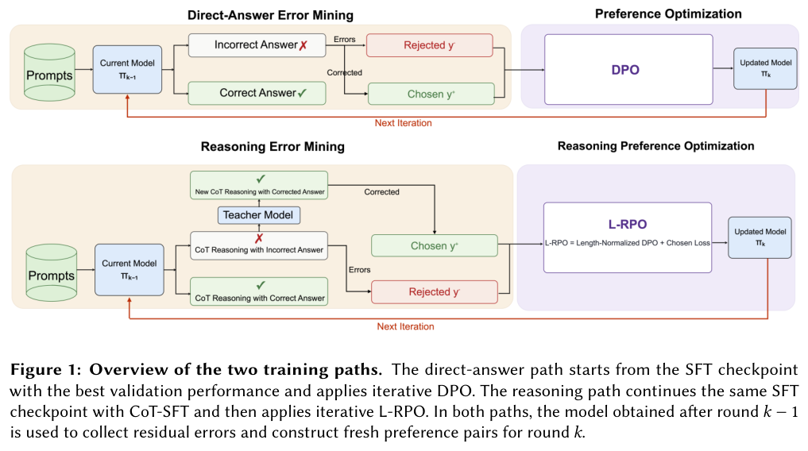
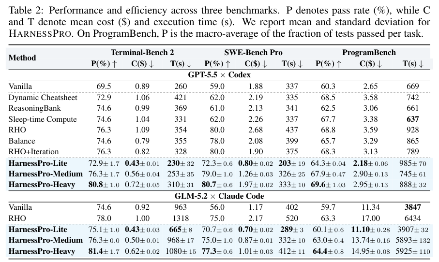
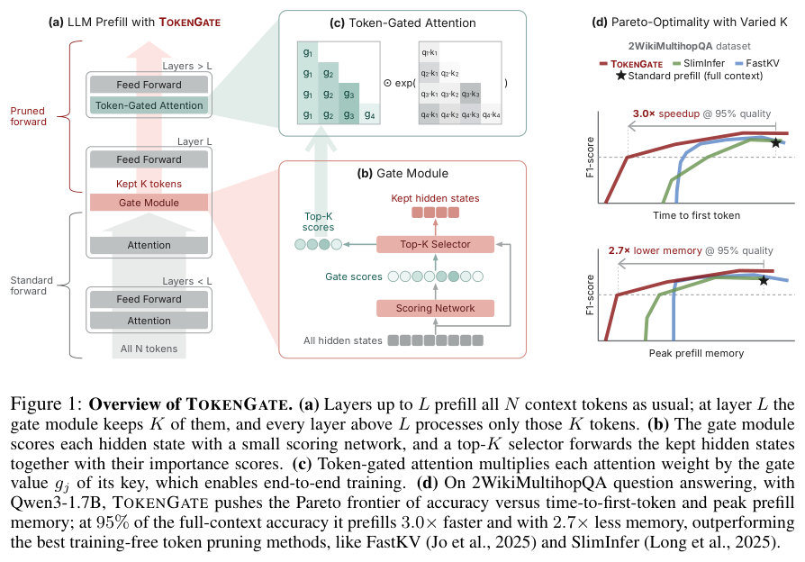

本期从本体对齐和表格实体链接出发，讨论不同模型输出如何组合、错误如何用于训练，再延伸到原生记忆、harness 演化、长输入剪枝和文生图预训练。

## 1. OntoAligner-Ensemble：融合异构本体对齐结果

字符串、图嵌入和 LLM 的错误各有特点。OntoAligner-Ensemble 将输出接入可配置融合与选择流程，研究互补是否实际改善精召平衡。

### 版本时间边界

本文讨论 OM 2026 workshop PDF。研讨会于 2026-10-25 举行，论文首次公开时间尚未确认；10 月 21 日是本篇阅读归档日期。

### 方法与实验

系统支持加权投票、倒数排名融合、Condorcet、Borda，再筛选融合候选。五个 OAEI 赛道八个任务中，Table 2 的 Fish–Zooplankton：LLM 集成 F1 为 96.5，GPT-5.4-Nano 单系统为 93.3；Mouse–Human 的 Matcha 基线 94.1，却高于 LLM 集成 91.6。CEON–MatOnto 也由原基线保持最高 F1。表内 P/R/F1 为百分制，不能称集成总是最好。

### 讨论

应按错误重叠选成员，而非只增加模型数量。部分基线直接取官方 OAEI 报告，并非同环境重跑；讨论成本与效果时要保留来源差异。软件 Apache 2.0 不等于论文截图许可，配图使用论文明确的 CC BY 4.0。

图源：Hamed Babaei Giglou, Sören Auer, Peio Popov, Mahsa Sanaei, Jennifer D’Souza，《OntoAligner-Ensemble: Voting-Based Fusion across Heterogeneous Ontology Alignment Techniques》，OM 2026 workshop PDF，Table 2，PDF 第 8 页。[原图出处](https://om.ontologymatching.org/2026/papers/om2026-LTpaper8.pdf#page=8) · [CC BY 4.0](https://creativecommons.org/licenses/by/4.0/)。裁剪自原文。

- [OntoAligner-Ensemble: Voting-Based Fusion across Heterogeneous Ontology Alignment Techniques](https://om.ontologymatching.org/2026/papers/om2026-LTpaper8.pdf) · OM 2026 workshop PDF。
- 版本公开日期：未独立确认；仅确认 OM 2026 研讨会于 2026-10-25 举行。

## 2. TELLER：用残余错误刷新表格实体链接偏好

TELLER 先检索和排序 Wikidata 候选，再保留精简表格证据，让模型为短而含糊的单元格选择实体。直接回答路线迭代更新偏好数据，专门收集新模型仍犯的错误；推理路线先用过滤、压缩的推理做 SFT，再进行带长度归一化与正则的偏好优化。

*图｜Kehao Li 等，TELLER，[Figure 1（PDF 第 7 页）](https://om.ontologymatching.org/2026/papers/om2026-LTpaper1.pdf#page=7)，[CC BY 4.0](https://creativecommons.org/licenses/by/4.0/)。裁剪自原文。*

TableInstruct 上直接路线准确率从 94.35% 到 94.50%，推理路线从 92.90% 到 92.95%；MammoTab V2 上改善相对更明显。这些较小差值不应包装成普遍显著进步，两条路线的起点也不同。候选检索和精简上下文仍决定了模型能看到哪些正确证据。

[TELLER: Dual-Path Iterative Preference Optimization for Table Entity Linking](https://om.ontologymatching.org/2026/papers/om2026-LTpaper1.pdf) · OM 2026 workshop PDF。

## 3. MemT-1.0：把记忆更新放进模型计算

MemT-1.0 用 Gated DeltaNet-2 的 token 级稳定更新和 Mixture-of-Storage 扩展原生记忆容量，再通过继续预训练与后训练学习保存和使用历史。它提供 Nano 与 Flash 模型，并分别检查记忆任务、通用能力和吸收程序经验后的 Agent 表现。

128K 历史下，Nano 相对完整上下文 KV 缓存报告约 1.86 倍端到端推理速度、66 倍持久存储压缩。这是两个不同成本口径，不能当作相同比例的总费用节省；有限记忆是否保住特定长尾事实，还需按检索粒度和下游任务检查。

[MemT-1.0: Towards Memory-Native Evolution](https://arxiv.org/abs/2610.26825v1) · 2610.26825v1。

[Figure 1（原文）](https://arxiv.org/pdf/2610.26825v1#page=1)。

## 4. HarnessPro：为性能与成本保留多种演化结果

HarnessPro 不使用官方答案或测试来选择候选，而由 LLM 生成测试，针对执行轨迹诊断并提出不同性能—费用偏好的修改。它不只返回一个 harness，而按归一化加权距离选出 lite、medium、heavy，供不同预算使用，再将选中者带入下一轮。

*图｜Pan, Zhuoshi 等，HarnessPro，[Table 2（PDF 第 8 页）](https://arxiv.org/pdf/2610.26770v1#page=8)，[CC BY 4.0](http://creativecommons.org/licenses/by/4.0/)。裁剪自原文。*

Terminal、SWE 和程序复现任务的实验显示，与 RHO 等对照相比可同时改善部分性能与费用。label-free 指候选演化不读官方标签，不等于生成测试不会偏离真实需求；部署档位的选择也应在独立留出任务上检查，而不能只看演化集上的 Pareto 位置。

[HarnessPro: Recursive Harness Self-Improvement with Pareto Optimization for Performance-Cost Trade-offs](https://arxiv.org/abs/2610.26770v1) · 2610.26770v1。

## 5. TokenGate：训练模型在 prefill 中跳过较不重要的 token

TokenGate 用小组件为长输入学习重要性评分，通过 token-gated attention 调整注意力 logits，绕开 Top-K 离散选择难以端到端学习的问题。模型逐层剪去不需要继续深入处理的 token，并能适配标准 Transformer 和混合注意力骨干。

*图｜Patel, Liana 等，TokenGate，[Figure 1（PDF 第 2 页）](https://arxiv.org/pdf/2610.26754v1#page=2)，[CC BY 4.0](http://creativecommons.org/licenses/by/4.0/)。裁剪自原文。*

论文分别报告首 token 时间和峰值内存收益，适配开销类似轻量参数高效微调。它不是无需训练的固定裁剪规则；“所测任务无准确率下降”也不意味着任意关键 token 都不会被删掉，长文检索、跨段依赖和输入分布变化仍需要单独测试。

[TokenGate: Adapting LLMs for Fast and Memory-Efficient Prefill with Learned Token Pruning](https://arxiv.org/abs/2610.26754v1) · 2610.26754v1。

## 6. Halcyon：文生图是否必须先做大规模语言预训练

Halcyon 从零在 1 亿图文对的 GPIC 上训练早期融合多模态自回归模型，直接研究文生图是否需要先经过互联网规模的纯文本预训练。受控实验没有发现该前置阶段能改善文生图，并尝试在相同预算内加入图像描述监督。

与既有生成器的比较显示较好的生成质量—预训练计算折中。但这里不使用纯语言预训练，仍使用大量带文字的图像配对，不能称为没有语言监督；结论也针对图像生成，而非模型所有文字理解和开放问答能力。

[Text-to-Image Generative Modeling Without Language Pretraining](https://arxiv.org/abs/2610.26863v1) · 2610.26863v1。

[Figure 1（原文）](https://arxiv.org/pdf/2610.26863v1#page=1)。
