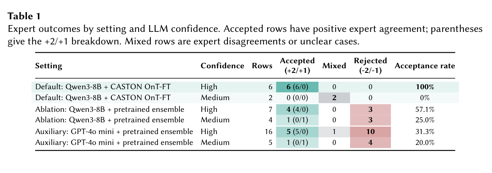

本文为 **2026-10-22 精选阅读回补**，于 2026-10-29 核对公开原文。归档日期不等于首次发表日期；数字为作者报告，本站未独立复现。

CASTON 案例先以嵌入筛选可疑公理和替换候选，再由 LLM 给出修复及置信度，最后交领域专家判断。

## 方法与问题

默认组合为 CASTON 微调的 OnT 嵌入与 Qwen3-8B，避免一次将完整本体交给大模型。两位专家独立评分，双方均给正分才算接受；意见不一致或不明确归入 mixed。

## 实验证据

默认设置六条高置信度替换全部获两位专家接受，两条中置信度建议则均为 mixed。改用预训练嵌入集合，同一 Qwen3-8B 的七条高置信度建议只有四条接受。100% 的分母仅六，不能称通用修复准确率，也不能推断已覆盖所有本体错误。

## 我的判断

它更像专家工作台原型。应扩大随机抽样，记录候选生成漏掉的错误，并检查修复是否引入新冲突。优先级排序能否节省审核时间仍需测量，本文不编造工时收益。

## 原论文视觉证据

图源：Hui Yang , Ziyu Li , Xuan Liu , Anders Jarfors , He Tan , Jiaoyan Chen，《Ontology Refinement with Embeddings and LLMs: A Case Study on CASTON》，2610.21466v1，Table 1，PDF 第 4 页。[原图出处](https://arxiv.org/pdf/2610.21466v1#page=4) · [CC BY 4.0](https://creativecommons.org/licenses/by/4.0/)。仅裁剪原页面，保留完整图表、图注与标签，未重绘或修改数据，不表示作者认可本解读。该图沿用 CC BY 4.0，本站页脚许可不为其增加非商业或相同方式共享限制。

## 原文与核验范围

- [Ontology Refinement with Embeddings and LLMs: A Case Study on CASTON](https://arxiv.org/abs/2610.21466v1) · 2610.21466v1。
- 版本公开日期：2026-10-15。

本篇深读 1 篇，仅核对上述论文与正文引用条件；不宣称完整覆盖当天候选，也不把其余二手摘要视为已核验实验。
