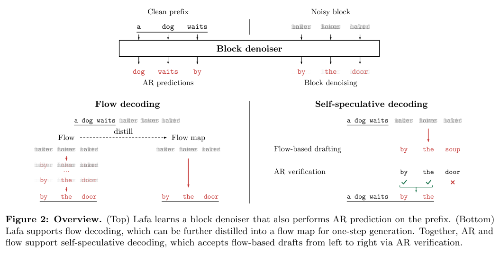
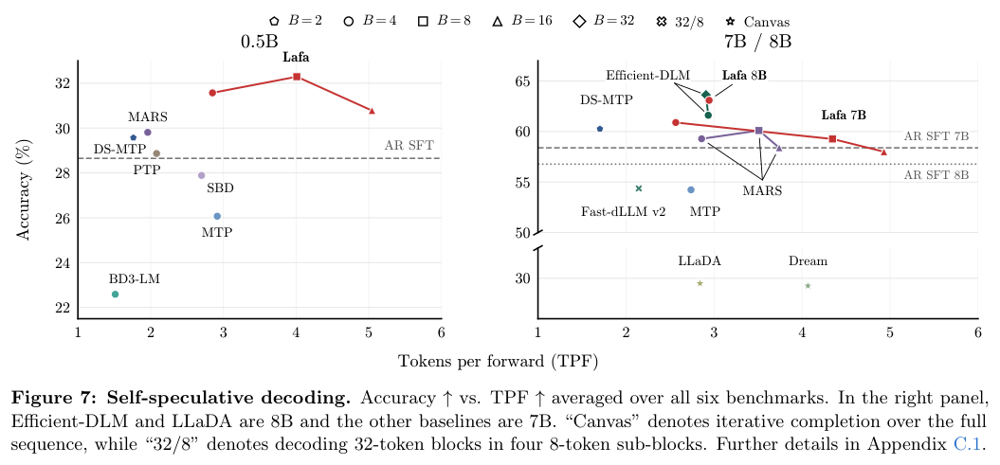
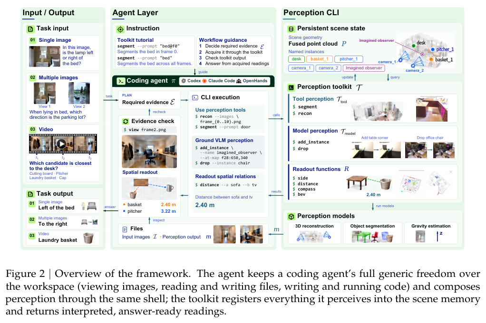
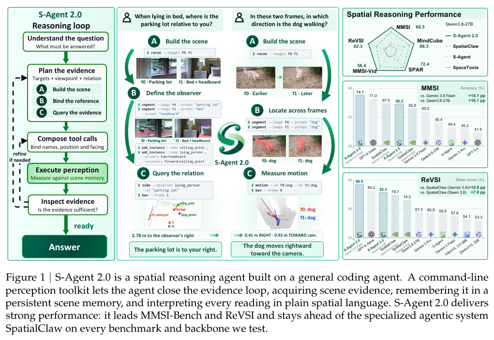
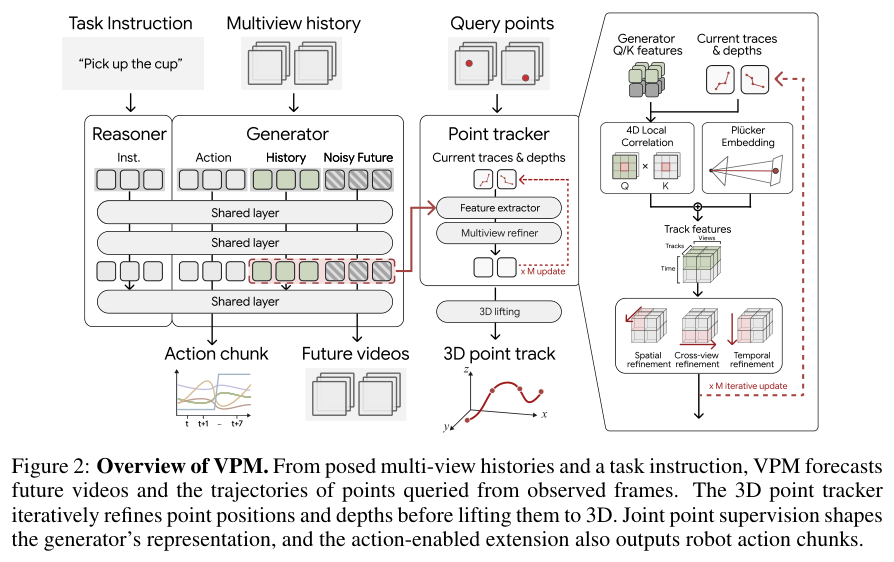

经验能否被复用，取决于适用条件和当前证据是否清楚。本期介绍本体修复与神经符号 Agent，并观察连续流语言模型、空间工具、人形动作追踪和多视角预测。

## 1. CASTON：用嵌入筛选与专家评审维护本体

CASTON 案例先以嵌入筛选可疑公理和替换候选，再由 LLM 给出修复及置信度，最后交领域专家判断。

### 方法与问题

默认组合为 CASTON 微调的 OnT 嵌入与 Qwen3-8B，避免一次将完整本体交给大模型。两位专家独立评分，双方均给正分才算接受；意见不一致或不明确归入 mixed。

### 实验证据

默认设置六条高置信度替换全部获两位专家接受，两条中置信度建议则均为 mixed。改用预训练嵌入集合，同一 Qwen3-8B 的七条高置信度建议只有四条接受。100% 的分母仅六，不能称通用修复准确率，也不能推断已覆盖所有本体错误。

### 讨论

它更像专家工作台原型。应扩大随机抽样，记录候选生成漏掉的错误，并检查修复是否引入新冲突。优先级排序能否节省审核时间仍需测量，本文不编造工时收益。

图源：Hui Yang , Ziyu Li , Xuan Liu , Anders Jarfors , He Tan , Jiaoyan Chen，《Ontology Refinement with Embeddings and LLMs: A Case Study on CASTON》，2610.21466v1，Table 1，PDF 第 4 页。[原图出处](https://arxiv.org/pdf/2610.21466v1#page=4) · [CC BY 4.0](https://creativecommons.org/licenses/by/4.0/)。裁剪自原文。

- [Ontology Refinement with Embeddings and LLMs: A Case Study on CASTON](https://arxiv.org/abs/2610.21466v1) · 2610.21466v1。
- 版本公开日期：2026-10-15。

## 2. OntoAct：把经验变成带适用条件的公理

OntoAct 将个别经历抽象为实体类型、关系与条件上的公理，用于生成下一情景的假说和动作。符号 verifier 根据当前观测检查支持条件，指出缺少哪些证据；新的观察和干预结果再更新假说，形成经验复用与现场验证的交替过程。

论文还提出 Tacit-FLE，用分散运行记录诊断 Factorio 工厂的隐藏故障，允许一次修复仍失败，迫使 Agent 重新判断。Tacit-FLE、Mars、ALFWorld 的结果支持这种组合，但公理来自经验归纳，仍可能过度概括；执行前验证只对已编码条件与可用观测负责。

[OntoAct: Hypothesis-Based Neuro-Symbolic Agents through Ontological Abstraction](https://arxiv.org/abs/2610.21983v1) · 2610.21983v1。

[Figure 1（原文）](https://arxiv.org/pdf/2610.21983v1#page=1)。

## 3. Lafa：块内连续流，块间因果前缀

Lafa 在语言生成中结合因果前缀注意力和块内双向异步连续 flow，从已训自回归模型适配到最多 8B 参数。前缀缓存与分块并行降低推理成本，flow 还可蒸馏为一步或少步映射，兼顾训练效率与并行解码。

*图｜Chavan, Arnav 等，Lafa，[Figure 2（PDF 第 2 页）](https://arxiv.org/pdf/2610.28559v1#page=2)，[CC BY 4.0](http://creativecommons.org/licenses/by/4.0/)。裁剪自原文。*

论文进一步在同一模型内用 flow 草稿、自回归验证实现自推测解码，报告可比质量下的吞吐收益。这一结果同时涉及块大小、缓存、草稿与验证，不能等同于一步生成天然优于自回归；不同训练 token 预算和任务也需要匹配比较。

*图｜Chavan, Arnav 等，Lafa，[Figure 7（PDF 第 8 页）](https://arxiv.org/pdf/2610.28559v1#page=8)，[CC BY 4.0](http://creativecommons.org/licenses/by/4.0/)。裁剪自原文。*

[Large Flow Language Models](https://arxiv.org/abs/2610.28559v1) · 2610.28559v1。

## 4. S-Agent 2.0：让三维读数变成可用的空间证据

S-Agent 2.0 为通用 coding Agent 提供命令行感知工具，围绕获取场景证据、写入持久场景记忆、用明确空间语言解释读数组织接口。它针对的是工具已经读对几何、模型却未据此答对的接口缺口，而非单纯增加更多感知调用。

*图｜Gong, Rui 等，S-Agent 2.0，[Figure 2（PDF 第 5 页）](https://arxiv.org/pdf/2610.28354v1#page=5)，[CC BY 4.0](http://creativecommons.org/licenses/by/4.0/)。裁剪自原文。*

MMSI-Bench 与 ReVSI 上，同骨干对照显示工具和证据组织带来收益，并可跨 Codex、Claude Code 等 harness 使用。几何来源约束了结论依据，但感知误差、坐标系和状态过期仍可能传递；bench 分数不是任意真实空间任务的可靠性保证。

*图｜Gong, Rui 等，S-Agent 2.0，[Figure 1（PDF 第 1 页）](https://arxiv.org/pdf/2610.28354v1#page=1)，[CC BY 4.0](http://creativecommons.org/licenses/by/4.0/)。裁剪自原文。*

[S-Agent 2.0: Spatial Reasoning with a General Coding Agent](https://arxiv.org/abs/2610.28354v1) · 2610.28354v1。

## 5. SuperMimic：共享可微世界模型摊薄动作追踪学习

SuperMimic 从刚体模拟器记录的转移拟合一个共享可微世界模型，与动作追踪策略共同训练。短想象 rollout 的时间反向传播直接提供策略梯度，避免为每个动作训练专家后再蒸馏，或完全依赖大量无模型采样。

作者在大规模动作库中比较回报、失败数和 GPU 小时，并展示 Unitree G1 的实机迁移。计算优势来自仿真数据、可微预测和训练路线的组合；模拟动作追踪失败少，不等于任意地面、接触或外部干扰下的全身控制都已验证。

[SuperMimic: Scaling Humanoid Whole-Body Control with One Differentiable World Model](https://arxiv.org/abs/2610.28480v1) · 2610.28480v1。

[Figure 1（原文）](https://arxiv.org/pdf/2610.28480v1#page=1)。

## 6. VPM：用持续三维点轨迹约束多视角未来

Video-Point Model 同时预测多视角未来视频和持久场景点的三维轨迹。一个点在所有相机中保持相同身份，使不同视角的外观变化共享同一运动描述；语言和相机条件共同控制预测，动作也可作为额外 token 与视频联合去噪。

*图｜Jeon, Byungwoo 等，VPM，[Figure 2（PDF 第 4 页）](https://arxiv.org/pdf/2610.28594v1#page=4)，[CC BY 4.0](http://creativecommons.org/licenses/by/4.0/)。裁剪自原文。*

论文提供同步多视角与点轨迹仿真数据，以及跨仿真和真实场景的 VP-WorldBench，比较仅视频监督和加入点监督的模型。视频保真、三维运动误差与机器人成功率是三类指标；点监督改善几何一致性，但不等于恢复了完整、精确的真实动力学。

[Learning the 4D World through Point Trajectory Forecasting](https://arxiv.org/abs/2610.28594v1) · 2610.28594v1。
