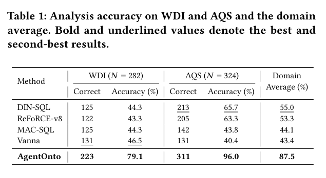

数据库 schema 未必能解释业务指标、分析前提或哪些请求不成立。AgentOnto 将数据库、业务文档和示例任务组织为显式本体，让分析过程使用并更新业务知识。

## 方法与问题

流程包括本体构建、指导分析、吸收已确认反馈，以及用自生成分析任务改善本体的准备阶段。评价要求分析判断正确；需要执行时，返回结果也必须正确，不能只看 SQL 能否运行。

## 实验证据

WDI 的 282 个请求中正确处理 223 个，为 79.1%；AQS 的 324 个请求中正确处理 311 个，为 96.0%。两领域准确率的宏平均为 87.5%，DIN-SQL 为 55.0%。宏平均不是把 606 个请求合并计算的微平均，更不是任意企业任务成功率。

## 我的判断

显式业务层可以保留反馈确认与修订影响，但迁移仍依赖文档质量、指标歧义和更新权限。本文按 2026 年 arXiv 预印本讨论：PDF 的 KDD 2027 模板与未填 DOI 不能证明会议录用。

## 原论文视觉证据

图源：Dayan Pan , Bincheng Zuo , Xiaojian Wang , Daogang Zhang , Jingyuan Wang，《AgentOnto: Ontology-Guided LLM Agents for Enterprise Data Analytics》，2610.23317v1，Table 1，PDF 第 6 页。[原图出处](https://arxiv.org/pdf/2610.23317v1#page=6) · [CC BY 4.0](https://creativecommons.org/licenses/by/4.0/)。裁剪自原文。

## 论文来源

- [AgentOnto: Ontology-Guided LLM Agents for Enterprise Data Analytics](https://arxiv.org/abs/2610.23317v1) · 2610.23317v1。
- 版本公开日期：2026-10-16。
