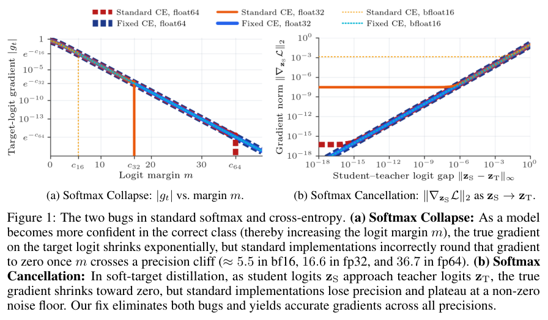
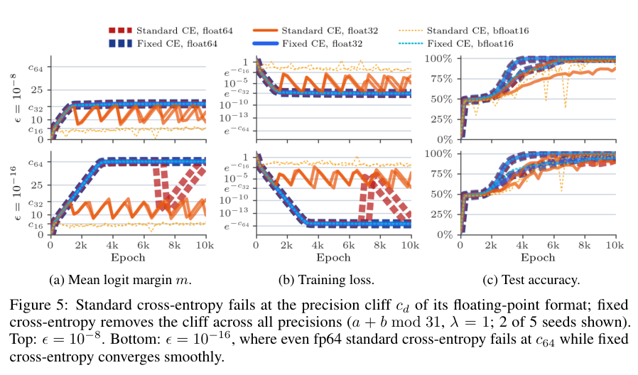
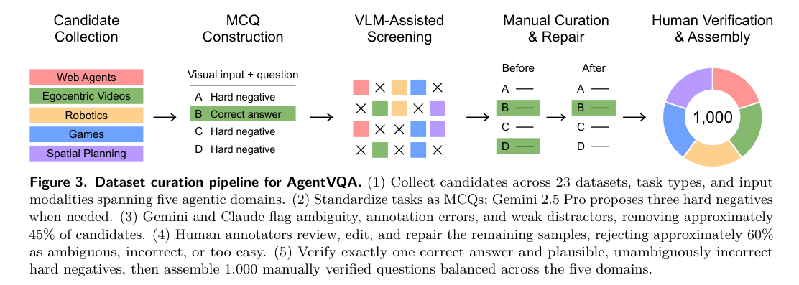
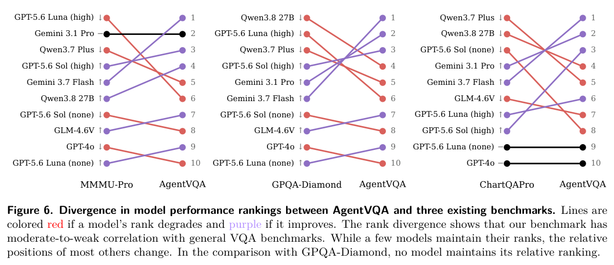

压缩、变换和结构化都可能改变模型能读取的证据。本期从原始历史检索和临床概念表示，延伸到数值梯度、视觉状态评测、序列压缩及跨 harness 训练。

## 1. MEDIATOR：不同医院的代码，映射到同一离散临床表示

MEDIATOR 将代码、地方标识、同义词和自由文本形式的临床概念映射到共享向量量化码本，用同义监督、丰富描述、共现和关系图塑造空间。这样，EHR Transformer 不必把不同词表中的等价概念当作无关 token，也不要求逐院手工映射完整固定词表。

论文在 MIMIC-III 与向 eICU 的零样本迁移上比较平均 AUPRC，并以相同输入对照拆分覆盖率和表示贡献。跨院收益有一部分来自能利用更多事件，不能全归因于编码质量；这些回顾性预测基准也不构成临床诊疗部署有效性证据。

[Discrete Neural Interlingua for Ontology-Agnostic EHR Modeling](https://arxiv.org/abs/2610.27047v1) · 2610.27047v1。

[Figure 1（原文）](https://arxiv.org/pdf/2610.27047v1#page=2)。

## 2. Softmax 与交叉熵：数值梯度也会偏离数学目标

A Fix for Softmax and Cross-Entropy 分析两类数值实现问题：目标 logit 很大时梯度被舍入为零，破坏梯度和为零的性质；师生 logits 接近时出现抵消误差，甚至相等时仍产生非零梯度。论文给出修正的 softmax、log-softmax 和交叉熵实现。

*图｜Barron, Jonathan T. 等，Softmax 与交叉熵，[Figure 1（PDF 第 1 页）](https://arxiv.org/pdf/2610.31642v1#page=1)，[CC BY 4.0](http://creativecommons.org/licenses/by/4.0/)。裁剪自原文。*

作者用 grokking、权重衰减和蒸馏实验检查这些问题如何影响训练，并重新分析部分已观察到的训练现象。这里修复的是有限精度运算中的实现误差，不是否定 softmax 数学定义；采用时应匹配数值精度、kernel 和梯度路径复核。

*图｜Barron, Jonathan T. 等，Softmax 与交叉熵，[Figure 5（PDF 第 7 页）](https://arxiv.org/pdf/2610.31642v1#page=7)，[CC BY 4.0](http://creativecommons.org/licenses/by/4.0/)。裁剪自原文。*

[A Fix for Softmax and Cross-Entropy](https://arxiv.org/abs/2610.31642v1) · 2610.31642v1。

## 3. Raw-RAG：检索原始历史作为记忆基线

复杂记忆系统需要先回答一个基线问题：直接检索原始历史能做到什么？Raw-RAG 对未经记忆变换的历史做稠密检索与重排序，再交给读取模型回答。

### 方法与问题

论文比较 LoCoMo、LongMemEval、MEME 与 MemoryAgentBench，区分必要证据覆盖率与读取模型利用率。需要保留的不只是答案值，还包括关系与推导路径。

### 实验证据

七个基准—模型设置中，Raw-RAG 在所比较记忆系统里六个排名第一，领先最强对比 Agent 记忆系统 0.13–5.53 分。范围限于论文系统与配置，不等于每个子任务都领先。Table 3 的 LongMemEval 总体准确率为 87.53，Memora 为 87.40，差距仅 0.13 分，本文不宣称统计显著。Figure 1 的左图使用分区截断线性刻度，柱形视觉长度不宜直接跨区比较。

### 讨论

应先保留原历史追溯层，再证明摘要、更新与结构化的收益。即使完整访问变换后记忆仍有差距，提示压缩可能丢失关系链；这不证明复杂记忆永远无用，实时更新、删除要求与成本仍需单独评估。

图源：Zhengye Bao , Shengtao Zhang , Haokai Zhang , Shiqi Lou , Muning Wen , Minnan Luo，《Is Complex Agentic Memory Always Needed? Naive RAG Is Stronger Than We Thought》，2610.30755v1，Figure 1，PDF 第 1 页。[原图出处](https://arxiv.org/pdf/2610.30755v1#page=1) · [CC BY 4.0](https://creativecommons.org/licenses/by/4.0/)。裁剪自原文。

- [Is Complex Agentic Memory Always Needed? Naive RAG Is Stronger Than We Thought](https://arxiv.org/abs/2610.30755v1) · 2610.30755v1。
- 版本公开日期：2026-10-22。

## 4. AgentVQA：用离线问题诊断交互视觉状态理解

AgentVQA 从 23 个来源数据集中人工选择 1,000 个困难实例，覆盖网页、机器人、第一视角视频、游戏和空间规划，形成可快速比较的离线 VQA。它保留交互情景中的视觉信息，作为昂贵在线运行的补充，观察排名是否与对应在线测试一致。

*图｜Gupta, Advait 等，AgentVQA，[Figure 3（PDF 第 4 页）](https://arxiv.org/pdf/2610.31494v1#page=4)，[CC BY 4.0](http://creativecommons.org/licenses/by/4.0/)。裁剪自原文。*

22 个模型中最高准确率为 58.5%；分析将许多错误定位到 UI 元素、运动、状态变化和三维关系的表示。离线答题不需要承担真实动作后果，也不测错误恢复全流程，因此排名相关性不能替代端到端 Agent 评测。

*图｜Gupta, Advait 等，AgentVQA，[Figure 6（PDF 第 7 页）](https://arxiv.org/pdf/2610.31494v1#page=7)，[CC BY 4.0](http://creativecommons.org/licenses/by/4.0/)。裁剪自原文。*

[AgentVQA: A Unified Benchmark for Agentic Visual Understanding](https://arxiv.org/abs/2610.31494v1) · 2610.31494v1。

## 5. TTR-Compressor：把压缩表示写成一次回归解

TTR-Compressor 把输入 token 组成回归问题，以前向中闭式求得的系数作为压缩表示；回归问题本身通过端到端反向传播学习。它提供池化、固定投影之外的压缩原语，不需要在每次测试时运行昂贵的多步优化。

论文将它用作分块稀疏注意力的块压缩器和多模态视觉 token merger，分别检查 RULER 与视觉理解表现。视觉配置中可用更少 token 匹配标准 MLP merger，但压缩比和任务质量需要一起看，不能从某项配置推断所有序列都能等比例压缩。

[Rethinking Sequence Compression with Test-time Regression](https://arxiv.org/abs/2610.31574v1) · 2610.31574v1。

[Figure 1（原文）](https://arxiv.org/pdf/2610.31574v1#page=1)。

## 6. Harness Scaling：训练时也变化执行框架

Harness Scaling 将运行框架拆成因子空间，选取覆盖均衡的小型配置子集，并为同一任务安排受控变化。目标是让模型在 RL 中学会适应工具、上下文和执行组织，而不是只针对一个固定 harness 的习惯优化。

多模型规模、算法与 benchmark 的实验支持向未见白盒配置及外部黑盒 harness 迁移。价值不只是增加配置数量，而是怎样组织变化；测试仍限于所选框架和任务，不能把跨 harness 泛化直接等同于跨领域、跨权限边界的可靠性。

[Harness Scaling for Generalizable Agentic Reinforcement Learning](https://arxiv.org/abs/2610.29458v1) · 2610.29458v1。

[Figure 1（原文）](https://arxiv.org/pdf/2610.29458v1#page=3)。
