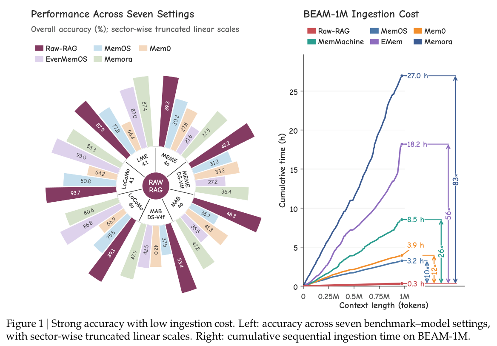

本文为 **2026-10-24 精选阅读回补**，于 2026-10-29 核对公开原文。归档日期不等于首次发表日期；数字为作者报告，本站未独立复现。

复杂记忆系统需要先回答一个基线问题：直接检索原始历史能做到什么？Raw-RAG 对未经记忆变换的历史做稠密检索与重排序，再交给读取模型回答。

## 方法与问题

论文比较 LoCoMo、LongMemEval、MEME 与 MemoryAgentBench，区分必要证据覆盖率与读取模型利用率。需要保留的不只是答案值，还包括关系与推导路径。

## 实验证据

七个基准—模型设置中，Raw-RAG 在所比较记忆系统里六个排名第一，领先最强对比 Agent 记忆系统 0.13–5.53 分。范围限于论文系统与配置，不等于每个子任务都领先。Table 3 的 LongMemEval 总体准确率为 87.53，Memora 为 87.40，差距仅 0.13 分，本文不宣称统计显著。Figure 1 的左图使用分区截断线性刻度，柱形视觉长度不宜直接跨区比较。

## 我的判断

应先保留原历史追溯层，再证明摘要、更新与结构化的收益。即使完整访问变换后记忆仍有差距，提示压缩可能丢失关系链；这不证明复杂记忆永远无用，实时更新、删除要求与成本仍需单独评估。

## 原论文视觉证据

图源：Zhengye Bao , Shengtao Zhang , Haokai Zhang , Shiqi Lou , Muning Wen , Minnan Luo，《Is Complex Agentic Memory Always Needed? Naive RAG Is Stronger Than We Thought》，2610.30755v1，Figure 1，PDF 第 1 页。[原图出处](https://arxiv.org/pdf/2610.30755v1#page=1) · [CC BY 4.0](https://creativecommons.org/licenses/by/4.0/)。裁剪自原文。

## 原文与核验范围

- [Is Complex Agentic Memory Always Needed? Naive RAG Is Stronger Than We Thought](https://arxiv.org/abs/2610.30755v1) · 2610.30755v1。
- 版本公开日期：2026-10-22。

本篇深读 1 篇，仅核对上述论文与正文引用条件；不宣称完整覆盖当天候选，也不把其余二手摘要视为已核验实验。
