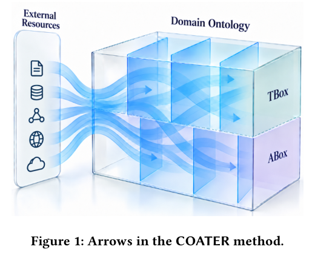

本文为 **2026-10-25 精选阅读回补**，于 2026-10-29 核对公开原文。归档日期不等于首次发表日期；数字为作者报告，本站未独立复现。

外部世界持续变化，本体维护需要有范围和证据。COATER 将局部本体与外部资源之间的审查封装成可执行组件，称为 arrow。

## 方法与问题

每个 arrow 定义范围、资源与检查方式，产生支持或挑战公理的证据，再由人或 Agent 辅助分流。案例针对软件语言工程 FSL 本体，按公理汇总覆盖，涉及语言、概念化与软件工程活动。

## 实验证据

一个 LLM 辅助 Wikipedia 链接练习，将符合既定链接政策的实体从 600 个中的 405 个增加到 600 个。这只表示该链接规范达标，不是整体本体准确率达到 100%，也不是完备率。其他外部资源提出的挑战仍需领域判断，不能自动当成本体错误。

## 我的判断

维护应能说明为什么建议修改，以及尚未覆盖什么。应给 arrow 版本化，记录资源时间、失效链接和人工裁决，避免把外部来源偏差直接当作权威。原文作者名为 Ralf Lämmel。

## 原论文视觉证据

图源：Ralf Lämmel，《Continuous Ontology Assurance through External Resources -- An Ontology Engineering Method with a Case Study in Software Language Engineering》，2610.24322v1，Figure 1，PDF 第 1 页。[原图出处](https://arxiv.org/pdf/2610.24322v1#page=1) · [CC BY 4.0](https://creativecommons.org/licenses/by/4.0/)。裁剪自原文。

## 原文与核验范围

- [Continuous Ontology Assurance through External Resources -- An Ontology Engineering Method with a Case Study in Software Language Engineering](https://arxiv.org/abs/2610.24322v1) · 2610.24322v1。
- 版本公开日期：2026-10-16。

本篇深读 1 篇，仅核对上述论文与正文引用条件；不宣称完整覆盖当天候选，也不把其余二手摘要视为已核验实验。
