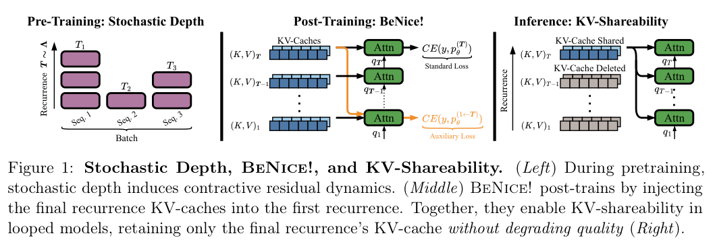
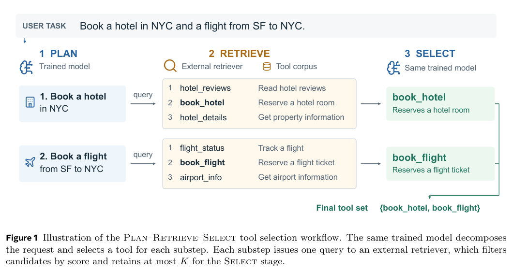
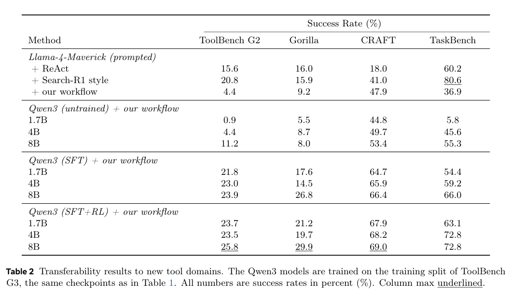
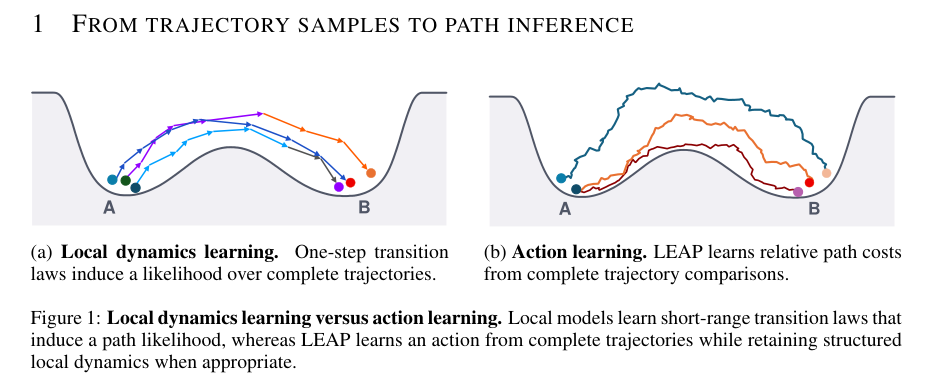

本期讨论如何把外部证据变成检查、如何约束生成结构与研究行为，以及如何复用模型计算。工具选择、人形接触规划和轨迹作用量学习提供了不同的行动接口。

## 1. LettRAGraph：保守集成文本抽取的本体三元组

LettRAGraph 用开放权重 LLM 从文本构造本体图，将结构化提示、谓词规范化和结构过滤组合起来。提示消融检查显式 taxonomy 规则和封闭世界约束的作用，保守集成则只保留两个提示配置共同生成的三元组，减少对单次生成的依赖。

官方测试集的 Graph Similarity 在精确、模糊、语义匹配下分别为 0.3584、0.4872、0.5162。这三种宽松程度不同的图相似分数不是事实正确率，也不能混成一个准确率；取交集的策略还需要同时检查是否丢掉只被一条路径正确抽出的关系。

[LettRAGraph at LLMs4OL 2026 Task Flagship: Prompt-Guided Ontology Extraction with Ensembling](https://www.eurecom.org/en/publication/8938) · LLMs4OL 2026 论文，EURECOM 出版记录。

## 2. COATER：以外部资源支持持续本体维护

外部世界持续变化，本体维护需要有范围和证据。COATER 将局部本体与外部资源之间的审查封装成可执行组件，称为 arrow。

### 方法与问题

每个 arrow 定义范围、资源与检查方式，产生支持或挑战公理的证据，再由人或 Agent 辅助分流。案例针对软件语言工程 FSL 本体，按公理汇总覆盖，涉及语言、概念化与软件工程活动。

### 实验证据

一个 LLM 辅助 Wikipedia 链接练习，将符合既定链接政策的实体从 600 个中的 405 个增加到 600 个。这只表示该链接规范达标，不是整体本体准确率达到 100%，也不是完备率。其他外部资源提出的挑战仍需领域判断，不能自动当成本体错误。

### 讨论

维护应能说明为什么建议修改，以及尚未覆盖什么。应给 arrow 版本化，记录资源时间、失效链接和人工裁决，避免把外部来源偏差直接当作权威。原文作者名为 Ralf Lämmel。

图源：Ralf Lämmel，《Continuous Ontology Assurance through External Resources -- An Ontology Engineering Method with a Case Study in Software Language Engineering》，2610.24322v1，Figure 1，PDF 第 1 页。[原图出处](https://arxiv.org/pdf/2610.24322v1#page=1) · [CC BY 4.0](https://creativecommons.org/licenses/by/4.0/)。裁剪自原文。

- [Continuous Ontology Assurance through External Resources -- An Ontology Engineering Method with a Case Study in Software Language Engineering](https://arxiv.org/abs/2610.24322v1) · 2610.24322v1。
- 版本公开日期：2026-10-16。

## 3. BeNice!：让循环模型学会跨轮共享 KV

BeNice! 研究循环模型各次访问能否共享最后一轮 KV。第一阶段用随机深度预训练促进跨轮表示收敛，第二阶段把最终 KV 广播到首次访问，让模型学习与其相容的残差，同时保持原模型质量，减少参数共享却缓存逐轮增长的矛盾。

*图｜Prairie, Hayden 等，BeNice!，[Figure 1（PDF 第 2 页）](https://arxiv.org/pdf/2610.31633v1#page=2)，[CC BY 4.0](http://creativecommons.org/licenses/by/4.0/)。裁剪自原文。*

论文比较验证困惑度，并与低精度缓存、不同序列 mixer 的压缩组合。在低内存长上下文的模拟服务中观察到命中率、吞吐和首 token 时延收益；模拟结果应与真实部署分开，缓存可共享也不是未训练循环模型天然具备的性质。

[BeNice! Closing Looping's Inference-Memory Gap via KV-Sharing](https://arxiv.org/abs/2610.31633v1) · 2610.31633v1。

## 4. RIDAR：检测并干预自动研究的完整性问题

RIDAR 用覆盖研究生命周期的 14 类 taxonomy 描述影响有效性、可复现性或忠实度的违规，再分别做事后轨迹检测和运行时干预。RIV-Gold 的 60 条专家标注轨迹用于评估检测，RIV-Wild 则观察更多任务中的行为分布。

检测器在 Gold 上报告 F1 85.2%，运行时版本减少了任务完成后仍残留的违规。Wild 中高检出比例受分类定义与检测误差影响，不能直接当作所有科研 Agent 的真实违规率；纠正检测到的问题也不等于研究结论已经通过独立复现。

[RIDAR: Safeguarding Research Integrity in Autonomous Research Agents via Automated Detection and Runtime Intervention](https://arxiv.org/abs/2610.31372v1) · 2610.31372v1。

[Figure 1（原文）](https://arxiv.org/pdf/2610.31372v1#page=1)。

## 5. 小模型也能学习分解指令并选择工具

Training Small Language Models for Transferable Tool Selection 面向上万工具的语料，训练小型开放模型驱动检索器，分解多步需求并从候选中选择实际需要的工具。它将相关性排名与任务所需工具集区分开，避免只按描述相似度拼出调用清单。

*图｜Zhou, Zhaoyi 等，小模型也能学习分解指令并选择工具，[Figure 1（PDF 第 2 页）](https://arxiv.org/pdf/2610.31483v1#page=2)，[CC BY 4.0](http://creativecommons.org/licenses/by/4.0/)。裁剪自原文。*

Qwen3-8B 后训练模型在 ToolBench 上超过一个更大对照，并能迁移到不同检索器及新领域工具库。工具选择有效不代表参数填写和真实调用一定成功；迁移仍需检查描述质量、工具依赖及检索器是否漏掉必需候选。

*图｜Zhou, Zhaoyi 等，小模型也能学习分解指令并选择工具，[Table 2（PDF 第 8 页）](https://arxiv.org/pdf/2610.31483v1#page=8)，[CC BY 4.0](http://creativecommons.org/licenses/by/4.0/)。裁剪自原文。*

[Training Small Language Models for Transferable Tool Selection](https://arxiv.org/abs/2610.31483v1) · 2610.31483v1。

## 6. 接触规划：连接人体动作先验和环境自适应

这项人形移动框架把动作数据限定为训练先验，由自监督 attention 接触规划器预测未来身体—环境接触，再由接触条件追踪器生成协调全身动作。强化学习和后续微调进一步探索原动作数据之外的环境变化，部署时不需要输入参考动作轨迹。

接触把感知和控制连接在比固定运动轨迹更灵活的层次，兼顾自然协调与地形适应。灵活性仍依赖接触预测、机载观测与训练环境范围；“运行时无参考输入”不等于没有动作数据先验，也不能说明任意复杂地形都已覆盖。

[Humanoid Mobility via Attention-based Contacts](https://arxiv.org/abs/2610.31608v1) · 2610.31608v1。

[Figure 1（原文）](https://arxiv.org/pdf/2610.31608v1#page=2)。

## 7. LEAP：从整条轨迹学习可复用的随机作用量

LEAP 的 action learning 指学习动力系统的随机作用量，而非训练工具 Agent 动作。方法以可计算参考过程为锚，比较观测与参考轨迹，学习作用量的剩余修正，得到可微路径目标，同时表达局部动力学与跨时间的非加性依赖。

*图｜Liaw, Sarah 等，LEAP，[Figure 1（PDF 第 1 页）](https://arxiv.org/pdf/2610.31585v1#page=1)，[CC BY 4.0](http://creativecommons.org/licenses/by/4.0/)。裁剪自原文。*

在随机物理、多体轨道和分子模拟中，同一目标可用于路径排序、推断、机制引导、约束优化和采样。它避免为每个问题只学一个局部转移，但所得作用量仍受参考过程、轨迹数据和物理条件限定，不是任意科学系统的通用真实能量函数。

[Action Learning for Scientific Simulations](https://arxiv.org/abs/2610.31585v1) · 2610.31585v1。
