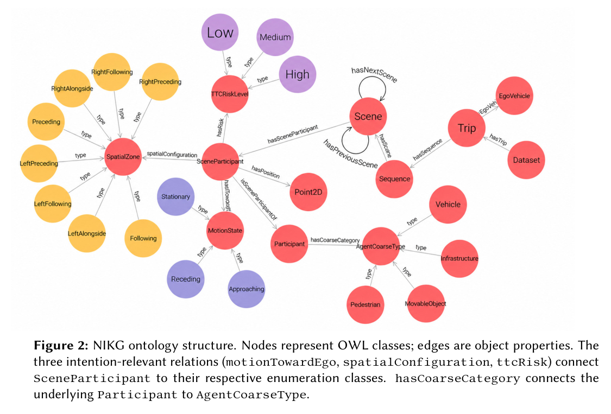

交通场景知识图谱不等于更准的驾驶意图预测器。NIKG 在感知结果与下游模型之间提供可查询、可验证的语义上下文。

## 方法与问题

流水线以 ego pose、跟踪目标标注与关键帧时序构建 OWL 支撑的 Turtle 图，显式表示相对自车运动、空间配置与碰撞时间风险，可供 SPARQL 特征提取和神经符号分析。配图仅使用论文的本体示意，不复制 nuScenes 相机画面。

## 实验证据

nuScenes mini 的 10 个场景产生 404 个关键帧、211,335 个三元组。论文协议下，相对运动标签的前向一致性为 92.5%。这是时序标签自洽性，不是意图预测或碰撞预测准确率，也没有完成真实道路驾驶决策安全验证。

## 我的判断

应把它当作语义数据产品。下一步固定预测器和数据划分，对照有无图特征的泛化效果，并加入感知误检与轨迹断裂。图规模和一致性不能替代下游预测收益证据。

## 原论文视觉证据

图源：Khaled Nowara , Mohamed Manzour , Catherine Elias，《A Semantic Knowledge Graph Construction Pipeline for Vehicle Intention Prediction in nuScenes》，2610.26528v1，Figure 2，PDF 第 4 页。[原图出处](https://arxiv.org/pdf/2610.26528v1#page=4) · [CC BY 4.0](https://creativecommons.org/licenses/by/4.0/)。裁剪自原文。

## 论文来源

- [A Semantic Knowledge Graph Construction Pipeline for Vehicle Intention Prediction in nuScenes](https://arxiv.org/abs/2610.26528v1) · 2610.26528v1。
- 版本公开日期：2026-10-19。
