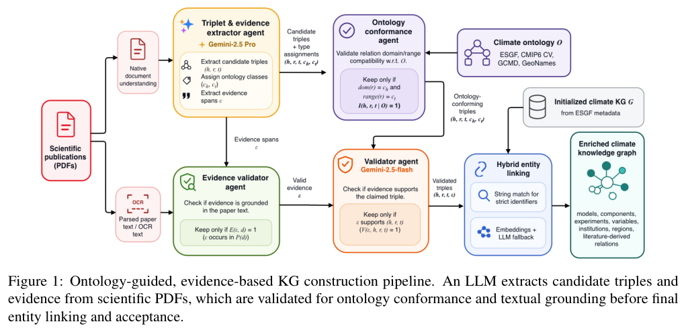
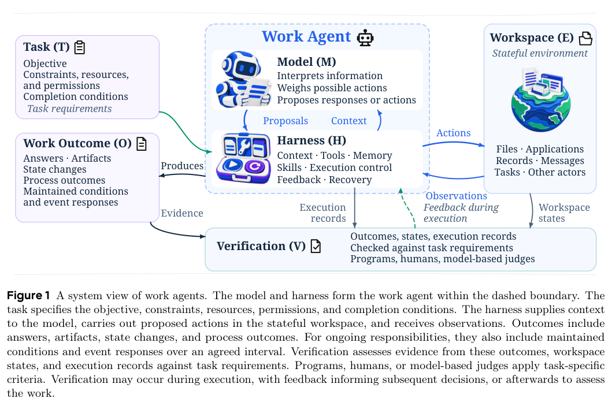
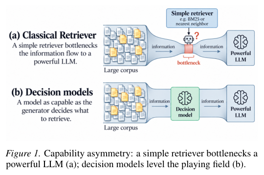
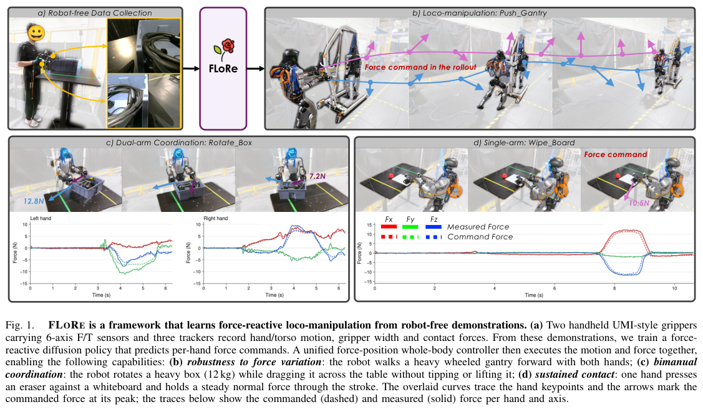
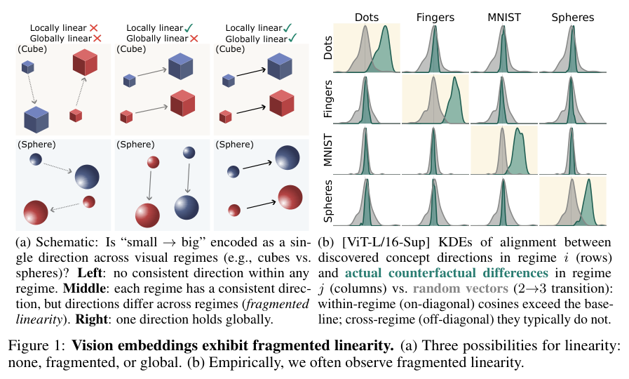

本期介绍从图结构获得训练信号、从文献提取可追踪事实，以及在文档和物理环境中寻找有效证据。工作 Agent、决策检索、力反馈控制和视觉概念表示各有不同的检验对象。

## 1. Evolve on Graph：用可执行查询构造推理课程

工业图谱往往缺少问答标注。Evolve on Graph 让同一个模型轮流出题和解题，同时用图上的可执行逻辑确定答案集合，而非完全依赖模型自评。

### 方法与问题

SVTS 采样推理拓扑并执行一阶逻辑查询，得到可验证骨架和完整答案集，再由出题者生成多跳问题。课程机制依据解题者分数方差，使题目接近能力边界。

### 实验证据

Table 2 的五个公开 KGQA 基准上，Qwen-2.5-7B 的 EoG 平均 Hit@1 为 61.55、F1 为 56.31；同骨干 Graph Reranker 为 54.09、44.26，均为百分制。论文另有工业图谱实验，合计六个基准。不能把公开五项均值与只覆盖部分任务的全监督方法均值直接排名。

### 讨论

无标注指不依赖人工或闭源教师问答标签，不代表没有监督：图谱事实、可执行逻辑与课程共同提供信号。图谱内可验证不保证外部事实真实，部署前仍需检查题目泄漏、拓扑覆盖与推理成本。

### 原图入口

[Table 2，原论文 PDF 第 6 页](https://arxiv.org/pdf/2610.35598v1#page=6)。

- [Evolve on Graph: Self-Evolving Knowledge Graph Reasoning without Question Annotations](https://arxiv.org/abs/2610.35598v1) · 2610.35598v1。
- 版本公开日期：2026-10-26。

## 2. 气候科学建图：三元组同时携带文本证据

这项 ontology-guided 框架用专门 Agent 处理文档、抽取、schema 符合性和实体链接。先提取带明确文本片段的三元组，再经过多阶段验证与本体约束；在 2,000 篇气候科学文献上构建图谱，将结构化元数据和论文事实连接起来。

*图｜Acharya, Aayush 等，气候科学建图，[Figure 1（PDF 第 4 页）](https://arxiv.org/pdf/2610.32725v1#page=4)，[CC BY 4.0](http://creativecommons.org/licenses/by/4.0/)。裁剪自原文。*

1,000 条三元组的一致性研究中，模型与三位人的 Cohen’s κ 落在 0.640–0.700，与人际区间接近；这是标注一致性，不是直接准确率。图规模也包含多种来源，不能把全部节点关系都当作新论文抽取成果，证据片段仍需能真正支持对应事实。

[Ontology-Guided Knowledge Graph Construction from Structured Metadata and Climate Science Publications](https://arxiv.org/abs/2610.32725v1) · 2610.32725v1。

## 3. Work Agents：按工作状态与可验证产物理解系统

Work Agents 将模型与 runtime harness 视为在有状态工作区内执行委托、交付可验证结果的系统。它用工作持续性和开放性描述条件，再按任务范围与组织方式区分工作形态，连接模型能力、工具使用、上下文管理和协作。

*图｜Xu, Zishan 等，Work Agents，[Figure 1（PDF 第 6 页）](https://arxiv.org/pdf/2610.35845v1#page=6)，[CC0 1.0](http://creativecommons.org/publicdomain/zero/1.0/)。裁剪自原文。*

文章整理五类核心能力，以及模型、harness 和联合优化路线，评估也从答案文本转向工作产物和执行结果。它是系统综述框架，不是新 Agent 的统一胜率；持续委托下的状态变化和开放环境适应，仍是需要实证解决的问题。

[Work Agents: Systems, Capabilities, and Optimization](https://arxiv.org/abs/2610.35845v1) · 2610.35845v1。

## 4. DecisionRAG：沿文档结构逐级判断相关分支

DecisionRAG 不依赖第一阶段词法或向量检索器，而用决策模型在一次前向中共同比较候选分支，从主题层级逐步走到段落。共享上下文中的候选评分可相互比较，目标是减少固定嵌入召回不足对强生成器形成的瓶颈。

*图｜Wan, Chao 等，DecisionRAG，[Figure 1（PDF 第 1 页）](https://arxiv.org/pdf/2610.35868v1#page=1)，[CC BY 4.0](http://creativecommons.org/licenses/by/4.0/)。裁剪自原文。*

论文在 MultiDoc2Dial、Natural Questions 等四项基准上报告检索指标收益，并测试大规模 Wikipedia 段落库。R@1、Hit@1 是检索命中口径，不是最终回答正确率；方法也需要可导航的语料组织，层级分支选择错误可能使正确段落提前被排除。

[Retriever-Free Retrieval: Navigating Documents with Decision Models](https://arxiv.org/abs/2610.35868v1) · 2610.35868v1。

## 5. FLORE：双手接触力与全身平衡一起控制

FLORE 用带力传感的双手 UMI 式夹爪和身体追踪器采集无机器人示范。扩散策略读取视觉、本体感知与实测 wrench，输出动作和每只手的力指令，再由带力跟踪的混合柔顺全身控制器执行，同时维持平衡。

*图｜Li, Sihang 等，FLORE，[Figure 1（PDF 第 1 页）](https://arxiv.org/pdf/2610.35862v1#page=1)，[CC BY 4.0](http://creativecommons.org/licenses/by/4.0/)。裁剪自原文。*

三项接触丰富的真实任务中，带力反馈策略成功率为 80%，同示范、同控制器的纯位置策略为 26.7%。这个对照有助隔离力反馈价值，但范围仍是所测任务与设备；传感精度、指令方向和控制器柔顺性共同影响效果，不能作为通用安全接触保证。

[Learning Force-Reactive Humanoid Loco-Manipulation](https://arxiv.org/abs/2610.35862v1) · 2610.35862v1。

## 6. 视觉概念的线性方向，能否跨外观形式共享

Do vision models know that three is three? 比较同一概念变化在不同视觉形式中的表示，例如数字 2→3 和手势 2→3。研究覆盖 46 个视觉编码器、10 类概念，分别检查每种形式内部的线性方向，以及这些方向能否跨形式保持一致。

*图｜Sonthalia, Ankit 等，视觉概念的线性方向，能否跨外观形式共享，[Figure 1（PDF 第 2 页）](https://arxiv.org/pdf/2610.35857v1#page=2)，[CC BY 4.0](http://creativecommons.org/licenses/by/4.0/)。裁剪自原文。*

作者观察到 fragmented linearity：局部线性普遍存在，全局共享却可能很弱；更强的局部结构与跨形式共享相关，出现共享时方向也能迁移为线性探针。这是表示几何证据，不能直接等同于模型理解了抽象概念的全部语义或具有系统性计数推理能力。

[Do vision models know that three is three?](https://arxiv.org/abs/2610.35857v1) · 2610.35857v1。
