本期介绍工程知识溯源、团队与经验优化、时间序列预测、多模态嵌入和机器人世界想象，并通过规则与逻辑评测观察模型能力的边界。

## 1. SFE-O

本体与知识图谱 · 首版 2026-10-27 · [论文](https://arxiv.org/abs/2610.37123) · [原文架构图所在页](https://arxiv.org/pdf/2610.37123#page=6)

### 研究问题与方法

超临界二氧化碳萃取的原料、工艺和产物数据分散在报告、计算模型与外部数据库中。SFE-O 用 OWL 2 连接生物质、过程和产物，记录实测、计算、外部资料及拟合参数的来源，并显式表示计算依赖，复用 QUDT、PROV-O 等语义资源。

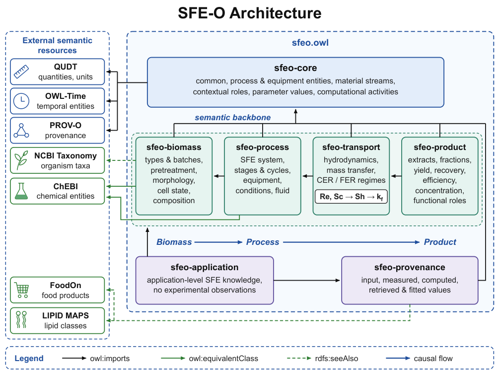

*图 1｜Thomas Pallet 等，SFE-O，[Figure 1，PDF 第 6 页](https://arxiv.org/pdf/2610.37123#page=6)。原论文截图，保留完整架构图与图例，裁去页内其他文字与空白；未改动图内内容。验证依据见[原文第 7–8 页](https://arxiv.org/pdf/2610.37123#page=7)。*

### 实例与验证

| 项目 | 论文报告 |
|---|---|
| 中试原料 | 盐生杜氏藻（Dunaliella salina） |
| 萃取条件 | 350 bar、65°C、CO₂ 流量 0.31 kg/min、120 min |
| 产物实例 | SE2 组分的 β-胡萝卜素浓度 7.08 mg/g，回收率 20.8% |
| 逻辑检查 | HermiT 对实例化本体进行分类，确认一致性 |
| 查询检查 | 执行 SPARQL，查询产物对应分离阶段及压力、温度 |

这些提取数值是用于实例化的过程数据，不能解释为本体提高了提取效果。论文展示了参数、来源和分离阶段的可查询关系；数值求解与 AI 效果评测尚未包含在验证中。工程知识库可以借鉴其溯源组织方式，性能收益仍需另外实验。

## 2. Evolving Agent Teams

Agent 系统 · 首版 2026-10-27 · [论文](https://arxiv.org/abs/2610.36848) · [全文](https://arxiv.org/html/2610.36848v1) · [原图 Figure 3](https://arxiv.org/pdf/2610.36848#page=7)

### 研究问题与方法

GPU 内核搜索容易停在局部有效的实现上。Evolving Agent Teams 由监督 Agent 诊断停滞并重新组织团队，将学习记录、演化历史和产物保存在持久化文件中，支持后续角色调整与优化。

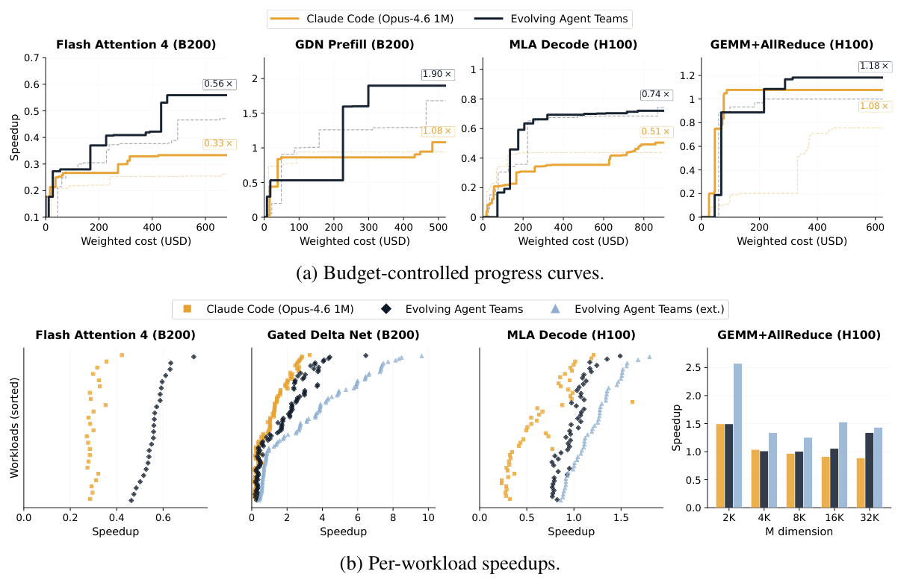

*图 3｜Shiyi Cao 等，Evolving Agent Teams，[Figure 3，PDF 第 7 页](https://arxiv.org/pdf/2610.36848#page=7)。原论文截图，保留 (a) 预算受控曲线和 (b) 逐工作负载加速比及图例，裁去页内其他文字与空白；未改动图内内容。(a) 实线为两次运行中的最佳结果，虚线为另一次运行；(b) 的 ext. 表示追加预算。MLA decode 匹配预算结果在图中标为 0.74×，同页正文写为 0.75×；下表追加预算的 1.21×来自正文报告，两种预算不构成等成本比较。*

### 实验结果与条件

| 设置 | 相对生产 FlashInfer 的几何平均加速比 |
|---|---:|
| 匹配预算的 EAT | 0.74×（Figure 3） |
| 生产基线 | 1.00× |
| 追加预算的 EAT | 1.21× |

任务为 H100 上的 MLA decode，包含 47 个 FlashInfer-Bench 生产工作负载；主实验每个设置运行两次，报告最佳结果。追加预算后，36/47 个负载快于生产基线。加速比按各负载的基线延迟与生成内核延迟之比取几何平均，超过 1 才表示更快。

团队调整与经验持久化为长时搜索提供了机制，但匹配预算下仍未超过生产基线。追加预算结果不能单独证明相同成本下的优势，两次运行取最佳也限制了统计结论。

## 3. Timestral：分离预测时域与因果上下文

Timestral 提供 5M 至 209M 参数的四个概率时间序列模型。Decoupled Horizon Forecasting 将预测 token 与因果编码上下文分离，使更长预测时域不必遮掉已观察数据，并原生处理已知未来协变量；训练先用多样合成数据，再混合真实与合成序列后训练。

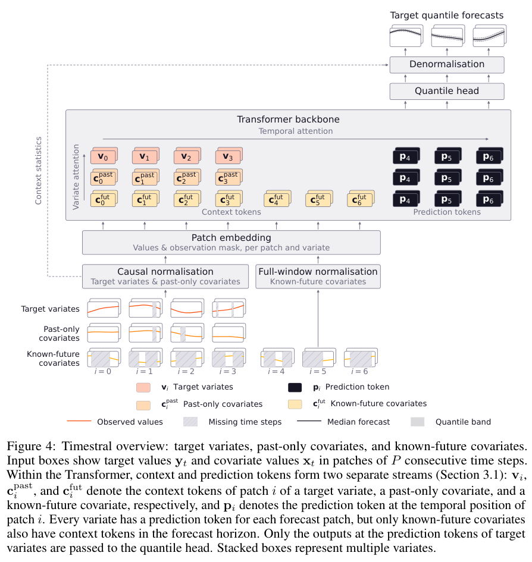

*图｜Petralia, Adrien 等，Timestral，[Figure 4（PDF 第 6 页）](https://arxiv.org/pdf/2610.37585v1#page=6)，[CC BY 4.0](http://creativecommons.org/licenses/by/4.0/)。裁剪自原文。*

报告在 GIFT-Eval、TIME、fev-bench 上比较预测质量。概率预测不应只看点误差，还需检查区间和分布的校准；已知未来协变量必须确实在预测时可获得，跨行业迁移也取决于数据频率、缺失机制和分布变化。

Figure 6 的 GIFT-Eval 结果同时报告 MASE 与 CRPS，均以更低为好。Timestral-209M 的几何平均 MASE 为 0.6575、CRPS 为 0.4476；Timestral-123M 分别为 0.6589 和 0.4496。两种度量反映点预测误差与概率预测质量，不能用其中一个分数替代全部预测性能。

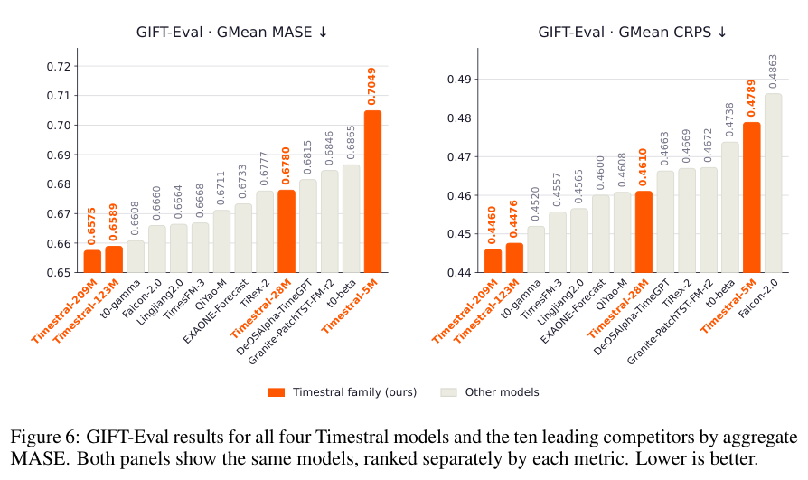

*图｜Petralia, Adrien 等，Timestral，[Figure 6（PDF 第 10 页）](https://arxiv.org/pdf/2610.37585v1#page=10)，[CC BY 4.0](http://creativecommons.org/licenses/by/4.0/)。裁剪自原文。*

[Timestral](https://arxiv.org/abs/2610.37585v1) · 2610.37585v1。

## 4. GEPA-Curator

Agent 系统 · 首版 2026-10-27 · [论文](https://arxiv.org/abs/2610.37651) · [全文](https://arxiv.org/html/2610.37651v1) · [原表 Table 2](https://arxiv.org/pdf/2610.37651#page=6)

### 研究问题与方法

失败轨迹可能包含提示词问题，也可能来自环境限制或评判噪声。GEPA-Curator 在当前批次中筛选有学习价值的任务，并检索同一任务的可靠成功轨迹，给反思优化提供对照。筛选针对当前阶段，困难任务不会因此永久退出训练。

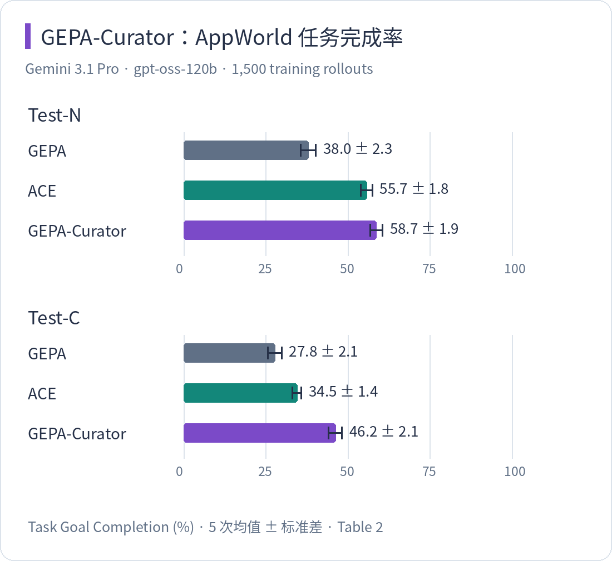

*图 2｜Zack Yu、Nicholas Lee 等，GEPA-Curator，[Table 2，PDF 第 6 页](https://arxiv.org/pdf/2610.37651#page=6)。原论文表格截图，保留表头、Seed 行和 Gemini 3.1 Pro 部分；裁去 Claude Opus 5 部分及页内其他内容，未改动保留的数值。AppWorld 指标为 Task Goal Completion（%），± 后为标准差；下表摘录 AppWorld 两列。*

### 实验结果与条件

| 方法 | Test-N（%） | Test-C（%） |
|---|---:|---:|
| GEPA | 38.0 ± 2.3 | 27.8 ± 2.1 |
| ACE | 55.7 ± 1.8 | 34.5 ± 1.4 |
| GEPA-Curator | 58.7 ± 1.9 | 46.2 ± 2.1 |

这组实验使用 Gemini 3.1 Pro 优化器、gpt-oss-120b 执行模型、AppWorld 官方数据划分和 1,500 次训练 rollout，表中为 5 次均值 ± 标准差。Test-N 从 38.0% 到 58.7% 的差为 **20.7 个百分点**；Test-C 相比 GEPA 高 18.4 个百分点。

结果支持在反思前筛选经验的设计，但收益依赖执行模型、任务与预算。标准差描述重复运行的波动，不能直接当成显著性检验；本文也没有据这两列结果推断其他 Agent 的收益。

## 5. EmbeddingGemma 2：统一文本、图像、声音和视频表示

EmbeddingGemma 2 将文本、图像、音频、视频及其组合编码到统一嵌入空间，采用简化逐层 embedding 和按模态、目标推进的多阶段课程。它同时检查单模态、跨模态和混合输入检索，避免只用一个文本基准代表多模态质量。

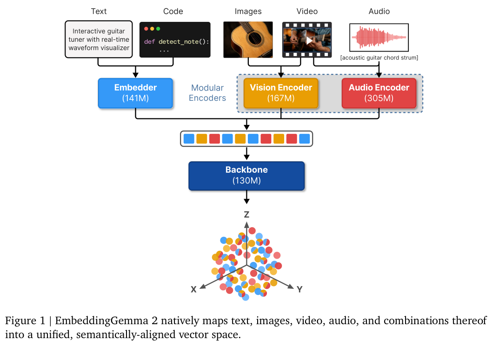

*图｜Vera, Henrique Schechter 等，EmbeddingGemma 2，[Figure 1（PDF 第 2 页）](https://arxiv.org/pdf/2610.37364v1#page=2)，[CC BY 4.0](http://creativecommons.org/licenses/by/4.0/)。裁剪自原文。*

模型还支持按需加载模态编码器、调整视觉 token 预算、截断嵌入维度和量化权重，为资源受限部署提供选择。不同维度与编码预算会改变质量和开销，模型大小比较也不能替代具体语料的召回、延迟与跨模态对齐评测。

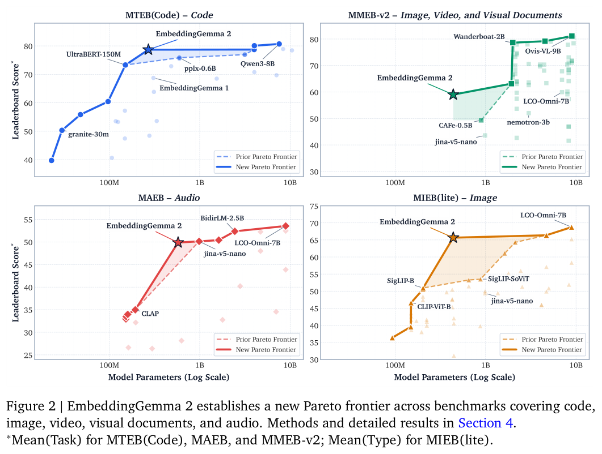

*图｜Vera, Henrique Schechter 等，EmbeddingGemma 2，[Figure 2（PDF 第 3 页）](https://arxiv.org/pdf/2610.37364v1#page=3)，[CC BY 4.0](http://creativecommons.org/licenses/by/4.0/)。裁剪自原文。*

[EmbeddingGemma 2: Unified and Efficient Multimodal Representations](https://arxiv.org/abs/2610.37364v1) · 2610.37364v1。

## 6. ThinkWorld：用视频中的状态变化训练动作思考

ThinkWorld 将动作思考表示成离散运动 token 的 Chain-of-Dynamics，描述当前到未来状态之间的变化，作为不同身体形态共享的动作表示。先用带动作标签的示范初始化，再预测每条 CoD 导致的未来，以预测和真实观测的匹配度强化学习。

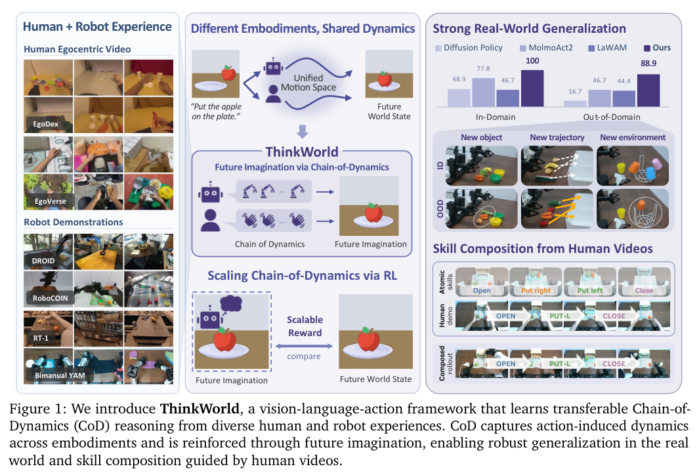

*图｜Kim, Chaehyun 等，ThinkWorld，[Figure 1（PDF 第 1 页）](https://arxiv.org/pdf/2610.37666v1#page=1)，[CC BY 4.0](http://creativecommons.org/licenses/by/4.0/)。裁剪自原文。*

这种世界想象监督让没有动作标注的人类视频也能提供学习信号，论文在仿真和实机中测试跨任务、环境及人到机器人的迁移。但无动作标签并非没有监督：世界预测器、初始动作示范和观测一致性共同定义目标，预测失真也可能影响动作学习。

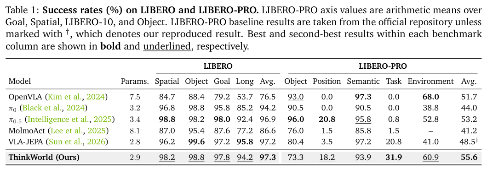

*图｜Kim, Chaehyun 等，ThinkWorld，[Table 1（PDF 第 8 页）](https://arxiv.org/pdf/2610.37666v1#page=8)，[CC BY 4.0](http://creativecommons.org/licenses/by/4.0/)。裁剪自原文。*

[ThinkWorld: World Imagination Reinforces Chain-of-Dynamics Reasoning](https://arxiv.org/abs/2610.37666v1) · 2610.37666v1。

## 7. RuleTrek

规则推理评测 · 首版 2026-10-14 · [论文](https://arxiv.org/abs/2610.19698) · [全文](https://arxiv.org/html/2610.19698v1) · [原表 Table 2](https://arxiv.org/pdf/2610.19698#page=6)

### 研究问题与方法

实际任务的规则和事实常分散在多个文件中。RuleTrek 分别测试规则识别（RI）、已给定必要规则时的演绎（RD）和自行识别并应用规则的端到端任务（E2E），便于定位信息整合与规则应用的问题。

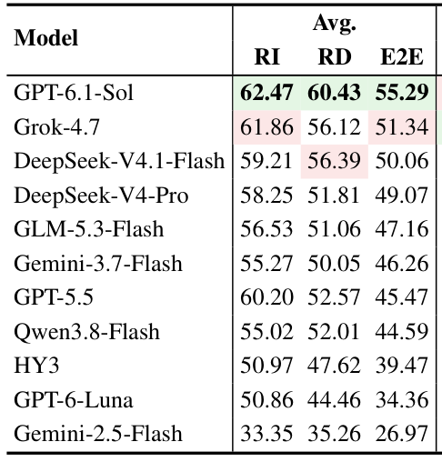

*图 4｜Chenhao Yuan、Bohan Yu、Yinhao Xu 等，RuleTrek，[Table 2，PDF 第 6 页](https://arxiv.org/pdf/2610.19698#page=6)。原论文表格截图，保留全部 11 个模型的名称及 Avg. 下 RI、RD、E2E 三列，裁去六个领域的分列；未改动保留的数值、排序或着色。下表另摘录 7 个模型的 RD 与 E2E，均为 0–100 综合评分，融合答案正确性与推理评分，不是简单准确率。*

### 实验结果与条件

| 模型 | RD | E2E |
|---|---:|---:|
| GPT-6.1-Sol | 60.43 | 55.29 |
| Grok-4.7 | 56.12 | 51.34 |
| DeepSeek-V4.1-Flash | 56.39 | 50.06 |
| GLM-5.3-Flash | 51.06 | 47.16 |
| Gemini-3.7-Flash | 50.05 | 46.26 |
| Qwen3.8-Flash | 52.01 | 44.59 |
| HY3 | 47.62 | 39.47 |

评测包含 240 个实例、6 个领域，每个模型运行 3 次取均值，单次上限为 30 分钟和 200 步，无外网访问。RD 与 E2E 的差距提示规则识别会进一步增加任务难度；RD 本身的得分也说明，仅提供完整规则仍不足以确保正确应用。

资料为英文，规则与场景预先固定。多语言和规则动态变化环境的表现仍需验证，表中差距也不能直接用作单一错误来源的因果估计。

## 8. CBE

逻辑推理评测 · 首版 2026-10-16 · [论文](https://arxiv.org/abs/2610.22894) · [全文](https://arxiv.org/html/2610.22894v1) · [原图 Figure 2](https://arxiv.org/pdf/2610.22894#page=6)

### 研究问题与方法

固定测试集上的平均准确率可能掩盖等价表述下的不稳定。CBE 用参数化生成器改变排序任务的规模，为同一问题生成保持答案不变的配对表述，联合观察平均准确率、两次回答一致的比例，以及两种表述都答对的比例。

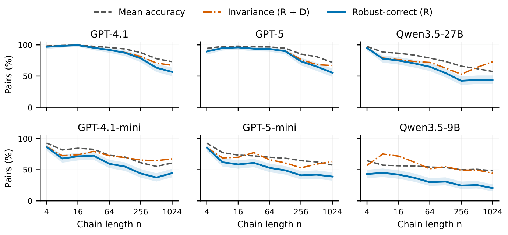

*图 5｜Jize Jiang、Chengxiang Zhai，Competence-Based Evaluation of Logical Reasoning in Large Language Models，[Figure 2](https://arxiv.org/pdf/2610.22894#page=6)，[CC BY 4.0](https://creativecommons.org/licenses/by/4.0/)。从 PDF 第 6 页裁出完整绘图区，移除页内其他文字与空白；未修改图中曲线、坐标、图例或颜色。外部原图依 CC BY 4.0 使用，不适用本站页脚的默认许可。点击图片可查看完整细节。*

### 实验结果与条件

GPT-4.1 的 front/behind 排序任务：

| 指标 | n = 4 | n = 1024 |
|---|---:|---:|
| 平均准确率 | 98.3% | 73.1% |
| 两种表述均正确（R） | 97.0% | 56.8% |
| 两次回答一致（R + D） | 97.5% | 67.3% |

每个规模生成 200 对问题，图中三个指标使用同一有效配对集合；R 的阴影为逐点 95% Wilson 区间。这里的 73.1% 是配对集合上的平均准确率，不能与原始提示单侧准确率混用。

一致性包含两次都错的情况，因此一致不等于正确。配对指标可以揭示平均分忽略的退化；有限样本能发现能力条件被违反，不能证明对整个问题族普遍正确。论文的主要实证对象为排序任务，扩展到更复杂推理还需重新验证。

---

图 1–4 为原论文图表的必要截图节选，来源、作者及裁剪范围见各图注；对应 arXiv 版本标注 non-exclusive distribution，博客转载原图的许可尚未确认，本文不将其表述为已获授权或开放许可。这些外部图表不适用本站页脚的默认许可。图 5 按 CC BY 4.0 引用，作者与变更说明见图注。
