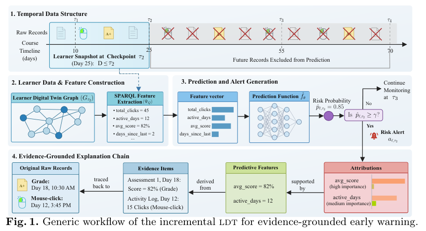
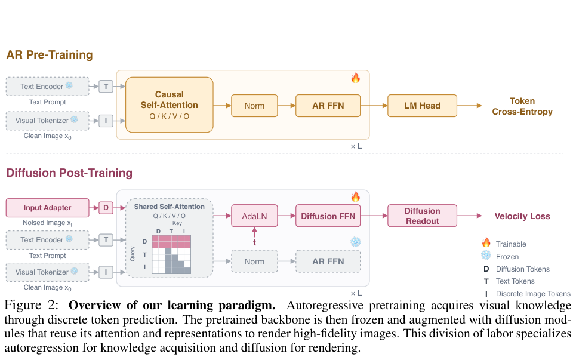

今天挑出的五篇论文有一个共同问题：系统的中间表示，究竟保留了什么？知识图谱保留决策证据，合成环境保留状态变化，机器人迁移保留接触，视觉 token 保留语义。它们的价值不能只由最终排行榜上的一个数字决定，还要看对照实验有没有回答对应问题。

本文为北京时间 **2026-10-30** 的原创阅读整理。四篇从 AlphaXiv 发现，专题一篇由 arXiv 补充。五篇均核对 arXiv v1 与官方 PDF，提交日期均为 2026-10-27；推荐日期不等于首发日期。实验数字为作者报告，本站未独立复现；会议接收状态未能稳定确认，按预印本讨论。

## 专题观察：没有新的核心 OBDA 算法，也有值得读的语义工程证据

本次没有核实到适合新增推荐的核心 VKG/OBDA 或本体学习算法论文。最近已经推荐的论文不再重复。下面的学习预警系统属于知识图谱与溯源应用，不能冒称虚拟图谱查询技术，但它提供了一个很具体的语义层评价范例。

## 1. 学习预警：让每条警报回到原始证据

**论文**：[An Incremental Knowledge-Graph Learner Digital Twin for Evidence-Grounded Early Warning](https://arxiv.org/abs/2610.36820v1)

**作者**：Le, Ngoc Luyen；Abel, Marie-Hélène；Laforge, Bertrand。**机构**：Gamaizer；Université de technologie de Compiègne / CNRS / Heudiasyc；Sorbonne Université / CNRS / LPNHE。**来源**：arXiv 专题补充。

真正值得借鉴的是实验把预测和证据治理拆开。在同样的特征和调参预算下，图谱中间层没有改变模型输出，却把警报、特征、归因、证据项和原始记录连起来。这对 OBDA/VKG 工程有启发：语义层的收益可以通过追溯与校验衡量，不必把所有价值都包装成准确率提升。

OULAD 六个测试模块的平均图规模从第 4 周约 137 万条三元组增至第 12 周约 328 万条，SHACL 检查均为零违规。各检查点最好的 AUC 分别为 0.735、0.809、0.847，但最佳模型不同，且后续周可用信息更多；这组数不能解释为知识图谱比表格更准。图谱和配对表格特征得到相同指标，才是本文真正的对照结果。

更有信息量的是负面边界：上下文覆盖与可追溯性均为 1.000，但 Direct@3 从 0.764 降到 0.648，Fid@3 从 0.898 降到 0.744。没有活动本身难以对应一条直接活动记录，解释策略也会选择不同类型的证据。可追溯、解释忠实与预测正确是三个问题，不能混用。历史回放尚不等于真实流式集成，教师是否因此更好地干预也未被验证。

**作者资源**：[作者代码](https://github.com/lengocluyen/ldt-early-warning)。

图源：Le, Ngoc Luyen；Abel, Marie-Hélène；Laforge, Bertrand，*An Incremental Knowledge-Graph Learner Digital Twin for Evidence-Grounded Early Warning*，2610.36820v1，Figure 1，PDF 第 6 页。[原图出处](https://arxiv.org/pdf/2610.36820v1#page=6) · [CC BY 4.0](https://creativecommons.org/licenses/by/4.0/)。由公开原论文 PDF 栅格化并矩形裁切，保留图内内容和原图注，未重绘或修改数据。

## 2. SynthAPI：Agent 训练数据该怎样扩展

**论文**：[Scaling Laws for Tool-Use Agents via Controllable Environment Synthesis](https://arxiv.org/abs/2610.37648v1)

**作者**：Szot, Andrew；Abnar, Samira；Attia, Omar；Kazerouni, Abbas；Kirchhof, Michael；Hsieh, Cheng-Yu；等。**机构**：Apple。**来源**：AlphaXiv。

如果有预算再生成三万条 Agent 轨迹，应增加题目措辞、增加应用种类，还是更换数据库状态？SynthAPI 把这些选择变成可控实验：工具背后有可执行 Python 代码，环境状态会随操作变化，而不是由语言模型随口模拟工具返回。

作者在 458,752 个任务上训练 849 个不同设置的模型。最适合工程决策的证据是同预算比较：两组都用 32,768 个任务，次优方案为 32 个应用、每应用 1,024 个任务模板、每任务 1 个数据库；优化方案为 64 个应用、每应用 128 个模板、每任务 4 个数据库，同时增加数据库生成深度。4B 模型在 AppWorld Test-C 的成功率从 38.4% 到 45.0%，9B 从 53.0% 到 56.2%，27B 从 73.8% 到 74.1%。改配比有帮助，但收益大小随模型变化。

这也提示不要把所有提升归给单一因素：上述优化同时改变多个控制量，单因素分析要回到论文对应实验。SynthAPI-Big 的 4B Test-C 达到 66.4%，但它还增加数据并训练四轮，与同预算配比实验不是一回事。规律外推仍受合成环境、训练模型与基准范围限制，生产工具的权限、失败恢复和长期状态管理需要另外验证。

**原图入口**：[原论文第 6 页](https://arxiv.org/pdf/2610.37648v1#page=6)。原文采用 [arXiv 非独占分发许可](https://arxiv.org/licenses/nonexclusive-distrib/1.0/)，本篇仅链接，不转载原图。

## 3. CARD：迁移人手动作时保住接触和力度

**论文**：[CARD: Contact-Anchored Retargeting for Dexterous Manipulation](https://arxiv.org/abs/2610.36539v1)

**作者**：Dai, Cunxi；He, Botao；Hogan, Francois R；Pan, Wei；Fu, Rao；Hsieh, Wen-Han；等。**机构**：Carnegie Mellon University；Amazon Frontier AI & Robotics；University of Maryland, College Park；UC Berkeley。**来源**：AlphaXiv。

机械手模仿人的动作，难点不只是关节角度不同。挤瓶子需要施力，举杯子需要摩擦接触，姿势看似正确仍可能让物体滑走。CARD 先把视频、手套或动作捕捉示范转成统一的手—接触表示，再根据机械手的语义部位映射求出关节与接触力目标。主要迁移流程不要求物体模型或仿真器；论文另外讨论的物理仿真变体不应与它混为一谈。

最清楚的对照是固定 CARD 轨迹，只开关触觉跟踪器。SHARPA Wave 上举锤、举杯、挤芥末各做 10 次，纯位置回放分别成功 1、3、0 次；加入触觉跟踪后为 8、10、7 次。实验减少了策略学习差异这一干扰，因此支持接触力目标确实有用，但样本只有每项 10 次，不能推导任意任务的平均成功率。

论文所谓开放环回放，指任务动作轨迹没有在线重新规划，内层依然用触觉纠正力。物体被大幅推离预期位置时，这种控制仍不能恢复。不同手型也不是全部使用同一传感条件：无触觉的 Unitree Dex3 使用了动作缩放。因此跨本体形态迁移展示与严格同条件比较需要分开读。

**作者资源**：[作者项目页](https://card-retargeting.github.io/)。

**原图入口**：[原论文第 6 页](https://arxiv.org/pdf/2610.36539v1#page=6)。原文采用 [arXiv 非独占分发许可](https://arxiv.org/licenses/nonexclusive-distrib/1.0/)，本篇仅链接，不转载原图。

## 4. Know, then Draw：先学语义，再学画细节

**论文**：[Know, then Draw: A New Learning Paradigm for Visual Generation](https://arxiv.org/abs/2610.37626v1)

**作者**：Mao, Yucheng；Ge, Chongjian；Tu, Zhuowen；Tan, Hao；Jiang, Hanwen。**机构**：University of California, San Diego；Adobe Research。**来源**：AlphaXiv。

自回归和扩散模型经常被当作二选一方案。这篇论文换了问题：是否可以让前者负责知道画面应该有什么，让后者负责画出纹理和像素？语义分词器 Semantic-LM 仅通过语言监督学习，不带图像解码器或重建损失；自回归模型预测这种表示，扩散阶段再完成渲染。

作者报告最终 3B 模型总训练预算约 6,600 H100 GPU 小时，GenEval 为 86、DPG-Bench 为 87。约 3,960 与 2,640 GPU 小时是按 3:2 给两阶段分配的名义预算，不是分别测出的运行时间。对表示设计更有价值的是受控比较：像素重建质量、自回归阶段单独生成的质量，都不必然对应最终扩散渲染质量。

读排行榜必须继续读附录。GenEval 用 553 条提示、每条一张图和固定种子 42；DPG-Bench 用 1,065 条提示、每条四张图、种子 42–45。系统还做 LLM 提示改写，并按这些固定种子的评测分数选择提示变体。推理使用 50 步 Euler 扩散采样。这些条件意味着训练效率证据值得研究，但不能直接宣称在未经挑选的新提示上也有同样排名，更不能将图中的 48 倍训练计算差异当作整个系统成本节省。

图源：Mao, Yucheng；Ge, Chongjian；Tu, Zhuowen；Tan, Hao；Jiang, Hanwen，*Know, then Draw: A New Learning Paradigm for Visual Generation*，2610.37626v1，Figure 2，PDF 第 3 页。[原图出处](https://arxiv.org/pdf/2610.37626v1#page=3) · [CC BY 4.0](https://creativecommons.org/licenses/by/4.0/)。由公开原论文 PDF 栅格化并矩形裁切，保留图内内容和原图注，未重绘或修改数据。

## 5. FVQ：离散视觉表示一定会丢掉理解能力吗

**论文**：[Can Discrete Tokens Serve as Semantically Lossless Representations of Visual Signals?](https://arxiv.org/abs/2610.37662v1)

**作者**：Zou, Jialv；Li, Xiaotong；Yue, Zhengrong；Huang, Xu；Luo, Yaxin；Yan, Wenhao；等。**机构**：华中科技大学；美团 LongCat；上海交通大学；北京大学；MBZUAI；清华大学；香港中文大学。**来源**：AlphaXiv。

视觉 token 的量化误差大，是否一定理解得差？论文表 1 给出了反例：普通 VQ 的特征重建 MSE 为 0.027，八个理解基准的平均分为 51.2；只保留交替码本的 RVQ Odd，MSE 上升到 0.246，理解均分却达到 60.7。此处均值将 OCRBench 除以 10 后与其余指标等权计算，不是概率，也不是所有视觉能力的统一尺度。

作者因此关注有效位数，而非仅关注重建误差。FVQ 把视觉特征转换为互补的固定维度视角，使用对称并行码本，目标是让新增码本继续携带新信息，而不是在已有信息上重复细化。它与前一篇生成论文形成一个值得研究的共同点：为像素重建设计的表示指标，不一定符合下游语义任务需要。

论文最终工业训练模型的若干理解结果接近连续表示，但不能由此证明数学意义的语义无损。主模型比较的训练数据与外部模型并不完全配对；论文也提供较受控的 LLaVA-OneVision SFT 版本，但该表的部分基线仍来自前作，基础语言模型也有差异。我的判断是将其视为视觉接口设计的证据，而不是离散表示已在所有任务中取代连续表示的结论。

**作者资源**：[作者代码](https://github.com/hustvl/FVQ) · [作者项目页](https://doctor-james.github.io/FVQ-Page/)。

**原图入口**：[原论文第 3 页](https://arxiv.org/pdf/2610.37662v1#page=3)。原文采用 [arXiv 非独占分发许可](https://arxiv.org/licenses/nonexclusive-distrib/1.0/)，本篇仅链接，不转载原图。

## 我会怎样安排阅读顺序

做 Agent 的读者先看 SynthAPI 的同预算对照，而不是只看最大训练版本。做语义数据集成的读者先看学习预警论文，特别是图谱与表格指标相同、直接证据覆盖却不完整这一组合。机器人读者看 CARD 的同轨迹触觉消融。最后把两篇视觉论文放在一起读：下游任务需要的语义质量，未必与图像或特征重建误差同向。

这些联系是我的阅读判断，不是论文共同证明的定理。迁移到自己的系统时，应分别测量质量、成本、证据可追溯性和失败恢复能力；对照条件不同的数字不应拼成一个排行榜。
