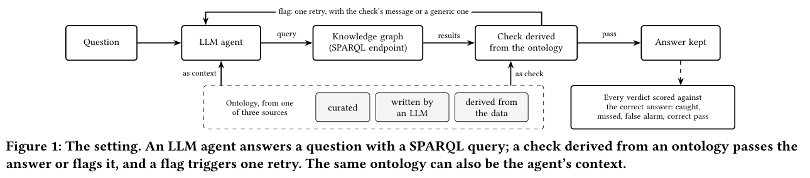
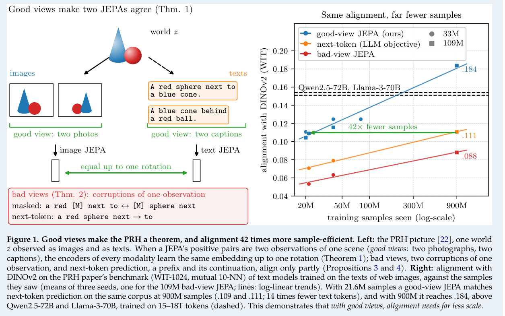
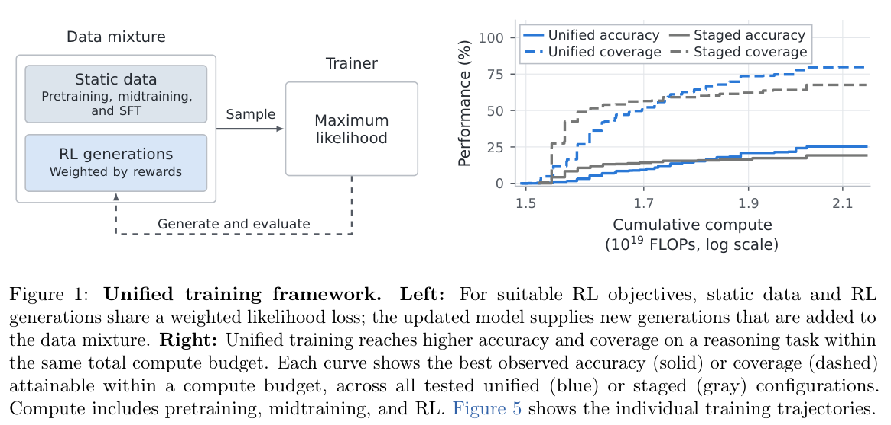
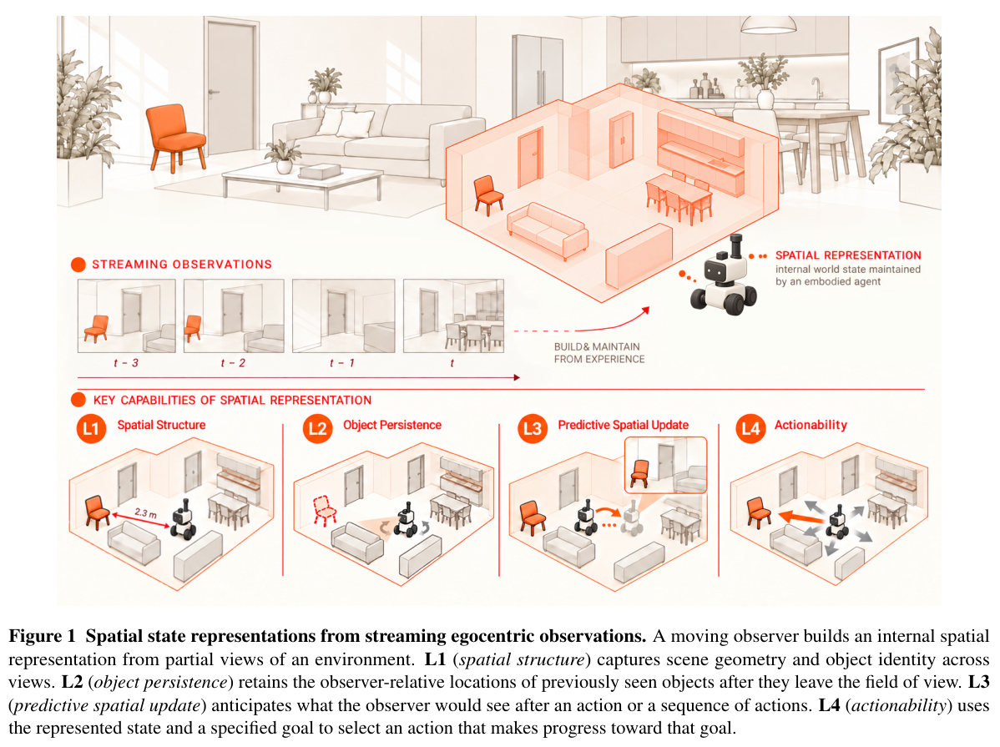

给模型加一个检查器、多喂一些训练配对、保留更长历史，都像是改进系统的自然办法。今天五篇论文值得放在一起读，是因为它们要求我们把“增加了一个部件”与“解决了一个问题”分开验证。检查器会不会把好答案改坏？长历史是否真被记住？训练后的成功率提高，又付出了多少推理成本？

本期论文的首版发表于 2026-10-27 或 2026-10-29，按预印本讨论。

## 专题观察：语义约束的裁判也有误差

本体专题关注本体作为问答验证器的效用，与语义数据访问系统的可靠性密切相关。

## 1. 本体检查器，也需要被检查

**论文**：[What Does an Ontology Catch? Curated, LLM-Generated and Data-Derived Ontologies as Checkers of LLM Agents over Knowledge Graphs](https://arxiv.org/abs/2610.37809v1)

**作者**：Orzechowski, Michal；Tawfiq, Rund；Kosciolek, Tomasz。

**机构**：ACK Cyfronet AGH；AGH University of Krakow；Sano Centre for Computational Medicine。

**状态**：arXiv cs.AI / cs.DB 预印本，v1，2026/10/27；作者标注 under review，具体场所未能稳定确认。

当 Agent 把问题转换成 SPARQL 查询时，本体可以检查查询是否符合数据类型与关系规则。本文反过来检查这个裁判：比较人工维护、从数据归纳、由 LLM 生成的本体，分别作为提示背景、查询检查器或二者组合，统计抓错与误报。

图源：Orzechowski, Michal；Tawfiq, Rund；Kosciolek, Tomasz，*What Does an Ontology Catch? Curated, LLM-Generated and Data-Derived Ontologies as Checkers of LLM Agents over Knowledge Graphs*，2610.37809v1，Figure 1，PDF 第 2 页。[原图出处](https://arxiv.org/pdf/2610.37809v1#page=2) · [CC BY 4.0](https://creativecommons.org/licenses/by/4.0/)。由官方 PDF 栅格化并矩形裁切，保留图内内容及原图注，未重绘或修改数据。

读图：本体既能作为 Agent 的上下文，也能在查询执行后充当检查器；被标记的结果会触发重试，因此误报可能把本来正确的答案送回修改。

UniProt 七个模型的真实答案实验中，人工本体检查器抓到 18.9% 的错误答案，但也误报 16.8% 的正确答案；数据归纳本体分别为 8.2% 与 3.5%。它让语义工程的收益与代价都变得可测，提醒我们不要直接把本体违反解释为 Agent 犯错。

读表 2 时要分清分母：18.9% 是错误答案中被抓到的比例，16.8% 是正确答案中被误报的比例，不能直接相减得到净收益。人工故障与真实错误也很不同：仅对空结果重试，能发现 79.2% 的人工故障，却只发现 2.5% 的真实错误。很多真实错误查询仍返回看似合理的数据，因此测语法、类型或空结果，不足以测语义正确。

消融显示，单用类别检查时误报为 0.6%，加上 domain/range 后为 8.8%，完整规则为 16.8%。RDF/OWL 中的推理公理并不天然等于封闭数据库的拒绝约束，公开本体也可能和数据实际用法不一致。具体反馈修复了 28.3% 被标记的错误答案，同时损坏了 1.0% 被标记的正确答案；这些同样是条件比例。工程上应先校准裁判，再决定是否自动重试，而不是看到校验器就认为可靠性已经解决。

**边界与局限**：确认性结论限于冻结的 UniProt 数据与指定检查器，其他图谱为探索性结果；本文不是新的 OBDA 重写算法。结构合规不等于回答了正确问题；从同一图谱归纳规则及据此构造部分故障，会偏向数据归纳方案。作者标注 under review，具体投稿场所未能稳定确认。 作者匿名复现包可访问性未能稳定确认。

**作者资源**：[作者匿名复现包](https://anonymous.4open.science/r/www-2027-replication-package-36D6)。

## 2. JEPA：怎样选训练配对，影响跨模态对齐

**论文**：[Proving and Improving the Platonic Representation Hypothesis with JEPAs](https://arxiv.org/abs/2610.39302v1)

**作者**：Balestriero, Randall；LeCun, Yann。

**机构**：Brown University；New York University；AMI Labs。

**状态**：arXiv cs.AI / cs.CV / stat.ML 预印本，v1，2026/10/29；会议发表场所未能稳定确认。

两段描述如果对应同一场景，就可以作为一组训练配对，让文本模型学习它们共同指向的内容。本文在理想条件下证明，这种配对能使不同模态分别训练出的表示只差一个旋转，并比较它与掩码训练、下一 token 预测的差别。

图源：Balestriero, Randall；LeCun, Yann，*Proving and Improving the Platonic Representation Hypothesis with JEPAs*，2610.39302v1，Figure 1，PDF 第 1 页。[原图出处](https://arxiv.org/pdf/2610.39302v1#page=1) · [CC BY 4.0](https://creativecommons.org/licenses/by/4.0/)。由官方 PDF 栅格化并矩形裁切，保留图内内容及原图注，未重绘或修改数据。

读图：左边比较同一场景的不同观测与单个观测的损坏版本；右边横轴是训练样本数，对齐度的样本效率不能直接当作计算或耗时节省。

固定 109M 编码器和语料的比较中，场景配对训练用 21.6M 样本达到约 0.109 对齐度，下一 token 预测用 900M 样本达到约 0.111。约 42 倍是样本数差异，提示数据之间的关联方式本身可以成为训练设计变量。

这里的对齐度看两个表示空间中相邻样本是否相似，不等于通用智能或所有视觉任务的准确率。论文将同一场景的不同观测称为好视图，将同一描述的损坏版本称为坏视图：后者容易保留措辞等观测特有信息。这个区别比“是否用 JEPA”更具体，也更适合用数据消融验证。

同语料对照之外，作者还把小型文本 JEPA 与更大的外部语言模型比较。那种结果能说明该模型在指定对齐指标上有效，却不是同数据、同算力的架构胜负。理论保证和实证趋势应分别阅读；选择好视图的超参数调优、合成描述来源以及不同随机种子的波动，都可能影响复现。

**边界与局限**：定理依赖有限世界、可逆识别的观测映射与总体最优等假设；现实实验并不完全满足。42 倍不是实测训练时间或计算节省，超参数也未完全相同。大规模多描述数据包含来自视觉语言模型的合成描述，不能理解为从未引入图文知识。

**作者资源**：[作者代码](https://github.com/galilai-group/prh-proof)；[作者演示](https://huggingface.co/spaces/galilai-group/prh_demo)。

## 3. 统一训练：把阶段切换改成数据配比

**论文**：[Training Foundation Models with a Single Algorithm](https://arxiv.org/abs/2610.40564v1)

**作者**：Song, Yuda；Zhang, Alvin；Tajwar, Fahim；Arora, Daman；Schneider, Jeff；Khashabi, Daniel；等。

**机构**：Carnegie Mellon University；Johns Hopkins University；Aurora Innovation。

**状态**：arXiv cs.LG 预印本，v1，2026/10/29；会议发表场所未能稳定确认。

预训练、示范微调和部分强化学习更新，都可以写成带权的最大似然训练：提高指定文本出现的概率。系统将固定数据与按奖励筛选的模型生成放进一个训练器，阶段式训练变成某段时间只选择一种数据的特殊情况。

图源：Song, Yuda；Zhang, Alvin；Tajwar, Fahim；Arora, Daman；Schneider, Jeff；Khashabi, Daniel；等，*Training Foundation Models with a Single Algorithm*，2610.40564v1，Figure 1，PDF 第 2 页。[原图出处](https://arxiv.org/pdf/2610.40564v1#page=2) · [CC BY 4.0](https://creativecommons.org/licenses/by/4.0/)。由官方 PDF 栅格化并矩形裁切，保留图内内容及原图注，未重绘或修改数据。

读图：固定数据和奖励筛选的生成数据进入同一个最大似然训练器。右侧的计算预算曲线展示指定受控实验，不能替代后文真实数据实验的预算核对。

它把“现在练哪种能力、用多少旧数据防遗忘”变成可控的配比问题。0.76B 模型先做数学训练、再用相同编码 RL 继续训练 4,000 步时，混入 5% 中间训练数据的模型在 MBPP+ 的 pass@16 为 58.47%，阶段式模型为 52.12%。

最大似然可以直白地理解为：让模型更愿意输出选中的例子。对于二值可验证奖励，成功输出得到权重，失败输出不贡献这部分更新；静态语料、示范和生成数据可以复用一套 token 损失计算。不过当生成器与正在更新的模型不同，拟合生成器的成功样本并不一般等于当前策略的 MaxRL 梯度，这个边界不能忽略。

论文分别提供了含生成与训练 FLOPs 的受控预算比较，以及固定 RL 步数的真实混合数据比较。两者支持的结论不同。pass@16 表示多次尝试至少成功一次的估计，与单次回答正确率不同。还有一组损失归一化消融显示，统一损失并非每个配对实验都胜出；其价值包括共享基础设施、少调一项权重，以及为后续任务保留可学习性。

**边界与局限**：上述实际数据实验固定 RL 更新数，前一阶段并非等计算预算；不能据此宣称同算力全面领先。受控研究主要用 124M 模型；论文尚未验证大规模基础模型的普遍收益，也未给出通用最优配方。部分奖励目标可统一，不代表任意 RL 都等价。

**作者资源**：[作者代码](https://github.com/yudasong/unified-training)；[作者项目页](https://yudasong.github.io/unified-training/)。

## 4. CodeSpecWeave：训练编程 Agent 处理相互牵制的要求

**论文**：[When Requirements Interact: Scaling Long-Horizon Coding via Interdependent Specifications](https://arxiv.org/abs/2610.40256v1)

**作者**：Cai, Yishuo；Wang, Minzheng；Zhao, Liang；Zhang, Linghao；Li, Lei；Li, Shicheng；等。

**机构**：Xiaomi LLM Core；北京大学；香港大学。

**状态**：arXiv cs.SE / cs.CL 预印本，v1，2026/10/29；会议发表场所未能稳定确认。

真实软件修改常常既要兼容旧接口，又要正确处理异常和状态。CodeSpecWeave 从开发者需求出发，逐步合成相互依赖的规格与可执行测试，再由审查流程检查多模型解题轨迹，减少测试误判。它构建 4,670 个训练任务与一个 100 题评测集。

MiMo-V2.5 在 DeepSWE-v1.1 的成功率由基础模型 12.39% 提升至 25.30%，MiMo-V2.6-Flash-SFT 从 54.42% 至 62.98%。增益集中在长任务约束，更适合解释为训练任务结构的价值，而非仅增加需求条数。

表 2 的外部 DeepSWE 结果比自建评测更有说服力，但四项分数应逐项看。MiMo-V2.5 用 CodeSpecWeave 后，SWE-bench Verified 为 72.00%，低于 MiMo Coding 训练的 73.63%；SWE-bench Pro 为 51.30%，也低于其 53.81%。因此“平均最好”并不意味着所有工作负载最好。

另一个关键对照是执行代价：在自建评测上，MiMo-V2.5 的平均 thinking tokens 从 29.7k 增至 141.6k，编辑后测试循环从 3.48 次增至 4.34 次；Flash-SFT 的 token 从 22.8k 增至 69.5k。训练改变了代理愿意投入多少搜索与验证。若要用于生产，还应在固定 token、耗时或费用预算下测成功率，并检查更大补丁是否增加回归风险。

**边界与局限**：训练后推理 token 与改动范围也变大，不能把收益全归于同推理成本下更聪明。自建评测与训练数据来自同一合成方法，需结合外部基准读；并未在四项评测上全部击败其他训练集。专属公开代码链接未能稳定确认。

## 5. 视觉模型：看懂场景之后，能否记住和行动

**论文**：[Probing Spatial State Representations in Visual Foundation Models](https://arxiv.org/abs/2610.40636v1)

**作者**：Yin, Baiqiao；Cai, Zhongang；Wang, Ruisi；Liang, Qiwei；Yang, Lei；Liu, Ziwei。

**机构**：New York University；Nanyang Technological University；香港科技大学；香港中文大学。

**状态**：arXiv cs.CV 预印本，v1，2026/10/29；会议发表场所未能稳定确认。

摄像头转身后，模型还记得刚才那把椅子在哪里吗？本文冻结十类视觉表示，训练浅层探针，分别测试可见场景结构、离开视野的物体位置、运动后的表示预测，以及朝目标行动的能力。

图源：Yin, Baiqiao；Cai, Zhongang；Wang, Ruisi；Liang, Qiwei；Yang, Lei；Liu, Ziwei，*Probing Spatial State Representations in Visual Foundation Models*，2610.40636v1，Figure 1，PDF 第 2 页。[原图出处](https://arxiv.org/pdf/2610.40636v1#page=2) · [CC BY 4.0](https://creativecommons.org/licenses/by/4.0/)。由官方 PDF 栅格化并矩形裁切，保留图内内容及原图注，未重绘或修改数据。

读图：四个层次分别是可见结构、视野外物体持存、运动后的预测更新与行动效用。这是能力定义示意图，不是机器人已经完成这些任务的实验截图。

它把常被混称为空间理解的能力拆开测量。八个模型的 56 组指标比较中，较长前缀 24 帧对比 8 帧，有 45 组变差、8 组变好、3 组持平；八组物体持存指标均变差。更多历史并不自动变成更好的空间记忆。

比较使用 8、12、16、24 帧因果前缀，并检查不同网络层。45 组较短前缀占优中有 33 组的配对 95% 区间排除零，较长前缀占优的 8 组中有 5 组达到该条件。因此应同时看方向和不确定性，不能把所有差异都当成稳健结论。读出层改变还会翻转某些模型排序，选一个层测一个任务不足以给模型下总评。

运动与历史的匹配对照，用来区分模型是否真正利用了时序信息；目标切换实验则区分动作是否对目标敏感，与正确目标是否真的改善进展。原生预测特征保留一些可解码空间信息，但用真实特征训练的读取器不能原样迁移过去。实际系统应分别测记忆、预测特征分布和闭环动作效果，而不是从一个漂亮的几何可视化直接推出机器人控制能力。

**边界与局限**：实验限于静态室内 ScanNet++ 场景与观察者运动；前缀独立编码，不能当作在线记忆更新实验。探针只能说明信息在该读取方式下可用，不能证明模型自身会行动；部分验证场景与 Fast3R 训练数据重叠。

**作者资源**：[作者代码](https://github.com/yyyybq/Probing_Spatial_State_Release)；[作者项目页](https://yyyybq.github.io/probing-spatial-state/)。

## 放在一起看：评价的分母比口号更重要

本体论文提醒我们把误报率与抓错率分开，JEPA 要把对齐度与通用能力分开，统一训练要把更新步数与计算预算分开，编程任务要把成功率与推理开销分开，空间状态则要把信息可解码与动作有效分开。这些区别决定了一个结果究竟能迁移到什么工程决策。

| 如果准备采用 | 先补上的本地验证 |
| --- | --- |
| 本体驱动 Agent 校验 | 用人工核验的正确/错误答案分别测误报、漏报与重试损坏 |
| 场景配对自监督训练 | 固定模型、语料、样本预算，追踪配对来源和合成模型知识 |
| 统一训练流程 | 同时记录训练与采样 FLOPs，保留未来任务的验证集 |
| 复杂编程任务训练 | 固定推理费用，比较外部基准与旧功能回归 |
| 视觉历史与世界模型 | 单独测视野外定位、预测表示读取和闭环目标进展 |

专题读者先读本体检查器；工程 Agent 读者先读 CodeSpecWeave；研究训练方法的读者可把 JEPA 与统一训练对照阅读。它们并未给出通用配方，却都提供了更具体、可以被反驳的评估问题。

文中实验结果为论文作者报告，未独立复现。
