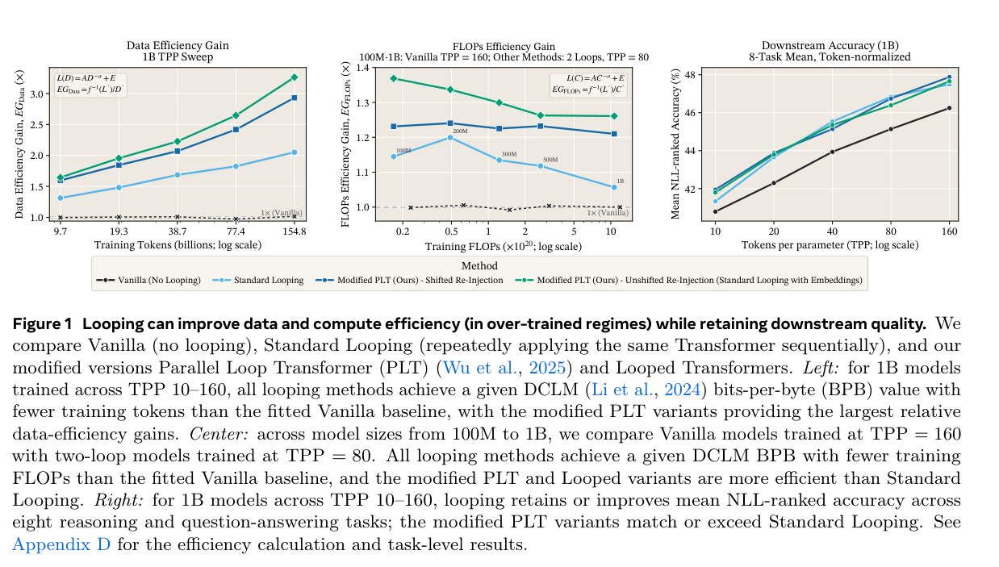
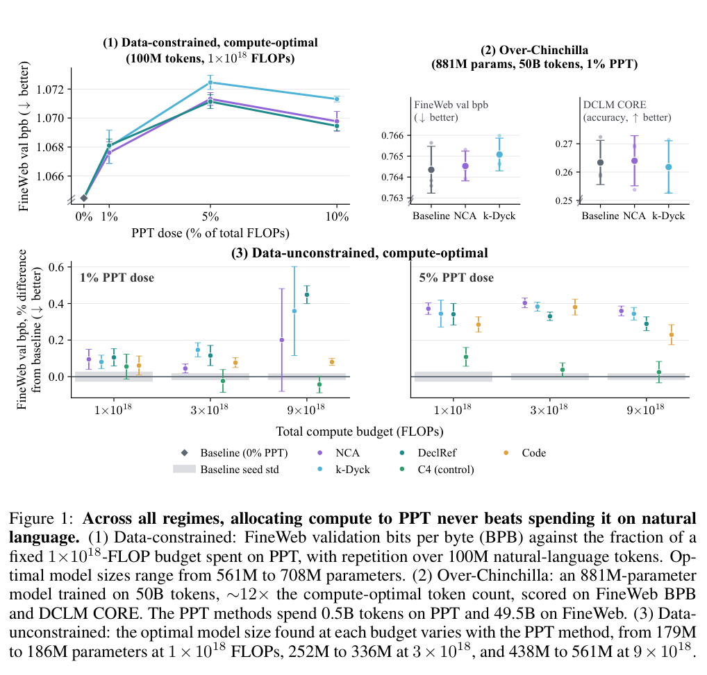
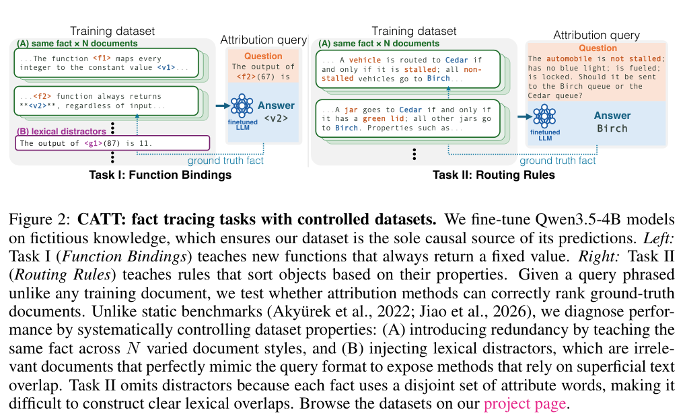
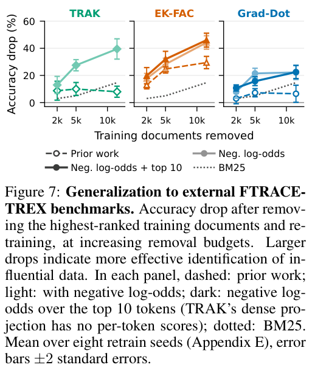

一个模型答对了问题，不等于它按我们设想的机制答对；一个系统少用了参数，也不等于它更省计算。这些区别在知识工程和 Agent 中尤其重要：我们既需要能工作的系统，也需要知道它为什么有效，以及在哪些条件下会失效。

本体工程把实体、类别与上下位关系显式组织起来；语言模型则把这些信息混在参数表示中。两者结合时，一个实际问题是：能否修改某种类别知识，同时不破坏对象的其他信息？

## 1. MIOE：答对本体问题，是否真的用到了相应知识

**论文**：[Can LLMs Faithfully Solve Ontology Engineering Tasks? A Mechanistic Interpretability Study](https://arxiv.org/abs/2610.38326v1)

**作者**：Zhang, Bohui；Meroño-Peñuela, Albert；Simperl, Elena。

**机构**：King’s College London；Technical University of Munich。

**状态**：arXiv cs.AI 预印本，v1，2026/10/28。

MIOE 不只检查模型答对了什么，还尝试替换模型内部的一部分表示：能否改变实体所属类别或概念的上位类，同时保留该对象的其他属性？作者在 Qwen3-8B 和 Qwen3-4B 上比较稀疏特征、掩码和分布式子空间干预。

数据覆盖 54 个实体类型类别和 39 个上下位类别。干预将来源对象的内部表示移到目标对象，检验输出是否按设定的反事实变化。这里的 Cause 是目标答案替换指标，Iso 是辅助属性保持指标；它们不是原始问答正确率，也不是对现实因果关系的发现。

它把“懂本体”拆成两个可测要求：目标知识能被改变，旁边的知识不被误伤。Qwen3-8B 单层实体类型实验中，DAS 的目标干预分数为 0.589、辅助保持分数为 0.579；多任务 MDAS 分别为 0.527、0.658，展示保护旁支信息与干预强度之间的取舍。

多任务方法直接加入辅助属性保持监督，因而不能将其结果解释为模型未经训练就自然分离出纯粹本体模块。论文还比较提示模板、上下文提示与连续层窗口，发现类别之间差异显著。对本体辅助系统的启发是：编辑一种类型知识时，应同步测试相关属性是否被破坏，而非只测目标答案。

**局限**：结论限于指定 Qwen3 模型、两个任务和选定辅助属性；尚未隔离出完全解耦的本体机制。

[实验 Table 2 与 Figure 1（PDF 第 6 页）](https://arxiv.org/pdf/2610.38326v1#page=6)。

**作者资源**：[作者代码](https://github.com/King-s-Knowledge-Graph-Lab/MIOE)。

## 2. 循环 Transformer：省参数、算力与延迟是三道题

**论文**：[How to Loop Your Transformer: Loop Scaling, Specialization, and Parallel Inference](https://arxiv.org/abs/2610.40325v1)

**作者**：Ekbote, Chanakya；Pagnoni, Artidoro；Sachan, Devendra Singh；Bhosale, Shruti；Lewis, Mike；Fazel-Zarandi, Maryam；等。

**机构**：FAIR at Meta；MIT。

**状态**：arXiv cs.LG / cs.AI 预印本，v1，2026/10/29。

让同一组 Transformer 层反复处理表示，可以增加计算深度而不同比增加参数。本文系统比较循环整网、循环中间层、每轮加入小型低秩适配器，以及把相邻 token 的隐藏状态错位传递以并行执行循环。

实验最大约 1B 参数、155B token、32 轮循环；这些是整个实验集合的上限，并非所有大模型都跑了 32 轮。1B 的部分扫描只到 4 轮。普通循环的生成有串行依赖，参数少并不自动意味着响应快。

固定参数量时循环整网通常更有利；固定训练 FLOPs 时，循环中间层更划算。它给模型设计者一个具体提醒：必须先说清限制的是显存、训练预算，还是逐 token 生成延迟，再比较哪种循环方式值得用。

作者为每轮增加小型低秩适配器，让共享主体之外仍能形成轮次分工；对并行循环，则保留当前 token 的嵌入，并分别归一化它与前一 token 的隐藏状态后再组合，缓解原配方的质量损失。效果随循环数和预算变化，增加循环可能饱和、反转甚至不稳定。

*图｜Ekbote, Chanakya 等，How to Loop Your Transformer: Loop Scaling, Specialization, and Parallel Inference，[Figure 1（PDF 第 2 页）](https://arxiv.org/pdf/2610.40325v1#page=2) · [CC BY 4.0](https://creativecommons.org/licenses/by/4.0/)。裁剪自原文。*

读图：横轴预算与纵轴指标应一起看；等参数、等训练计算量和生成速度不能相互替代。

**局限**：从零训练的稠密模型最大 1B，未覆盖更大模型、MoE 或后训练；主要使用似然类评估。不能将参数效率或拟合的计算效率直接当作实际服务吞吐提升。

## 3. 合成数据预热：先核对算力和初始化

**论文**：[Rethinking Pre-pretraining](https://arxiv.org/abs/2610.40051v1)

**作者**：Stern, Alexander；Rocktäschel, Tim；Locatelli, Acyr；Ruis, Laura。

**机构**：Cohere；UCL AI Centre；MIT。

**状态**：arXiv cs.CL / cs.AI 预印本，v1，2026/10/29。

先用括号语言、神经元胞自动机、声明式参考语料或代码训练，再学自然语言，是否更省训练资源？作者在总计算量相同、自然文本稀缺和较高 token/参数比等条件下，重新比较这类预热课程。

881M 参数、总计 50B token 的一组实验，将 0.5B token 用于预热、49.5B 用于自然文本，与自然文本基线比较。作者也复现了旧初始化下 NCA 预热带来的 5.4% 困惑度改善，但换一种初始化后，无预热基线获益更多，原差距消失。

在本文的等计算预算实验中，预热没有优于纯自然语言训练；即使只有 100M token 自然文本，重复读取也胜过这些合成课程的验证损失。这能帮助团队检验：新训练阶段的增益究竟来自课程，还是来自多花算力或较弱基线。

另一个对照允许预热额外消耗计算量：在 50M 和 100M 自然语言 token 时仍有收益，到 1B 时消失。这个结果与等预算实验回答不同问题。交错混入同类数据可以减少遗忘，却未显著改善自然语言表现；“记住合成任务”与“更会处理自然语言”需要分别评估。

*图｜Stern, Alexander 等，Rethinking Pre-pretraining，[Figure 1（PDF 第 2 页）](https://arxiv.org/pdf/2610.40051v1#page=2) · [CC BY 4.0](https://creativecommons.org/licenses/by/4.0/)。裁剪自原文。*

读图：三组对照分别控制数据、模型与计算预算，图中误差和基线波动也应纳入判断。

**局限**：不能推断所有合成数据均无用。测试受限于所选课程、NanoChat 设置、模型尺度和预算；较大规模未完整搜索超参数，部分预热比例未测试。BPB 差异也不能直接换成同百分比困惑度收益。

## 4. CATT：追溯训练来源，要避免整篇平均淹没关键 token

**论文**：[Elucidating the Design Space of LM Data Attribution](https://arxiv.org/abs/2610.40655v1)

**作者**：Yu, Steven；Wang, Sheng-Yu；Hamidieh, Kimia；Torralba, Antonio；Bau, David。

**机构**：Northeastern University；MIT。

**状态**：arXiv cs.CL 预印本，v1，2026/10/29。

当模型给出某条事实，究竟哪些训练文档造成了这个回答？CATT 用虚构事实微调模型，确保来源已知，再逐项增加重复事实文档和词面相似的无关文档，观察归因方法如何失败。

受控实验对 Qwen3.5-4B 做 LoRA 微调，每种数据配置使用三个种子。负对数赔率调整改变归因计算的梯度，不是重新训练一个更强的回答模型。通过控制事实冗余与干扰，可以区分算法依赖真正支持证据还是只匹配措辞。

*图｜Yu, Steven 等，Elucidating the Design Space of LM Data Attribution，[Figure 2（PDF 第 3 页）](https://arxiv.org/pdf/2610.40655v1#page=3) · [CC BY-SA 4.0](https://creativecommons.org/licenses/by-sa/4.0/)。裁剪自原文。*

关键证据可能只占文档几个 token，整篇平均会稀释它。作者改用负对数赔率梯度并聚合高分 token，在诊断基准上令多种基线的真实来源召回率增加 35–72 个百分点。改进的是来源识别，不是问答准确率。

在 FTRACE-TREX 删除高分训练数据并重新训练的测试中，最大删除预算下 TRAK 的准确率下降从约 8% 变为 40%，论文报告提升约 4.9 倍；这表示找到的数据更有因果影响，不是让部署模型性能提高 4.9 倍。该数据上 top-token 聚合的额外效果较小，不能把所有增益都归给它。

*图｜Yu, Steven 等，Elucidating the Design Space of LM Data Attribution，[Figure 7（PDF 第 8 页）](https://arxiv.org/pdf/2610.40655v1#page=8) · [CC BY-SA 4.0](https://creativecommons.org/licenses/by-sa/4.0/)。裁剪自原文。*

**局限**：主要评估单 token 输出和单任务微调，尚不足以代表长回答、多任务或完整预训练语料的归因。top-k 引入额外参数，现实中往往缺少可调参的真实来源标签。

**作者资源**：[作者项目页](https://catt.baulab.info/)；[作者代码](https://github.com/Lamsheeper/catt)。

## 5. 代数世界模型：证明不能赢之前，先检验学到的规则

**论文**：[Algebraic World Model: From Exploration to Proofs](https://arxiv.org/abs/2610.40503v1)

**作者**：Pan, Guancheng；Tan, Qixin；Yuan, Yang；Yao, Andrew Chi-Chih。

**机构**：浙江大学；清华大学；上海期智研究院。

**状态**：arXiv cs.AI / cs.LO 预印本，v1，2026/10/29。

AWM 先在未知游戏中探索，写出可运行的 Python 规则并用观察反复修订；再整理成对象和共享规则，最终在 Lean 4 中证明目标可达或不可达。Lean 是能由小型内核核对证明步骤的形式化工具。

证明始终相对于学到的模型成立。最初两次边界错误说明，逻辑证明可以严格正确，而模型仍可能漏掉真实环境的一种机制。因此需要保留规则证据、未见转移测试和反例驱动修订，而不能用证明通过替代对环境的核验。

它把“试了很多次没赢”变成“在明确规则下所有合法序列都不可能赢”。两个不可解游戏变体、各三次运行中，六次都构建了机器检查的不可达证明；初始最小代价界四次正确，得到存在更便宜解的反馈后修订至六次正确。

作者在 25 个公开 ARC-AGI-3 游戏的 183 关中重放并验证获胜轨迹。认证获胜动作共 7,448 次，约为人类基线 17,135 次的 43%；但加上探索和其他会话，实际共 24,604 次动作。43% 不代表整个求解过程只花了人类 43% 的交互成本。主表部分基线没有代码执行工具，不能据此单独归因于数学结构设计。

**局限**：主要验证离散、可即时观察反馈的游戏；隐藏状态、延迟反馈和随机环境尚待测试。不可达实验证据量小，模型正确性不由 Lean 自动保证。arXiv 提供示例 Lean 附属文件。

[方法 Figure 1（PDF 第 2 页）](https://arxiv.org/pdf/2610.40503v1#page=2) · [实验 Tables 1–2（PDF 第 7 页）](https://arxiv.org/pdf/2610.40503v1#page=7)。

**作者资源**：[作者项目页](https://ephemeral6.github.io/awm-site/)。

---

这些工作分别触及不同的可信度问题。MIOE 要求同时测目标改变与非目标保持；循环架构要求分清参数、计算和延迟；预热实验要求计算预算与初始化匹配；归因工作要求有可控的真实来源；AWM 则要求明确证明依赖哪些学到的规则。

对知识工程系统，最直接的实践是建立成对检查：修改类型之后复测属性；增加训练阶段之后重算总预算；引入证明器之后继续寻找环境反例。这样的检查不会保证系统永远正确，却能让失败原因更明确，让研究结论对应到具体的部署条件。
