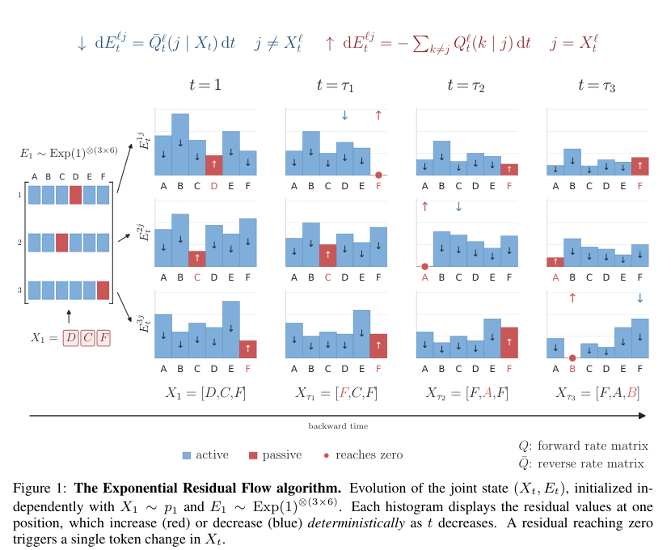

计算机系统中的浪费常常发生在边界上。数据库把本可提前筛掉的数据传给应用，推理引擎把本可连续读取的缓存拆成碎片，图像模型让只负责纹理的表示参与全局通信。解决这些问题，需要先确定哪些信息必须流动，再决定在哪里计算。

另一类边界来自研究结论本身。采样轨迹可以变得确定，却未必立刻更快；两个分布暂时无法区分，也不表示它们已经被证明相同。下面五篇工作分别提供了可检验的机制，也留下了值得辨认的适用范围。

## 1. ProbSPARQL 让查询表达测量的不确定性

**论文**：[ProbSPARQL: Querying Knowledge Graphs with Multi-dimensional, Uncertain Numeric Data](https://arxiv.org/abs/2607.18262v2)。Jingcheng Wu、Ratan Bahadur Thapa、Daniel Hernandez、Hongkuan Zhou、Steffen Staab，来自斯图加特大学、Bosch Corporate Research 与南安普顿大学。本文为 ISWC 2026 In-Use Track 工作，[会议论文集](https://link.springer.com/chapter/10.1007/978-3-032-42029-9_19)于 10 月 23 日上线；预印本 v2 发布于 8 月 7 日。

回收零件能不能重新使用，不能只看测得的长度。传感器噪声、扫描和重建误差会让数值带有不确定性。如果先把分布压成一个平均值，后续查询就无法区分“略低于阈值但很稳定”和“平均达标但波动很大”的部件。

ProbSPARQL 把随机变量作为图中的节点，把概率分布参数编码进带类型的 RDF 字面量。这样，查询仍可沿着零件、测量记录和单位关系找到数据，同时调用分布函数。例如，查询可以要求“某个齿的长度低于 9.8 mm 的概率至少为 0.9”，而不只是筛选平均长度。实现建立在 Apache Jena ARQ 上，并提供 Fuseki 兼容执行层。

这项设计的直接工程价值是把过滤推进引擎。作者将其与先取回全部分布、再由 Python SciPy 过滤的方案比较。在选出 1% 数据时，引擎内过滤快 3.41 倍；选出 30% 时仍快 1.96 倍。这里减少的主要是无用数据的序列化和传输，不能据此宣称概率计算本身没有成本。相对于确定数值查询，分布反序列化和运算仍有开销。

分布连接则回答另一种问题，即两组零件的硬度分布是否足够接近。作者以快速下界、顺序检验和必要时更昂贵的采样组成 Adaptive-Cascade。近阈值的 Hard 工作负载中，它把每个候选对的中位判断时间从 MC-Naive 的 25.68 ms 降到 3.27 ms，但 F1 也由 96.7% 变为 95.9%。这是明确的速度与准确率取舍。

**局限**：真实项目片段为 4,037 条三元组，约 154 万条三元组的规模测试使用生成数据，运行在 M4 Pro、48 GB 内存笔记本上。连接最坏仍需平方数量的候选对；“不能拒绝分布差异较小”也不能替代机械安全或实际装配验证。这项工作扩展的是查询层，不是完整概率本体推理或 OBDA 查询重写。[实现代码](https://github.com/0sidewalkenforcer0/ProbSPARQL)可用于继续检查运算语义。

## 2. FlatCake 从写入时就安排长会话缓存

**论文**：[FlatCake: A Flat KVCache Storage Architecture for LLM Serving](https://arxiv.org/abs/2610.38355v1)。Xin Huang、Teng Ma、Zhuoran Li、Yibo Zhao、Zhaoshi Li、Qianchao Zhu 等，主要单位包括复旦大学、北京大学、MetaX Technology 和中科院计算所，另有独立研究者。2026 年 10 月 28 日 arXiv cs.DC / cs.OS 预印本。

长会话 Agent 反复带着历史工具输出和文件内容请求模型。KV 缓存能避免重算这些上下文，但当会话超过主机内存容量，许多命中必须从 SSD 恢复。此时，“先放内存，淘汰后落盘，再经内存搬回 GPU”的路径可能让内存成为中转瓶颈。

FlatCake 利用两个特点重新组织存储。KV 块生成后不再修改，同一会话的块又经常一起读取，因此它在创建时就将块分配到 DRAM 或 SSD，并按会话、模型层连续摆放。读取 SSD 时，通过 GPUDirect Storage 合并传输，送入有限大小的 GPU 窗口；调度器分开处理 DRAM 已就绪和 SSD 预取中的请求，减少慢请求阻塞快请求。

主实验在 8 张 B200、3 TB 主机内存和 8 盘 NVMe RAID 0 服务器上进行，各系统分配相同的 1 TiB 主机缓存与 4 TiB SSD 预算。在 98,827 个请求、393 个会话的 Claude Code 生产轨迹回放中，负载从 0.1 增至 1 QPS。高负载时，FlatCake 的缓存命中率约为 94%，Mooncake 约为 64%；峰值平均首 token 等待为 7.57 秒，对照为 12.24 秒，总 token 吞吐约增至 1.6 倍。

只比较传统中转与 GDS，可能混淆接口收益与布局收益。因此，论文另在 4 张 A100、Llama-3.1-70B 的上下文扫描中加入 Mooncake-GDS，它保留分层淘汰布局但改为直接读取。FlatCake 相对这个对照的平均首 token 等待最多改善 1.8 倍，说明布局和调度仍有额外作用。

**局限**：轨迹回放的结果依赖会话复用、硬件带宽与存储容量，不能视为任意线上业务都能获得的加速。写入时的分配还依赖可观察的会话范围信号。对实践者更有用的下一步，是测量自身缓存恢复链路，而非直接取消所有分层。[原文 Figure 1 与 Figure 3](https://arxiv.org/pdf/2610.38355v1#page=5)可帮助理解数据路径。

## 3. SpecSlot 区分需要全局协调的结构与局部细节

**论文**：[Read, Allocate, Route: Role-Coupled Tokenization for Pixel-Space Generative Transformers](https://arxiv.org/abs/2610.40647v1)。Jiongfan Yang、Weichen Fan、Haiwen Diao、Zhongang Cai、Ziwei Liu，来自北京大学、南洋理工大学和商汤科技。10 月 29 日 arXiv v1，ICLR 2027 审稿中。[代码](https://github.com/JiongfanYang/SpecSlot)。

更细的图像并不总需要更多全局通信。大体轮廓需要跨位置保持协调，而很多高频纹理只需局部信息。SpecSlot 为每个空间锚点分配多个槽位，用 DCT 系数频段指定各槽位负责的输出。只有最低频槽位参与全局注意力，其余通过局部交互交换信息，再以空间预测头补充修正。

这种分工与简单删除高频信息不同。各频段仍由模型预测，只是承担不同通信角色。最终状态、训练目标和损失仍在像素空间，不是另训一个图像压缩器后在其潜空间生成。

在 ImageNet-512 上，SpecSlot-K4 的 FID 为 9.14，计算匹配对照 JiT-CM 为 11.98，前向 FLOPs 少 3.9%。但更高计算量的 JiT-B/16 为 8.45，质量仍更好。主结果用了五个独立训练种子和 50 步 Heun 采样，各模型分别搜索 CFG。256 分辨率下，SpecSlot 与计算匹配对照的最终 FID 在置信区间内接近，不能将较早收敛扩大成所有设置都显著领先。

文生图也说明指标各有侧重。SpecSlot 的 DPG-Bench 为 62.21，JiT-B/8 为 61.15；GenEval 却为 26.99，低于对照的 29.78。因此，若应用更在乎对象组合正确性，应继续检查分项结果，而不只看一个总分。

**局限**：JiT-CM 是作者构造的前向计算匹配对照，节省比例也主要描述指定 profiler 下的前向 FLOPs。它不自动等于端到端训练、服务延迟或所有分辨率上的同等节省。

## 4. ERF 把离散采样的随机性放到初始化

**论文**：[An ODE-based Sampler for Discrete Diffusion Models](https://arxiv.org/abs/2610.40618v1)。Samson Gourevitch、Yazid Janati、Eric Moulines、Eric P. Xing、Alain Durmus、Giacomo Zanella，机构包括 École polytechnique / CMAP、Institute of Foundation Models、MBZUAI、EPITA / LRE 和 Bocconi University。10 月 29 日 arXiv cs.LG / stat.ML 预印本。

连续扩散可以沿确定的常微分方程轨迹生成样本，但离散 token 只能跳变，不能直接平滑移动。ERF 为每个位置和候选 token 引入连续剩余量，开始时随机初始化，随后完全按规则变化；哪个剩余量先到零，就触发相应 token 切换。作者证明，在理想连续过程下，各时刻的离散状态分布与原扩散一致。

*Gourevitch、Janati 等，Figure 1，[原文第 3 页](https://arxiv.org/pdf/2610.40618v1#page=3)，[CC BY 4.0](https://creativecommons.org/licenses/by/4.0/)，裁剪自原文，保留图注。*

图中柱形表示剩余量，红点表示到零时刻。初始化后不再抽取新的随机数，使同一个初始状态对应稳定轨迹，从而能训练少步学生去逼近多步教师。

直接采样与蒸馏需要分开比较。相同教师检查点、相同网络评估次数下，原始 ERF 的质量大致接近祖先采样。DiffusionGemma 在 140 道 MMLU-Pro、三个配对种子的实验中，祖先采样准确率为 57.4%，ERF 两版本为 56.7% 和 57.1%，置信区间高度重叠，耗时也未更低。

蒸馏结果则更积极。在 TinyGSM 和 OpenWebText 上，学生分别使用 50 与 100 GPU 小时，相同批量和同系列教师；uniform diffusion 的 ERC 在 TinyGSM 的 2、4 次网络评估预算中，准确率约为最强竞争方法的两倍。但 masked diffusion 的收益小得多，大致接近第二强方法。这支持的是某种教师与蒸馏结构的组合，而非所有离散扩散都同幅获益。

**局限**：边缘分布定理不保证有限步离散实现毫无误差。求跳变时刻也有额外开销。论文中 U-NetFlux 在 TinyGSM 的 2.83 倍运行加速，相对的是 ERF Uniform，不是祖先采样；比较分母决定了这条数字能说明什么。

## 5. IDM 用自身特征约束少步生图的统计差异

**论文**：[Intrinsic Distribution Matching](https://arxiv.org/abs/2610.39633v1)。Deyuan Liu、Yansen Han、Kaiwen Zheng、Jun Xie、Jiacheng Liu、Zhenglin Cheng 等，机构包括 Inclusion AI、西湖大学、清华大学、浙江大学、上海创智学院与 MBZUAI。10 月 29 日 arXiv cs.CV / cs.AI 预印本。[代码](https://github.com/inclusionAI/IDM)。

少步生图缺少反复修改细节的机会，长段文字尤其容易出错。IDM 保留完整的分布匹配蒸馏指导，再用生成器的指数移动平均副本提取特征，匹配生成样本和参考样本的均值与各维标准差。移动平均副本把近期参数平滑起来，提供相对稳定的特征空间，因此无需另加一个外部视觉编码器。

均值和标准差并不能决定一个分布的全部形状。论文先从理论分解说明这一点，因此新增特征统计约束只是补充，不能替代原有 DMD 项。这个区别也避免把“匹配简单统计”误解为已经实现完整分布一致。

实验在 Z-Image-Turbo 6B 与 Qwen-Image 20B 上比较全参数和 LoRA 训练。两次网络评估预算下，作者报告中文与英文 LongText-Bench 分数分别为 94.25% 和 90.20%。这些结果适合继续研究海报和密集文字渲染，但并非任意文字提示都能正确生成的概率。

**局限**：训练包含更大规模的文字渲染数据，外部方法沿用各自发表设置，不能把跨论文表格中的差距都归因于新增损失。内部消融更适合判断损失本身的作用。两次网络评估也未涵盖文本编码、图像解码和服务调度等全部成本。

## 阅读时把比较条件放在数字旁边

这五篇工作可以沿三条线继续读。语义系统读者可从 ProbSPARQL 的真实数据片段与生成规模实验入手，分清表达能力和部署规模；推理工程读者可检查 FlatCake 中布局、调度与传输接口的各自贡献；生成模型读者则可比较 SpecSlot 的通信分工、ERF 的轨迹蒸馏和 IDM 的特征统计监督。

共同的研究问题是，省下的究竟是哪项成本，又付出了什么。把对照模型、预算、采样设置与精度代价一并保留，才容易判断论文方法能否迁移到自己的系统。
