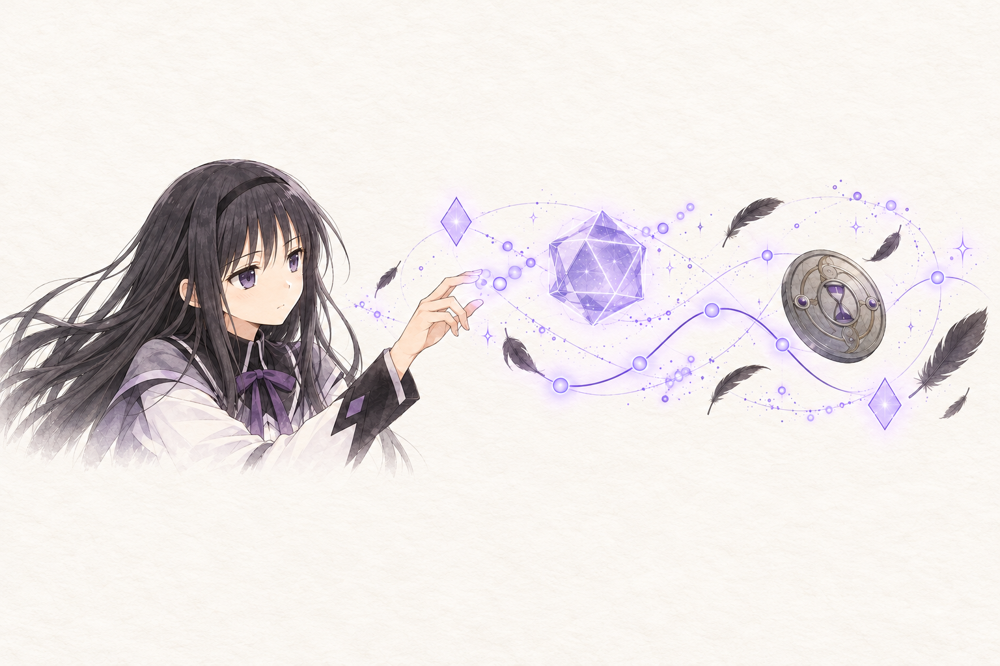

<div class="figure-banner">



</div>

浏览器里的图形与动画，底层只有四种绘制方式：DOM 与 CSS、SVG、Canvas 2D、WebGL 与 WebGPU。各类库都建立在这四种方式之上，区别在于封装的层次和擅长的场景。路线选错的代价往往在项目进行到一半才出现：用 DOM 做上千个粒子会掉帧，为了一个着色器背景引入 three.js 会让包体多出几百 KB。

每种技术都配有一个在页面中实时运行的示例，素材取自《魔法少女小圆》。示例接近可视区域时才加载对应的库，没有滚动到的示例不产生下载。

## 技术路线总览

| 绘制方式 | 擅长的场景 | 代表技术 |
|---|---|---|
| DOM 与 CSS | 界面元素的过渡、布局变化、滚动效果 | CSS 动画、Web Animations API、View Transitions、GSAP、Motion |
| SVG | 矢量图形、图标、描线动画 | anime.js、GSAP |
| Canvas 2D | 数千个简单图形、粒子、自绘图表 | 原生 Canvas 2D、配合 matter.js 绘制物理场景 |
| WebGL | 大量精灵、三维场景、着色器特效 | three.js、Babylon.js、PixiJS、OGL |
| WebGPU | GPU 通用计算与新一代渲染 | 原生 WebGPU、three.js 与 Babylon.js 的 WebGPU 后端 |

选择时先看元素数量和维度。几百个以内、需要文字选择与无障碍访问的界面元素用 DOM 与 SVG；数量到几千用 Canvas 2D；上万个、需要三维或着色器时用 WebGL；需要在 GPU 上做通用计算时用 WebGPU。动画库与绘制方式是两个维度，GSAP 既能驱动 DOM，也能驱动 three.js 对象的属性。

## 浏览器原生能力

下面四个示例都只使用浏览器 API，不引入任何库。

### Canvas 2D

Canvas 2D 是即时模式的绘图接口：每一帧清空或覆盖画布，再把所有图形重新画一遍，浏览器不保留图形对象。Canvas 2D 没有场景树和事件系统，换来的是极低的开销和完全的控制权，适合粒子、自绘图表和小游戏。CPU 逐个提交绘制命令，图形数量到几千个时开始成为瓶颈。

<div class="gfx-demo not-prose" data-gfx="canvas2d"><p class="gfx-hint">两千条流线沿旋转的角度场运动，指针附近形成漩涡</p></div>

每帧先用半透明底色覆盖整张画布，上一帧的线条逐渐变暗，就形成了拖尾：

```js title="canvas-2d.js"
const ctx = canvas.getContext("2d");

function frame(t) {
	ctx.fillStyle = "rgba(20, 12, 32, 0.08)";
	ctx.fillRect(0, 0, canvas.width, canvas.height);
	for (const p of particles) {
		const angle = Math.sin(p.x * 0.006 + t * 0.0003) + Math.cos(p.y * 0.007);
		ctx.beginPath();
		ctx.moveTo(p.x, p.y);
		p.x += Math.cos(angle);
		p.y += Math.sin(angle);
		ctx.lineTo(p.x, p.y);
		ctx.stroke();
	}
	requestAnimationFrame(frame);
}
requestAnimationFrame(frame);
```

### Web Animations API

`element.animate(keyframes, options)` 与 CSS 动画共用同一套动画引擎，`transform` 与 `opacity` 的动画在合成线程运行，主线程繁忙时也不卡顿。`element.animate()` 返回一个 `Animation` 对象，可以随时暂停、倒放、调整速度，`finished` 属性是一个 Promise，便于串联后续逻辑。CSS 动画只能靠切换类名控制，Web Animations API 补上了脚本控制的能力。

<div class="gfx-demo not-prose" data-gfx="waapi"><p class="gfx-hint">焰的魔法阵用菱形代替圆形，右上角可以暂停、倒放、加速</p></div>

```js title="waapi.js"
const spin = ring.animate(
	[{ rotate: "0deg" }, { rotate: "360deg" }],
	{ duration: 24000, iterations: Infinity },
);

// 十二颗菱形共用一组关键帧，用 delay 错开
diamonds.forEach((d, i) =>
	d.animate([{ opacity: 0.35 }, { opacity: 1 }, { opacity: 0.35 }], {
		duration: 2400,
		delay: i * 200,
		iterations: Infinity,
	}),
);

spin.playbackRate = -1; // 倒放
spin.pause();
```

### CSS 滚动驱动动画

`animation-timeline` 把动画进度绑定到滚动位置：`scroll()` 跟随滚动容器的滚动进度，`view()` 跟随元素穿过可视区域的进度。整个效果由 CSS 描述，不需要监听滚动事件，也不占用主线程。Chromium 内核浏览器与 Safari 26 起支持，不支持的浏览器上动画不生效，内容照常显示。

下面这个示例没有任何脚本。在框内滚动，焰的几条时间线依次滑入，顶部的进度条随滚动伸长：

<div class="gfx-demo gfx-scroll not-prose">
<div class="gfx-scroll-track">
<div class="gfx-scroll-progress"></div>
<div class="gfx-scroll-card"><div><strong>第一条时间线</strong><span>转学生焰在魔女的结界里被小圆救下，小圆在与 Walpurgisnacht 的战斗中牺牲，焰许下重来的愿望。</span></div></div>
<div class="gfx-scroll-card"><div><strong>第二条时间线</strong><span>焰成为魔法少女，用自制炸弹与小圆、麻美并肩作战，小圆最终魔女化。</span></div></div>
<div class="gfx-scroll-card"><div><strong>第三条时间线</strong><span>焰说出丘比的真相却无人相信，与小圆一同战斗到最后，两人的灵魂宝石都已浑浊。</span></div></div>
<div class="gfx-scroll-card"><div><strong>第四条时间线起</strong><span>焰摘下眼镜、解开麻花辫，不再依靠任何人，独自一次次回到一个月前。</span></div></div>
<div class="gfx-scroll-card"><div><strong>圆环之理</strong><span>小圆许愿在所有魔女诞生之前将其消灭，成为跨越时空的概念。</span></div></div>
<div class="gfx-scroll-card"><div><strong>叛逆的物语</strong><span>焰将小圆的一部分从圆环之理中分离出来，灵魂宝石化为黑暗宝珠，自己成为恶魔。</span></div></div>
</div>
<p class="gfx-hint">在框内滚动，没有使用脚本</p>
</div>

```css title="scroll-driven.css"
.track {
	overflow-y: auto;
	scroll-timeline: --loop block; /* 给滚动容器的进度命名 */
}
.progress {
	animation: grow linear both;
	animation-timeline: --loop;
}
.card {
	animation: pass linear both;
	animation-timeline: view(block); /* 卡片穿过可视区域的进度 */
}
```

### View Transitions

`document.startViewTransition(update)` 在执行 `update` 前后各拍一张快照，再由浏览器生成两者之间的过渡。设置了相同 `view-transition-name` 的元素会被配对，从旧位置平滑移动到新位置。开发者只负责修改 DOM，不需要计算元素的起止位置。同一文档内的过渡在 Chrome 111、Safari 18、Firefox 144 起支持，Chromium 与 Safari 还支持跨页面的过渡。

<div class="gfx-demo not-prose" data-gfx="view-transition"><p class="gfx-hint">单击角色卡放大，右上角可以打乱顺序</p></div>

```js title="view-transition.js"
cards.forEach((card, i) => (card.style.viewTransitionName = `card-${i}`));

grid.addEventListener("click", (e) => {
	const card = e.target.closest(".card");
	document.startViewTransition(() => {
		card.classList.toggle("is-big");
		grid.prepend(card);
	});
});
```

## 三维渲染

WebGL 是目前普及程度最高的 GPU 绘制接口，直接使用时要自己管理缓冲区、着色器程序和绘制状态，画一个带光照的立方体就需要上百行代码。三维库在 WebGL 之上提供场景树、相机、材质、光照、模型加载器和后期处理。

### three.js

three.js 是使用最广泛的网页 3D 库，提供场景树、基于物理的材质、glTF 模型加载、后期处理，`examples/jsm` 里还有轨道控制器、环境贴图、线条等大量扩展。资料和示例最多，遇到问题基本都能找到先例。本站首页的灵魂宝石就是一个 three.js 场景。

框架封装方面，React 项目可以用 React Three Fiber 与配套的 drei 组件库，Svelte 项目可以用 Threlte，两者都用组件描述场景。

<div class="gfx-demo not-prose" data-gfx="three"><p class="gfx-hint">拖动旋转焰的盾，单击让沙漏里的沙子停住</p></div>

焰的盾本身就是一个沙漏，挡住沙子的流动就能停止时间。示例里的盾面贴着盾的线稿作为发光纹样，最小的场景搭建如下：

```js title="three.js"
import * as THREE from "three";
import { OrbitControls } from "three/addons/controls/OrbitControls.js";

const renderer = new THREE.WebGLRenderer({ antialias: true });
const scene = new THREE.Scene();
const camera = new THREE.PerspectiveCamera(35, width / height, 0.1, 50);
camera.position.z = 6;
const controls = new OrbitControls(camera, renderer.domElement);

const face = new THREE.MeshStandardMaterial({
	emissive: 0xb48cff,
	emissiveMap: new THREE.TextureLoader().load("/images/fx/shield.webp"),
});
const shield = new THREE.Mesh(new THREE.CylinderGeometry(1.6, 1.6, 0.16, 128), face);
shield.rotation.x = Math.PI / 2;
scene.add(shield, new THREE.HemisphereLight(0xffffff, 0x222222, 1));

renderer.setAnimationLoop(() => {
	controls.update();
	renderer.render(scene, camera);
});
```

### OGL

OGL 只封装 WebGL 的常用部分：着色器程序、几何体、纹理、渲染目标和一个简单的场景树。API 与 three.js 相近，体积小一个数量级以上。全屏着色器背景、图片扭曲、液体效果这类主要靠着色器完成的效果，用 OGL 比引入完整的三维库合适。

<div class="gfx-demo not-prose" data-gfx="ogl"><p class="gfx-hint">Homulilly 结界里的彼岸花，整幅画面由一个片元着色器计算，花心跟随指针</p></div>

彼岸花的花瓣来自极坐标下的余弦函数，角度随半径和时间偏移，花瓣就会向外翻卷：

```glsl title="spider-lily.frag"
float r = length(p);
float a = atan(p.y, p.x);
float curl = a + 0.55 * sin(r * 5.5 - uTime * 1.1);
float petal = pow(abs(cos(curl * 3.0)), 6.0);      // 六片花瓣
float body = petal * smoothstep(0.85, 0.12, r);     // 越靠外越淡
col = mix(col, vec3(0.95, 0.15, 0.3), body);
```

```js title="ogl.js"
import { Renderer, Program, Mesh, Triangle } from "ogl";

const renderer = new Renderer({ dpr: 2 });
const gl = renderer.gl;
const program = new Program(gl, { vertex, fragment, uniforms: { uTime: { value: 0 } } });
const mesh = new Mesh(gl, { geometry: new Triangle(gl), program });

requestAnimationFrame(function frame(t) {
	program.uniforms.uTime.value = t / 1000;
	renderer.render({ scene: mesh });
	requestAnimationFrame(frame);
});
```

### WebGPU

WebGPU 是 WebGL 的后继标准，设计上接近 Vulkan、Metal 与 Direct3D 12。它显式管理管线和资源，绘制开销更低，最大的变化是提供了计算着色器：粒子模拟、物理、图像处理、机器学习推理都可以在 GPU 上并行完成，数据不必在 CPU 与 GPU 之间往返。Chrome 与 Edge 113、Safari 26、Firefox 141（Windows）起支持。three.js 的 `WebGPURenderer` 与 Babylon.js 都已提供 WebGPU 后端。出于安全考虑，WebGPU 只在 HTTPS 或 localhost 页面中可用，不满足条件时示例会改用 Canvas 2D 在 CPU 上计算同样的粒子，数量减少到四千个。

<div class="gfx-demo not-prose" data-gfx="webgpu"><p class="gfx-hint">四万个粒子由计算着色器更新：粉色为小圆，紫色为焰；按住指针产生引力</p></div>

每个粒子由一个计算着色器线程更新，四万个粒子在一次 `dispatchWorkgroups` 中完成：

```wgsl title="particles.wgsl"
@group(0) @binding(1) var<storage, read_write> particles: array<vec4f>;

@compute @workgroup_size(64)
fn main(@builtin(global_invocation_id) id: vec3u) {
	let p = particles[id.x];
	var pos = p.xy;
	var vel = p.zw;
	let dir = normalize(pos);
	let ring = select(0.66, 0.42, id.x % 2u == 1u);   // 小圆在外圈，焰在内圈
	var force = -dir * (length(pos) - ring) * 14.0;   // 回到各自的环上
	force += vec2f(-dir.y, dir.x) * select(0.55, -0.75, id.x % 2u == 1u);  // 反向绕行
	vel = (vel + force * params.dt) * 0.985;
	particles[id.x] = vec4f(pos + vel * params.dt, vel);
}
```

### 其他三维方案

| 名称 | 定位 | 适合 |
|---|---|---|
| Babylon.js | 完整的游戏引擎，自带物理、粒子、GUI、调试面板与 WebGPU 后端 | 游戏、复杂的交互场景 |
| PlayCanvas | 引擎加在线可视化编辑器，支持多人协作搭建场景 | 产品展示、需要编辑器的团队 |
| React Three Fiber | three.js 的 React 封装，配套 drei 组件库 | React 项目 |
| Threlte | three.js 的 Svelte 封装 | Svelte 项目 |
| `<model-viewer>` | 展示 glTF 模型的 Web Component，内置旋转、缩放与 AR | 只需要展示现成的模型 |
| Spline | 在线 3D 设计工具，导出运行时后嵌入网页 | 不写代码完成 3D 主视觉 |
| A-Frame | 用 HTML 标签描述 3D 与 VR 场景 | VR、快速原型 |

模型通常在 Blender 中制作，导出为 glTF 后用 `gltf-transform` 压缩网格与纹理，上述所有 3D 库都能直接加载。

## 二维渲染

### PixiJS

PixiJS 是基于 WebGL 的 2D 渲染器，v8 起也支持 WebGPU。它自动把共用纹理的精灵合并成一次绘制调用，提供滤镜、遮罩、文本和粒子容器。Canvas 2D 在几千个图形时开始掉帧，同样的场景用 PixiJS 可以流畅绘制数万个精灵，适合 2D 游戏、大量元素的交互特效和数据可视化。

<div class="gfx-demo not-prose" data-gfx="pixi"><p class="gfx-hint">恶魔焰身边盘旋的七百个精灵，指针划过会吹散它们，单击放出一圈羽毛</p></div>

```js title="pixi.js"
import { Application, Assets, Sprite } from "pixi.js";

const app = new Application();
await app.init({ resizeTo: container, backgroundAlpha: 0 });
container.append(app.canvas);

const texture = await Assets.load("/images/fx/feather-0.webp");
for (let i = 0; i < 700; i++) {
	const feather = new Sprite(texture);
	feather.anchor.set(0.5);
	feather.tint = 0xd9c8ff;
	app.stage.addChild(feather);
}
app.ticker.add(({ deltaTime }) => {
	// 更新每个精灵的位置与旋转
});
```

### matter.js

matter.js 是二维刚体物理引擎，负责碰撞检测、摩擦、弹性、约束与关节，不负责绘制。示例用 matter.js 计算道具的运动，再用 Canvas 2D 把每个刚体画成对应的图片。三维物理可以用 Rapier（Rust 编译为 WebAssembly，性能较好）或 cannon-es。

<div class="gfx-demo not-prose" data-gfx="matter"><p class="gfx-hint">焰与小圆的布偶、灵魂宝石、悲叹之种，拖动可以抓起甩出，单击空白处掉落新道具</p></div>

```js title="matter.js"
import Matter from "matter-js";
const { Engine, Bodies, Composite, Mouse, MouseConstraint } = Matter;

const engine = Engine.create();
const floor = Bodies.rectangle(width / 2, height + 30, width, 60, { isStatic: true });
const plush = Bodies.circle(200, -80, 46, { restitution: 0.35 });
Composite.add(engine.world, [floor, plush]);
Composite.add(engine.world, MouseConstraint.create(engine, { mouse: Mouse.create(canvas) }));

requestAnimationFrame(function frame() {
	Engine.update(engine, 1000 / 60);
	drawImageAt(plush.position, plush.angle); // 绘制交给 Canvas 2D
	requestAnimationFrame(frame);
});
```

### 其他二维方案

| 名称 | 定位 |
|---|---|
| p5.js | 创意编程框架，写生成艺术与教学示例很顺手 |
| Paper.js、Two.js | 矢量图形的绘制与动画，带路径运算 |
| Konva、Fabric.js | 可交互的画布，内置拖拽、缩放、选择，适合做图形编辑器 |
| tsParticles | 配置式的粒子背景，不写代码即可使用 |
| Phaser | 2D 游戏框架，包含场景管理、物理、音频与输入 |

## 动画库

原生 API 足以完成单个动画。多段动画需要编排先后与联动、需要随滚动或手势驱动时，动画库能省去大量计算与状态管理的代码。

### GSAP

GSAP 的核心是时间线：多段动画按时间点排列，整条时间线可以整体播放、倒放、跳转、调整速度。周边插件覆盖滚动联动（ScrollTrigger）、文字拆分（SplitText）、SVG 变形（MorphSVG）、拖拽惯性等场景。GSAP 在 2024 年被 Webflow 收购，2025 年起包括全部插件在内免费使用。GSAP 能驱动任意对象的数值属性，同一条时间线里可以同时控制 DOM 元素和 three.js 对象。

<div class="gfx-demo not-prose" data-gfx="gsap"><p class="gfx-hint">一条时间线编排的时间停止，右上角可以重播、倒放、慢放</p></div>

按设定，焰发动时间停止时，与她有身体接触的人不受影响。示例里小圆跑来牵住焰的手，表盘骤停后，除两人以外的画面变灰：

```js title="gsap.js"
import { gsap } from "gsap";
import { SplitText } from "gsap/SplitText";
gsap.registerPlugin(SplitText);

const chars = SplitText.create(title, { type: "chars" }).chars;
const tl = gsap.timeline({ defaults: { ease: "power3.out" } });

tl.from(homura, { xPercent: -160, opacity: 0, duration: 0.8 })
	.from(madoka, { xPercent: 220, opacity: 0, duration: 0.9 }, "-=0.3")
	.to(dial, { rotation: 720, duration: 1.2, ease: "power4.out" }, "stop")
	.to(featherFall, { timeScale: 0, duration: 0.6 }, "stop+=0.4")   // 羽毛定格
	.to(background, { filter: "grayscale(1)", duration: 0.8 }, "stop+=0.5")
	.from(chars, { y: -60, opacity: 0, stagger: 0.12, ease: "bounce.out" }, "stop+=0.7");

tl.reverse(); // 整条时间线倒放
```

### Motion

Motion 前身是 React 生态的 Framer Motion，现在提供与框架无关的版本。它基于 Web Animations API，主打弹簧物理和手势：每次调用 `animate()` 都会从当前的位置和速度开始过渡，跟手的交互不会出现跳变。`hover()`、`press()`、`inView()` 等手势函数处理了指针类型与触摸设备的差异。

<div class="gfx-demo not-prose" data-gfx="motion"><p class="gfx-hint">小圆跟着指针跑，焰追在后面；单击时小圆会跳一下，指针靠近丘比时它会站起来</p></div>

```js title="motion.js"
import { animate, hover, spring } from "motion";

stage.addEventListener("pointermove", ({ offsetX: x, offsetY: y }) => {
	animate(madoka, { x, y }, { type: spring, stiffness: 260, damping: 18 });
	// 更软的弹簧加延迟，焰总是慢半拍
	animate(homura, { x: x - 70, y }, { type: spring, stiffness: 70, damping: 12, delay: 0.12 });
});

hover(kyubey, () => {
	animate(kyubey, { y: -18 });
	return () => animate(kyubey, { y: 0 });
});
```

### anime.js

anime.js 在 v4 中重写为模块化结构，按需引入动画、时间线、交错、SVG 描线与变形、拖拽、文字拆分等功能。`stagger()` 支持按二维网格计算延迟，从任意一格向外扩散的波纹只需要一个参数。

<div class="gfx-demo not-prose" data-gfx="anime"><p class="gfx-hint">左侧逐笔描出焰的徽记；右侧的菱形取自焰长袜上的纹样，单击任一格，波纹从该格扩散</p></div>

```js title="anime.js"
import { animate, stagger, svg } from "animejs";

animate(svg.createDrawable(".emblem path"), {
	draw: ["0 0", "0 1", "1 1"],   // 从无到描满，再从起点擦除
	delay: stagger(260),
	loop: true,
});

grid.addEventListener("click", (e) => {
	animate(cells, {
		scale: [1, 1.6, 1],
		fill: ["#8b5cf6", "#f472b6", "#5b21b6"],
		delay: stagger(55, { grid: [12, 7], from: Number(e.target.dataset.index) }),
	});
});
```

### 设计工具导出的动画

| 名称 | 工作方式 | 适合 |
|---|---|---|
| Lottie | 在 After Effects 中制作，导出为 JSON，由 lottie-web 或 dotLottie 播放 | 设计师主导的图标与插画动画 |
| Rive | 在 Rive 编辑器中制作，动画带状态机，运行时根据输入切换状态 | 按钮、角色等需要随交互变化的动画 |
| Theatre.js | 在页面上打开可视化时间线编辑器，给 three.js 对象和 DOM 打关键帧 | 需要反复调整节奏的演示动画 |
| Spline | 在线 3D 编辑器内设置交互与动画，导出后嵌入 | 3D 主视觉 |

这一类方案的共同点是动画在可视化工具里制作，代码只负责加载和触发。

## 选型参考

| 场景 | 推荐 |
|---|---|
| 页面元素的进出场、悬停、布局切换 | CSS 过渡、Web Animations API、View Transitions |
| 滚动联动 | CSS 滚动驱动动画，编排复杂时用 GSAP ScrollTrigger |
| 多段动画编排 | GSAP 时间线 |
| 跟手、带弹性的交互 | Motion |
| SVG 描线、网格波纹 | anime.js |
| 粒子与大量精灵 | 几千个以内用 Canvas 2D，更多用 PixiJS |
| 全屏着色器背景 | OGL |
| 三维模型与场景 | three.js，需要完整引擎功能时用 Babylon.js |
| 物理效果 | matter.js（二维）、Rapier（三维） |
| GPU 通用计算 | WebGPU |
| 设计师交付的动画 | Lottie、Rive |

## 本站的用法

本站的主题特效混合使用了上面几种方式：

| 效果 | 实现 |
|---|---|
| 首页的灵魂宝石 | three.js 场景，宝石本体是贴在面片上的插画，核心叠加着色器流光 |
| 背景的黑羽与星屑 | Canvas 2D |
| 背景的焰之盾、指针与齿轮 | 单色线稿作为 CSS 遮罩，CSS 动画旋转，指针每秒由脚本设置 `transform` |
| 时间停止 | CSS `clip-path` 过渡与 `backdrop-filter` 灰阶 |
| 本文的示例 | 每个示例打包成独立的 chunk，接近可视区域时才动态加载 |

文中的角色与道具素材由图像生成模型绘制。
